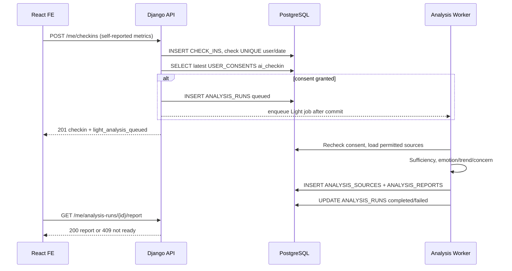
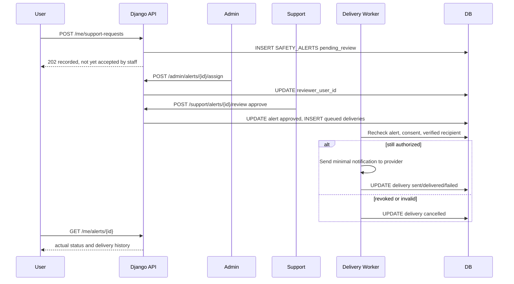

# MINDCARE — API Design Document (ERD 14 bảng)

> **Phiên bản:** `2.0 – 27/10/2026`  |  **Trạng thái:** Đề xuất thiết kế để lập trình đồ án, **chưa phải API đã triển khai**  |  **Base path:** `/api/v1`

> **Nguồn làm căn cứ:** File yêu cầu hệ thống `MindCare_YeuCauTinhNang_va_YeuCauHeThong.xlsx` (112 mã SR), ERD 14 bảng đã chốt trong cuộc trao đổi, và bố cục chi tiết tham khảo từ `API_Docs(1).md`. Tài liệu này không giả định các bảng đã bị loại khỏi ERD vẫn tồn tại. Các giới hạn được đánh dấu rõ ở mục 2 và bảng truy vết cuối tài liệu.

## 1. Mục tiêu, phạm vi và nguyên tắc thiết kế

Ứng dụng MINDCARE hỗ trợ người trẻ theo dõi các chỉ số tự báo cáo (stress, tâm trạng, lo âu, năng lượng, giấc ngủ), viết nhật ký, trò chuyện với chatbot có ngữ cảnh, xem phân tích AI và có cơ chế ghi nhận/duyệt/gửi thông báo hỗ trợ tối thiểu.

**Không phải hệ thống chẩn đoán, dự đoán tự hại đã được kiểm định lâm sàng hoặc dịch vụ phản ứng khẩn cấp 24/7.** Các ví dụ, điểm số và ngưỡng trong tài liệu chỉ là đề xuất kỹ thuật cần kiểm thử. Khi thiếu dữ liệu, API trả trạng thái giới hạn thay vì suy diễn. Với tín hiệu khẩn cấp, chatbot cung cấp hướng dẫn tiếp cận hỗ trợ phù hợp ngay, không chờ hoàn tất worker.

- **Số bảng nghiệp vụ:** `14`; **số HTTP API được đặc tả chi tiết:** `67`; **số worker/luồng nội bộ:** `16`; **số yêu cầu hệ thống đối chiếu:** `112`.
- Các API được chọn theo **nghiệp vụ cần giao tiếp FE ↔ BE**, không tách một endpoint cho mỗi bước AI. Emotion model, context builder, sufficiency checker, RAG và safety worker chạy nội bộ.
- Các chức năng chia sẻ dữ liệu bất kỳ, support case và audit trail bền vững **chưa triển khai đầy đủ** trên đúng 14 bảng. Không tạo API giả vờ có các bảng đó.
- Quy tắc ghi/đọc DB minh họa dưới dạng `C=Create, R=Read, U=Update, D=Delete`. Tên bảng viết hoa đúng theo ERD.

## 2. Actor, quyền hạn và những giới hạn của 14 bảng

| Actor | Lưu trên `USERS.role` | Được phép | Không mặc định được phép |
|---|---|---|---|
| **Public** | Chưa đăng nhập | Register, login, password reset, xác minh contact bằng signed token | Đọc check-in, journal, chat, phân tích |
| **User** | `user` | CRUD dữ liệu của chính mình; gọi chatbot, AI analysis; quản lý consent/contact/alerts | Đọc dữ liệu người dùng khác |
| **Support** | `support` | Review alert **được gán qua** `SAFETY_ALERTS.reviewer_user_id` | Đọc toàn bộ journal/chat/report hoặc tất cả alerts |
| **Admin** | `admin` | Trạng thái/role tài khoản; gán reviewer; xem job metadata; trạng thái RAG index | Đọc nội dung nhạy cảm không có mục đích và quyền rõ |

**Phạm vi không có bảng lưu riêng:**

1. `USER_CONSENTS` là lịch sử đồng ý/rút lại theo `scope`, **không phải** hệ thống `ACCESS_GRANTS` cho phép cấp quyền đọc bất kỳ dữ liệu nào. Đồ án chỉ hỗ trợ phạm vi chia sẻ cảnh báo tối thiểu theo contact.
2. Không có bảng sessions/token blacklist. JWT stateless thời hạn ngắn; `/auth/logout` chỉ xóa token phía client, không thu hồi ngay server-side. Nếu cần revoke theo thiết bị cần thêm persistent session store.
3. Không có `SUPPORT_CASES`, `CASE_NOTES`, `ALERT_POLICIES`, `AUDIT_LOGS`, `KNOWLEDGE_DOCUMENTS`, `KNOWLEDGE_CHUNKS`, `EXTRACTED_FACTS`, `AI_MODELS` hoặc `DATA_RIGHTS_REQUESTS`. Không đề xuất CRUD DB vào các bảng này.
4. Tài liệu RAG và embedding index lưu bằng **file/repository/object storage có version**, được review qua quy trình quản trị độc lập; chỉ metadata citations được lưu ở `CHAT_MESSAGES.metadata`.
5. Không có grant chia sẻ báo cáo có thể thu hồi cho người ngoài. API report preview chỉ dành cho chủ tài khoản; chia sẻ chính thức có thời hạn là backlog cần thêm schema.
6. Khi dùng PostgreSQL, `json` trong ERD có thể chọn `jsonb`. Các trường `JOURNAL_ENTRIES.content`, `CHAT_MESSAGES.content`, `SAFETY_PLANS.personal_notes` là `text` nhưng nên lưu **ciphertext encoded** bằng application-layer encryption; response chỉ giải mã sau authorization.

## 3. Quy ước API và dữ liệu

### 3.1. URL, header, kiểu dữ liệu

```http
GET /api/v1/me/checkins?from=2026-10-01&to=2026-10-27 HTTP/1.1
Authorization: Bearer <access_jwt>
Accept: application/json
X-Request-Id: <uuid>
```

- Trừ register/login/password reset/contact invitation, các API đều yêu cầu access JWT hợp lệ. JWT được xác minh chữ ký, TTL, sau đó backend kiểm tra lại `USERS.role`, `USERS.status=active` tại DB mỗi request.
- UUID là chuỗi chuẩn (RFC 4122). Ngày dạng `YYYY-MM-DD`. Datetime dùng ISO 8601 UTC (`Z`), client hiển thị theo `USERS.timezone` hợp lệ IANA.
- Field JSON và query dùng `snake_case`, ví dụ `analysis_type`, `period_start`, `stress_level`. Path luôn dùng `{uuid}` tương ứng với PK của bảng.
- API danh sách có `page >= 1`, `1 <= limit <= 100`, mặc định giới hạn theo endpoint. Sort, filter phải có allowlist; không ghép thẳng query vào SQL.
- Không tin `user_id`, `role`, `reviewer_user_id`, `status` do User tự truyền cho thao tác self-service. Owner luôn được xác định từ JWT và kiểm tra trong SQL WHERE.
- Không lưu plaintext password/token trong DB hoặc log. Hash password theo cơ chế Django; mã hóa nội dung nhạy cảm với key management tách khỏi DB. `Cache-Control: no-store` cho tài nguyên nhạy cảm.
- **Thang đo đề xuất, cần chốt trước code:** `stress_level`, `mood_level`, `anxiety_level`, `energy_level` integer `0..10` (nullable); `sleep_hours` float `0..24` (nullable). `NULL` nghĩa là thiếu dữ liệu, **không phải 0**.
- `ANALYSIS_RUNS.period_start` inclusive, `period_end` exclusive; ngày check-in so theo local date. Dữ liệu 7 ngày là 7 ngày lịch, không phải 7 bản ghi cuối cùng.
- Không ghi full prompt/PII vào `CHAT_MESSAGES.metadata`, log request hoặc tracing. Mọi cấu trúc metadata đều có whitelist và giới hạn dung lượng.

### 3.2. Response thống nhất

Thành công `200/201/202` bọc envelope:

```json
{
  "data": {
    "id": "11111111-1111-4111-8111-111111111111",
    "status": "queued"
  },
  "meta": {
    "request_id": "<uuid>"
  }
}
```

`204 No Content`: body rỗng (không bọc JSON). API xuất file `GET /me/data-export` trả file JSON trực tiếp và Content-Disposition attachment, không bọc `data`.

Response lỗi:

```json
{
  "error": {
    "code": "CONSENT_REQUIRED",
    "message": "Cần cấp quyền dùng dữ liệu cho mục đích này.",
    "details": [
      {
        "field": "scope",
        "reason": "ai_journal is not granted"
      }
    ]
  },
  "meta": {
    "request_id": "<uuid>"
  }
}
```

| HTTP | Code điển hình | Ý nghĩa / hành vi |
|---|---|---|
| `200` | `OK` | Đọc hoặc cập nhật thành công |
| `201` | `CREATED` | Tạo mới và commit DB |
| `202` | `ACCEPTED` | Đã enqueue/ghi yêu cầu, **chưa** hoàn tất xử lý bất đồng bộ |
| `204` | `NO_CONTENT` | Hoàn thành, body rỗng |
| `400` | `INVALID_REQUEST` | Sai nghiệp vụ hoặc trạng thái chuyển không hợp lệ |
| `401` | `UNAUTHENTICATED` | Thiếu token/sai token; riêng login là INVALID_CREDENTIALS |
| `403` | `FORBIDDEN / CONSENT_REQUIRED` | Thiếu quyền hoặc chưa có consent |
| `404` | `NOT_FOUND` | Không có tài nguyên hoặc không thuộc chủ để tránh enumerate |
| `409` | `CONFLICT / RESULT_NOT_READY` | Xung đột trạng thái hoặc đang chờ phân tích |
| `422` | `VALIDATION_ERROR` | Field, thang đo, UUID, filter sai |
| `429` | `RATE_LIMITED` | Vượt giới hạn auth/chat/model |
| `500` | `INTERNAL_ERROR` | Lỗi máy chủ; không trả traceback nhạy cảm |
| `503` | `DEPENDENCY_UNAVAILABLE` | Model, email, queue hoặc external provider không sẵn sàng |

### 3.3. State machine

| Đối tượng | Trạng thái/hành vi hợp lệ |
|---|---|
| `ANALYSIS_RUNS.status` | `queued -> running -> completed \| failed`; khi dữ liệu nguồn đổi hoặc consent bị rút: `completed -> outdated` (báo cáo cũ không còn là current). |
| `SAFETY_ALERTS.status` | `pending_review -> approved \| rejected \| cancelled`; các delivery được quản lý riêng; sau xử lý có thể `resolved` theo chính sách. |
| `ALERT_DELIVERIES.delivery_status` | `queued -> sent \| delivered \| failed \| cancelled`; `sent` không có nghĩa người nhận đã đọc. |
| `TRUSTED_CONTACTS.verification_status` | `pending -> verified \| declined`; đổi địa chỉ đặt lại `pending`; xóa liên hệ hủy khả năng gửi mới. |
| `USER_CONSENTS.action` | `grant \| revoke`, mỗi sự kiện append-only; quyền hiện tại = quyết định mới nhất hợp lệ (có xét hết hạn, scope và đối tượng liên quan). |
| `CHAT_SESSIONS.state_json` | Cờ `followup_enabled`, bộ đếm ngắn hạn và phiên bản pipeline; không lưu state khẩn cấp hay permission thay cho DB. |

### 3.4. Idempotency, lỗi và tác vụ bất đồng bộ

- Các API POST có tác động lặp (check-in, chat, analysis, support request, alert review) nên hỗ trợ header `Idempotency-Key` nếu có hạ tầng lock/cache, hoặc khóa nghiệp vụ rõ (`user_id+checkin_date`, `client_message_id`, `source_digest`). Nếu chưa có persistent idempotency store thì không tuyên bố bảo đảm exactly-once khi nhiều worker chạy đồng thời.
- Sửa/xóa nguồn cần tìm các `ANALYSIS_SOURCES` phụ thuộc, đánh dấu run `outdated` rồi mới tính lại khi consent còn hiệu lực.
- 202 nghĩa là chấp nhận queue; client dùng `GET /me/analysis-runs/{id}` hoặc `GET /me/alerts/{id}` để theo dõi. Không mô tả “đã gửi” khi mới queued.
- Model/provider lỗi phải trả fallback đúng ngữ cảnh, không thay thế bằng kết luận tự tạo. Safety layer không được phụ thuộc một LLM duy nhất.

## 4. Mapping 14 bảng DB

| Bảng | Vai trò | Trường cốt lõi trong ERD |
|---|---|---|
| `USERS` | Tài khoản, vai trò và giờ nhắc | `id, display_name, email, password_hash, role, status, timezone` |
| `USER_CONSENTS` | Lịch sử đồng ý/rút lại theo mục đích | `id, user_id, scope, action, policy_version, recorded_at, expires_at` |
| `CHECK_INS` | Chỉ số do user tự báo cáo | `id, user_id, checkin_date, stress_level, mood_level, anxiety_level, energy_level` |
| `JOURNAL_ENTRIES` | Nhật ký tự do của chủ user | `id, user_id, content, experienced_at, created_at, updated_at` |
| `CHAT_SESSIONS` | Phiên và trạng thái ngắn hạn chatbot | `id, user_id, title, summary, state_json, created_at, updated_at` |
| `CHAT_MESSAGES` | Tin nhắn và metadata điều phối/RAG/feedback | `id, session_id, reply_to_message_id, role, message_type, content, metadata` |
| `ANALYSIS_RUNS` | Một lượt AI Analysis, trạng thái, provenance và chất lượng | `id, user_id, analysis_type, trigger_source, status, period_start, period_end` |
| `ANALYSIS_REPORTS` | Kết quả AI gộp JSON (mỗi run tối đa 1) | `id, analysis_run_id, emotion_summary, trend_metrics, concern_level, summary, contributing_factors` |
| `ANALYSIS_SOURCES` | Tham chiếu nguồn đầu vào analysis | `id, analysis_run_id, check_in_id, journal_id, chat_message_id` |
| `SAFETY_ALERTS` | Tín hiệu/yêu cầu hỗ trợ và review decision | `id, user_id, analysis_run_id, trigger_message_id, reviewer_user_id, trigger_type, severity` |
| `ALERT_DELIVERIES` | Theo dõi gửi cảnh báo theo người nhận | `id, alert_id, trusted_contact_id, recipient_user_id, channel, delivery_status, sent_at` |
| `TRUSTED_CONTACTS` | Liên hệ tin cậy có trạng thái xác minh | `id, user_id, display_name, relationship, contact_type, contact_value_encrypted, verification_status` |
| `SAFETY_PLANS` | Kế hoạch tự hỗ trợ tùy chọn (1/user) | `id, user_id, coping_steps, personal_notes, enabled, updated_at` |
| `NOTIFICATIONS` | Thông báo trong ứng dụng | `id, user_id, safety_alert_id, notification_type, title, safe_message, is_read` |

**Ràng buộc migration cần có (không phải tạo thêm bảng):**

- `UNIQUE(LOWER(USERS.email))` hoặc normalize lowercase trong app + unique index; mật khẩu một nguồn hash, không lưu raw password.
- `UNIQUE(CHECK_INS.user_id, CHECK_INS.checkin_date)`; CHECK score `0..10` hoặc NULL; `sleep_hours BETWEEN 0 AND 24` hoặc NULL.
- `UNIQUE(ANALYSIS_REPORTS.analysis_run_id)`; `UNIQUE(SAFETY_PLANS.user_id)`; `ANALYSIS_SOURCES` CHECK đúng một trong `check_in_id`, `journal_id`, `chat_message_id` khác NULL.
- FK `SAFETY_ALERTS.trigger_message_id`, `SAFETY_ALERTS.analysis_run_id`, `ALERT_DELIVERIES.trusted_contact_id`, `NOTIFICATIONS.safety_alert_id`, `CHAT_MESSAGES.reply_to_message_id` nên cho `NULL` và xem xét `ON DELETE SET NULL` để xóa nguồn không xóa dấu vết tối thiểu ngoài ý muốn.
- `SAFETY_ALERTS.reviewer_user_id` FK vào USERS, support reviewer phải active + role=support. `ALERT_DELIVERIES` bắt buộc có đúng một recipient (`trusted_contact_id` XOR `recipient_user_id`) tại thời điểm tạo; sau khi contact bị xóa lịch sử có thể giữ recipient null theo retention được công bố.
- Các FK phải có index theo truy vấn thường dùng: `CHECK_INS(user_id, checkin_date)`, `CHAT_MESSAGES(session_id, created_at)`, `ANALYSIS_RUNS(user_id, created_at)`, `SAFETY_ALERTS(reviewer_user_id,status)`, `ALERT_DELIVERIES(alert_id,delivery_status)` và `USER_CONSENTS(user_id,scope,recorded_at)`.

## 5. Danh sách API

### A. Xác thực và tài khoản — 5 API

| ID | Method | Endpoint (`/api/v1` + path) | Mô tả | Permission | Truy vết SR |
|---|---|---|---|---|---|
| `API-001` | **POST** | `/auth/register` | Đăng ký tài khoản | Public | SR-001 |
| `API-002` | **POST** | `/auth/login` | Đăng nhập và cấp access JWT | Public | SR-002 |
| `API-003` | **POST** | `/auth/logout` | Đăng xuất phía client | User / Support / Admin | SR-002 |
| `API-004` | **POST** | `/auth/password-reset/request` | Yêu cầu đặt lại mật khẩu | Public | SR-003 |
| `API-005` | **POST** | `/auth/password-reset/confirm` | Đặt mật khẩu mới bằng token | Public | SR-003 |

### B. Hồ sơ và dữ liệu cá nhân — 6 API

| ID | Method | Endpoint (`/api/v1` + path) | Mô tả | Permission | Truy vết SR |
|---|---|---|---|---|---|
| `API-006` | **GET** | `/me` | Lấy hồ sơ tài khoản hiện tại | User / Support / Admin | SR-004, SR-005 |
| `API-007` | **PATCH** | `/me` | Cập nhật tên hiển thị và múi giờ | User / Support / Admin | SR-004, SR-005 |
| `API-008` | **GET** | `/me/preferences` | Lấy cấu hình nhắc check-in | User | SR-013 |
| `API-009` | **PATCH** | `/me/preferences` | Cập nhật giờ và bật/tắt nhắc | User | SR-013, SR-014 |
| `API-010` | **GET** | `/me/data-export` | Xuất dữ liệu cá nhân đang lưu | User | SR-011 |
| `API-011` | **POST** | `/me/data-deletion` | Xác nhận và xóa tài khoản/dữ liệu | User | SR-012 |

### C. Đồng thuận và phạm vi dùng dữ liệu — 2 API

| ID | Method | Endpoint (`/api/v1` + path) | Mô tả | Permission | Truy vết SR |
|---|---|---|---|---|---|
| `API-012` | **GET** | `/me/consents` | Lấy lịch sử và consent còn hiệu lực | User | SR-006, SR-007, SR-083 |
| `API-013` | **POST** | `/me/consents` | Ghi đồng ý hoặc thu hồi theo mục đích | User | SR-006, SR-007, SR-008, SR-010, SR-083 |

### D. Check-in hằng ngày — 4 API

| ID | Method | Endpoint (`/api/v1` + path) | Mô tả | Permission | Truy vết SR |
|---|---|---|---|---|---|
| `API-014` | **GET** | `/me/checkins` | Xem lịch sử check-in | User | SR-024, SR-025, SR-027 |
| `API-015` | **POST** | `/me/checkins` | Tạo check-in cho một ngày | User | SR-015, SR-016, SR-022, SR-034 |
| `API-016` | **GET** | `/me/checkins/{checkin_id}` | Xem chi tiết check-in | User | SR-025 |
| `API-017` | **PATCH** | `/me/checkins/{checkin_id}` | Sửa check-in đã lưu | User | SR-017, SR-018, SR-036 |

### E. Nhật ký cá nhân — 6 API

| ID | Method | Endpoint (`/api/v1` + path) | Mô tả | Permission | Truy vết SR |
|---|---|---|---|---|---|
| `API-018` | **GET** | `/me/journals` | Danh sách nhật ký riêng tư | User | SR-019, SR-024 |
| `API-019` | **POST** | `/me/journals` | Tạo nhật ký | User | SR-019, SR-020, SR-030, SR-034 |
| `API-020` | **GET** | `/me/journals/{journal_id}` | Xem nhật ký chi tiết | User | SR-019, SR-025 |
| `API-021` | **PATCH** | `/me/journals/{journal_id}` | Cập nhật nhật ký | User | SR-019, SR-020, SR-018 |
| `API-022` | **DELETE** | `/me/journals/{journal_id}` | Xóa nhật ký và dữ liệu phân tích phụ thuộc | User | SR-019, SR-012 |
| `API-023` | **GET** | `/me/journal-prompts` | Lấy câu gợi ý viết nhật ký (tĩnh) | User | SR-021 |

### F. Dashboard và AI Analysis — 10 API

| ID | Method | Endpoint (`/api/v1` + path) | Mô tả | Permission | Truy vết SR |
|---|---|---|---|---|---|
| `API-024` | **GET** | `/me/dashboard` | Tổng quan dashboard sức khỏe tinh thần | User | SR-026, SR-027, SR-047, SR-049 |
| `API-025` | **GET** | `/me/trends` | Tính chuỗi và xu hướng 7/30 ngày | User | SR-027, SR-028, SR-029, SR-032, SR-033, SR-040 |
| `API-026` | **POST** | `/me/analysis-runs` | Yêu cầu Deep Analysis thủ công | User | SR-038, SR-036, SR-040 |
| `API-027` | **GET** | `/me/analysis-runs` | Danh sách các lần AI Analysis | User | SR-034, SR-037, SR-038, SR-102 |
| `API-028` | **GET** | `/me/analysis-runs/{run_id}` | Chi tiết trạng thái một lần phân tích | User | SR-036, SR-040, SR-041, SR-102 |
| `API-029` | **GET** | `/me/analysis-runs/{run_id}/report` | Xem kết quả phân tích chi tiết | User | SR-039, SR-041, SR-044, SR-045, SR-047, SR-048, SR-049 |
| `API-030` | **GET** | `/me/analysis-reports/latest` | Xem báo cáo gần nhất đủ hiệu lực | User | SR-039, SR-047, SR-049 |
| `API-031` | **GET** | `/me/emotion-summary` | Tổng hợp kết quả emotion theo khoảng thời gian | User | SR-030, SR-031 |
| `API-032` | **GET** | `/me/concern-history` | Xem tín hiệu cần chú ý đã ghi nhận | User | SR-044, SR-045, SR-046 |
| `API-033` | **GET** | `/me/reports/preview` | Xem bản tóm tắt để tự tải/chia sẻ thủ công | User | SR-110, SR-111 |

### G. Chatbot với Context Builder / Router / RAG — 9 API

| ID | Method | Endpoint (`/api/v1` + path) | Mô tả | Permission | Truy vết SR |
|---|---|---|---|---|---|
| `API-034` | **POST** | `/me/chat/sessions` | Tạo phiên trò chuyện mới | User | SR-052 |
| `API-035` | **GET** | `/me/chat/sessions` | Danh sách phiên chat | User | SR-052, SR-053 |
| `API-036` | **GET** | `/me/chat/sessions/{session_id}` | Lấy thông tin phiên chat | User | SR-052, SR-061 |
| `API-037` | **PATCH** | `/me/chat/sessions/{session_id}` | Đổi tên phiên / bật tắt câu hỏi bổ sung | User | SR-053, SR-061 |
| `API-038` | **DELETE** | `/me/chat/sessions/{session_id}` | Xóa lịch sử một phiên chat | User | SR-053, SR-012 |
| `API-039` | **GET** | `/me/chat/sessions/{session_id}/messages` | Danh sách tin nhắn hội thoại | User | SR-050, SR-052 |
| `API-040` | **POST** | `/me/chat/sessions/{session_id}/messages` | Gửi tin nhắn và sinh phản hồi có điều phối | User | SR-050, SR-051, SR-054, SR-055, SR-056, SR-057, SR-058, SR-059, SR-060, SR-061, SR-062, SR-063, SR-064, SR-065, SR-072, SR-073, SR-074, SR-075, SR-076, SR-077 |
| `API-041` | **PATCH** | `/me/chat/messages/{message_id}/feedback` | Lưu phản hồi tự nguyện cho một phản hồi AI | User | SR-066, SR-067, SR-068 |
| `API-042` | **POST** | `/me/chat/messages/{message_id}/confirm-checkin` | Xác nhận dữ kiện check-in gợi ra từ chat | User | SR-042, SR-043, SR-069, SR-070, SR-071 |

### H. Safety Plan, liên hệ tin cậy và cảnh báo — 17 API

| ID | Method | Endpoint (`/api/v1` + path) | Mô tả | Permission | Truy vết SR |
|---|---|---|---|---|---|
| `API-043` | **GET** | `/me/safety-plan` | Lấy kế hoạch tự hỗ trợ | User | SR-078, SR-079 |
| `API-044` | **PUT** | `/me/safety-plan` | Tạo hoặc cập nhật kế hoạch tự hỗ trợ | User | SR-078, SR-079 |
| `API-045` | **GET** | `/me/trusted-contacts` | Danh sách liên hệ tin cậy | User | SR-080, SR-082, SR-083 |
| `API-046` | **POST** | `/me/trusted-contacts` | Thêm liên hệ tin cậy | User | SR-080, SR-081 |
| `API-047` | **PATCH** | `/me/trusted-contacts/{contact_id}` | Sửa liên hệ tin cậy | User | SR-080, SR-082 |
| `API-048` | **DELETE** | `/me/trusted-contacts/{contact_id}` | Xóa liên hệ tin cậy | User | SR-082, SR-010 |
| `API-049` | **POST** | `/me/trusted-contacts/{contact_id}/verification-request` | Gửi yêu cầu xác minh liên hệ | User | SR-081 |
| `API-050` | **POST** | `/trusted-contact-invitations/accept` | Người nhận xác nhận lời mời tin cậy | Public + signed token | SR-081 |
| `API-051` | **POST** | `/trusted-contact-invitations/decline` | Người nhận từ chối vai trò liên hệ | Public + signed token | SR-082 |
| `API-052` | **POST** | `/me/support-requests` | Người dùng chủ động yêu cầu hỗ trợ | User | SR-075, SR-092, SR-093 |
| `API-053` | **GET** | `/me/alerts` | Xem lịch sử cảnh báo / yêu cầu hỗ trợ | User | SR-073, SR-087, SR-093 |
| `API-054` | **GET** | `/me/alerts/{alert_id}` | Xem chi tiết trạng thái cảnh báo cá nhân | User | SR-087, SR-090, SR-091, SR-093 |
| `API-055` | **POST** | `/me/alerts/{alert_id}/cancel` | Hủy alert đang chờ xử lý | User | SR-082, SR-093 |
| `API-056` | **GET** | `/support/alerts` | Danh sách cảnh báo được phân công | Support | SR-087, SR-088, SR-093, SR-104 |
| `API-057` | **GET** | `/support/alerts/{alert_id}` | Chi tiết alert để nhân viên được phân công xem xét | Support | SR-088, SR-089, SR-104 |
| `API-058` | **POST** | `/support/alerts/{alert_id}/review` | Phê duyệt hoặc từ chối cảnh báo | Support | SR-087, SR-088, SR-089, SR-090 |
| `API-059` | **GET** | `/support/alerts/{alert_id}/deliveries` | Theo dõi kết quả gửi của alert được phân công | Support | SR-090, SR-091 |

### I. Thông báo — 2 API

| ID | Method | Endpoint (`/api/v1` + path) | Mô tả | Permission | Truy vết SR |
|---|---|---|---|---|---|
| `API-060` | **GET** | `/me/notifications` | Danh sách thông báo của tôi | User | SR-014, SR-108, SR-109 |
| `API-061` | **PATCH** | `/me/notifications/{notification_id}` | Đánh dấu thông báo đã đọc/chưa đọc | User | SR-109 |

### J. Quản trị tối thiểu và tiện ích — 6 API

| ID | Method | Endpoint (`/api/v1` + path) | Mô tả | Permission | Truy vết SR |
|---|---|---|---|---|---|
| `API-062` | **GET** | `/admin/users` | Danh sách tài khoản quản trị tối thiểu | Admin | SR-103, SR-105 |
| `API-063` | **PATCH** | `/admin/users/{user_id}` | Quản trị trạng thái/role tài khoản | Admin | SR-103, SR-105 |
| `API-064` | **GET** | `/admin/analysis-runs` | Dashboard vận hành job AI (không đọc dữ liệu riêng) | Admin | SR-036, SR-037, SR-102 |
| `API-065` | **GET** | `/admin/alerts` | Danh sách alert chờ phân công (metadata tối thiểu) | Admin | SR-087, SR-088, SR-105 |
| `API-066` | **POST** | `/admin/alerts/{alert_id}/assign` | Gán người hỗ trợ phụ trách một alert | Admin | SR-088, SR-103, SR-105 |
| `API-067` | **GET** | `/admin/rag-index/status` | Kiểm tra trạng thái index RAG đã duyệt | Admin | SR-062, SR-063, SR-098, SR-099, SR-100 |

## 6. Đặc tả API chi tiết

### A. Xác thực và tài khoản

#### API-001 — Đăng ký tài khoản

**Endpoint:** `POST /api/v1/auth/register`  
**Permission:** `Public`  
**Yêu cầu nguồn:** `SR-001`  
**Phạm vi:** `MVP`

**Use case / Mục đích:** Tạo tài khoản người dùng thông thường, không được tự chọn role.

**CRUD / bảng dữ liệu hoặc tích hợp:**

| Bảng / dịch vụ | Thao tác |
|---|---|
| `USERS` | C |

**Input / Request:**

```json
{
  "email": "user@example.com",
  "password": "ExampleStrongPassword!42",
  "display_name": "Người dùng mới",
  "timezone": "Asia/Ho_Chi_Minh"
}
```

**Backend xử lý theo thứ tự:**

1. Chuẩn hóa email (trim/lowercase), kiểm tra định dạng, password policy và timezone IANA.
2. Kiểm tra unique email bằng cả validation ứng dụng lẫn UNIQUE index ở USERS; xử lý race condition bằng 409.
3. Băm mật khẩu bằng cơ chế password hasher của Django; không giữ plaintext trong DB/log.
4. INSERT USERS với role=user, status=active, reminder_enabled=false; chưa tự tạo bất kỳ consent=grant nào.
5. Trả dữ liệu công khai tối thiểu của tài khoản; user đăng nhập bằng API login.

**Validation / quyền bắt buộc:**

- API công khai: không cấp quyền đọc dữ liệu chủ sở hữu chỉ bằng UUID trong request; token ký phải được xác thực đúng mục đích nếu có.
- Không nhận role, status, password_hash, id do client cung cấp.
- Email tối đa 254 ký tự; mật khẩu theo chính sách Django, không cố định regex yếu.

**Response `201`:**

```json
{
  "data": {
    "id": "11111111-1111-4111-8111-111111111111",
    "email": "user@example.com",
    "display_name": "Người dùng mới",
    "role": "user",
    "status": "active"
  },
  "meta": {
    "request_id": "<uuid>"
  }
}
```

**Các lỗi nghiệp vụ chính:** `409 EMAIL_ALREADY_EXISTS`, `422 VALIDATION_ERROR`

**Audit và side effects:** Ghi sự kiện kỹ thuật tối thiểu (actor ID, action, resource ID, result, request ID) vào log vận hành bảo vệ nếu được cấu hình; **không** ghi nội dung journal/chat, token, số điện thoại, prompt hoặc thông tin cá nhân nhạy cảm. Vì ERD không có `AUDIT_LOGS`, đây không phải audit trail bền vững trong PostgreSQL.

#### API-002 — Đăng nhập và cấp access JWT

**Endpoint:** `POST /api/v1/auth/login`  
**Permission:** `Public`  
**Yêu cầu nguồn:** `SR-002`  
**Phạm vi:** `MVP`

**Use case / Mục đích:** Xác thực mật khẩu và cấp JWT ngắn hạn cho React gọi Django REST API.

**CRUD / bảng dữ liệu hoặc tích hợp:**

| Bảng / dịch vụ | Thao tác |
|---|---|
| `USERS` | R |

**Input / Request:**

```json
{
  "email": "user@example.com",
  "password": "ExampleStrongPassword!42"
}
```

**Backend xử lý theo thứ tự:**

1. Rate-limit tại API gateway/cache theo IP và email (không ghi mật khẩu).
2. Tìm USERS theo email đã chuẩn hóa; xác thực bằng check_password, trả lỗi chung khi không hợp lệ.
3. Từ chối USERS.status khác active; xác định role từ DB, không lấy từ request.
4. Ký JWT chứa user_id, role, issued_at, expiry và jti với khóa bảo mật; thời hạn đề xuất 30 phút.
5. Trả JWT và thông tin tối thiểu; mọi API protected kiểm tra chữ ký và trạng thái USERS ở thời điểm xử lý.

**Validation / quyền bắt buộc:**

- API công khai: không cấp quyền đọc dữ liệu chủ sở hữu chỉ bằng UUID trong request; token ký phải được xác thực đúng mục đích nếu có.
- Áp dụng schema validation, length/range/enum và giới hạn tần suất theo mô tả xử lý ở trên; không biến giá trị missing thành giả định.

**Response `200`:**

```json
{
  "data": {
    "access_token": "<jwt_access_token>",
    "token_type": "Bearer",
    "expires_in": 1800,
    "user": {
      "id": "11111111-1111-4111-8111-111111111111",
      "role": "user",
      "display_name": "Người dùng mới"
    }
  },
  "meta": {
    "request_id": "<uuid>"
  }
}
```

**Các lỗi nghiệp vụ chính:** `401 INVALID_CREDENTIALS`, `403 ACCOUNT_INACTIVE`, `429 RATE_LIMITED`

**Ghi chú triển khai / giới hạn:**
- Không có bảng token/session/blacklist trong ERD. Bản 14 bảng không có refresh token rotation hoặc revoke JWT tức thời; hết hạn phải đăng nhập lại.

**Audit và side effects:** Ghi sự kiện kỹ thuật tối thiểu (actor ID, action, resource ID, result, request ID) vào log vận hành bảo vệ nếu được cấu hình; **không** ghi nội dung journal/chat, token, số điện thoại, prompt hoặc thông tin cá nhân nhạy cảm. Vì ERD không có `AUDIT_LOGS`, đây không phải audit trail bền vững trong PostgreSQL.

#### API-003 — Đăng xuất phía client

**Endpoint:** `POST /api/v1/auth/logout`  
**Permission:** `User / Support / Admin`  
**Yêu cầu nguồn:** `SR-002`  
**Phạm vi:** `MVP`

**Use case / Mục đích:** API tương thích giao diện, trả 204 để FE xóa access JWT; không giả vờ token đã bị revoke ở máy chủ.

**CRUD / bảng dữ liệu hoặc tích hợp:**

| Bảng / dịch vụ | Thao tác |
|---|---|
| `USERS` | R |

**Input / Request:**

```json
{}
```

**Backend xử lý theo thứ tự:**

1. Xác thực JWT và kiểm tra tài khoản còn active.
2. Không INSERT/DELETE token vì ERD không có kho session hoặc blacklist.
3. Trả 204; FE buộc xóa token khỏi memory và dữ liệu cá nhân đã cache.
4. JWT đã cấp chỉ mất hiệu lực khi hết hạn hoặc USERS bị vô hiệu hóa; nêu hạn chế rõ trong tài liệu.

**Validation / quyền bắt buộc:**

- Bắt buộc JWT hợp lệ, `USERS.status=active` và permission đúng vai trò; với dữ liệu cá nhân phải lọc `user_id=current_user` ngay trong truy vấn.
- Chỉ chấp nhận các input field được phép; không cho client gán `owner_user_id`/`user_id`, role, pipeline flags hoặc metadata không nằm trong whitelist.
- Áp dụng schema validation, length/range/enum và giới hạn tần suất theo mô tả xử lý ở trên; không biến giá trị missing thành giả định.

**Response `204`:**

```http
204 No Content
```
Không có JSON body.

**Các lỗi nghiệp vụ chính:** `401 UNAUTHENTICATED`

**Ghi chú triển khai / giới hạn:**
- Để có logout thu hồi ngay từng thiết bị, cần hạ tầng session/revocation ngoài ERD (ví dụ Redis hoặc django_session); chưa được thiết kế.

**Audit và side effects:** Ghi sự kiện kỹ thuật tối thiểu (actor ID, action, resource ID, result, request ID) vào log vận hành bảo vệ nếu được cấu hình; **không** ghi nội dung journal/chat, token, số điện thoại, prompt hoặc thông tin cá nhân nhạy cảm. Vì ERD không có `AUDIT_LOGS`, đây không phải audit trail bền vững trong PostgreSQL.

#### API-004 — Yêu cầu đặt lại mật khẩu

**Endpoint:** `POST /api/v1/auth/password-reset/request`  
**Permission:** `Public`  
**Yêu cầu nguồn:** `SR-003`  
**Phạm vi:** `MVP`

**Use case / Mục đích:** Gửi email khôi phục mà không cần bảng PASSWORD_RESET_REQUESTS.

**CRUD / bảng dữ liệu hoặc tích hợp:**

| Bảng / dịch vụ | Thao tác |
|---|---|
| `USERS` | R |

**Input / Request:**

```json
{
  "email": "user@example.com"
}
```

**Backend xử lý theo thứ tự:**

1. Chuẩn hóa email; rate-limit theo IP/email và trả cùng thông điệp cho email có hoặc không có tài khoản.
2. Nếu USERS tồn tại và active, dùng Django PasswordResetTokenGenerator tạo token ký có thời hạn, gắn trạng thái password hiện tại.
3. Gửi liên kết reset tới email đã xác thực, không ghi token/plaintext URL vào log.
4. Không tạo bản ghi DB; sau khi đổi mật khẩu thành công, token cũ bị vô hiệu theo password_hash mới.

**Validation / quyền bắt buộc:**

- API công khai: không cấp quyền đọc dữ liệu chủ sở hữu chỉ bằng UUID trong request; token ký phải được xác thực đúng mục đích nếu có.
- Áp dụng schema validation, length/range/enum và giới hạn tần suất theo mô tả xử lý ở trên; không biến giá trị missing thành giả định.

**Response `200`:**

```json
{
  "data": {
    "message": "Nếu tài khoản hợp lệ, hướng dẫn khôi phục đã được gửi."
  },
  "meta": {
    "request_id": "<uuid>"
  }
}
```

**Các lỗi nghiệp vụ chính:** `422 VALIDATION_ERROR`, `429 RATE_LIMITED`, `503 MAIL_PROVIDER_UNAVAILABLE`

**Ghi chú triển khai / giới hạn:**
- Token không hoàn toàn thu hồi được trước khi đổi mật khẩu nếu không có lưu trạng thái. Phải cấu hình timeout của PasswordResetTokenGenerator.

**Audit và side effects:** Ghi sự kiện kỹ thuật tối thiểu (actor ID, action, resource ID, result, request ID) vào log vận hành bảo vệ nếu được cấu hình; **không** ghi nội dung journal/chat, token, số điện thoại, prompt hoặc thông tin cá nhân nhạy cảm. Vì ERD không có `AUDIT_LOGS`, đây không phải audit trail bền vững trong PostgreSQL.

#### API-005 — Đặt mật khẩu mới bằng token

**Endpoint:** `POST /api/v1/auth/password-reset/confirm`  
**Permission:** `Public`  
**Yêu cầu nguồn:** `SR-003`  
**Phạm vi:** `MVP`

**Use case / Mục đích:** Xác minh token rồi thay mật khẩu trong một transaction.

**CRUD / bảng dữ liệu hoặc tích hợp:**

| Bảng / dịch vụ | Thao tác |
|---|---|
| `USERS` | R/U |

**Input / Request:**

```json
{
  "uid": "11111111-1111-4111-8111-111111111111",
  "token": "<signed_reset_token>",
  "new_password": "NewStrongPassword!43"
}
```

**Backend xử lý theo thứ tự:**

1. Kiểm tra uid/token/mật khẩu; dùng Django PasswordResetTokenGenerator kiểm tra tuổi token, chữ ký và password state.
2. Lock USERS trong transaction, xác minh token lần nữa để tránh race condition.
3. Hash và UPDATE USERS.password_hash; không trả mật khẩu, token hoặc password_hash.
4. JWT stateless được cấp trước đó không tự hết hạn nếu chỉ dựa vào chữ ký: cần thêm kiểm tra version/password-state hoặc chấp nhận TTL ngắn.
5. Trả 204; người dùng đăng nhập lại với mật khẩu mới.

**Validation / quyền bắt buộc:**

- API công khai: không cấp quyền đọc dữ liệu chủ sở hữu chỉ bằng UUID trong request; token ký phải được xác thực đúng mục đích nếu có.
- Áp dụng schema validation, length/range/enum và giới hạn tần suất theo mô tả xử lý ở trên; không biến giá trị missing thành giả định.

**Response `204`:**

```http
204 No Content
```
Không có JSON body.

**Các lỗi nghiệp vụ chính:** `400 INVALID_OR_EXPIRED_TOKEN`, `422 PASSWORD_POLICY_FAILED`

**Ghi chú triển khai / giới hạn:**
- Nếu dùng Django custom user model, map ERD password_hash sang trường password của Django; tránh lưu hai bản hash.

**Audit và side effects:** Ghi sự kiện kỹ thuật tối thiểu (actor ID, action, resource ID, result, request ID) vào log vận hành bảo vệ nếu được cấu hình; **không** ghi nội dung journal/chat, token, số điện thoại, prompt hoặc thông tin cá nhân nhạy cảm. Vì ERD không có `AUDIT_LOGS`, đây không phải audit trail bền vững trong PostgreSQL.

### B. Hồ sơ và dữ liệu cá nhân

#### API-006 — Lấy hồ sơ tài khoản hiện tại

**Endpoint:** `GET /api/v1/me`  
**Permission:** `User / Support / Admin`  
**Yêu cầu nguồn:** `SR-004`, `SR-005`  
**Phạm vi:** `MVP`

**Use case / Mục đích:** Lấy profile tối thiểu từ JWT, không nhận user_id ở query.

**CRUD / bảng dữ liệu hoặc tích hợp:**

| Bảng / dịch vụ | Thao tác |
|---|---|
| `USERS` | R |

**Input / Request:**

*Không có body. Path/query theo đặc tả endpoint; thông tin chủ tài khoản lấy từ JWT.*

**Backend xử lý theo thứ tự:**

1. Resolve request.user.id từ token; kiểm tra status active.
2. SELECT USERS theo id của chủ token, chỉ serialize các field cho phép.
3. Không trả password_hash; role dùng để điều khiển UI, backend vẫn kiểm tra quyền ở mỗi API.
4. Đặt Cache-Control: no-store và trả thông tin tài khoản.

**Validation / quyền bắt buộc:**

- Bắt buộc JWT hợp lệ, `USERS.status=active` và permission đúng vai trò; với dữ liệu cá nhân phải lọc `user_id=current_user` ngay trong truy vấn.
- Áp dụng schema validation, length/range/enum và giới hạn tần suất theo mô tả xử lý ở trên; không biến giá trị missing thành giả định.

**Response `200`:**

```json
{
  "data": {
    "id": "11111111-1111-4111-8111-111111111111",
    "display_name": "Người dùng mới",
    "email": "user@example.com",
    "role": "user",
    "timezone": "Asia/Ho_Chi_Minh",
    "status": "active",
    "created_at": "2026-10-27T09:30:00Z"
  },
  "meta": {
    "request_id": "<uuid>"
  }
}
```

**Các lỗi nghiệp vụ chính:** `401 UNAUTHENTICATED`, `403 ACCOUNT_INACTIVE`

#### API-007 — Cập nhật tên hiển thị và múi giờ

**Endpoint:** `PATCH /api/v1/me`  
**Permission:** `User / Support / Admin`  
**Yêu cầu nguồn:** `SR-004`, `SR-005`  
**Phạm vi:** `MVP`

**Use case / Mục đích:** Cho sửa các thông tin tối thiểu đang tồn tại trên USERS.

**CRUD / bảng dữ liệu hoặc tích hợp:**

| Bảng / dịch vụ | Thao tác |
|---|---|
| `USERS` | R/U |

**Input / Request:**

```json
{
  "display_name": "Nguyễn An",
  "timezone": "Asia/Ho_Chi_Minh"
}
```

**Backend xử lý theo thứ tự:**

1. Lấy user_id từ JWT, không từ body.
2. Allowlist display_name và timezone; validate timezone theo IANA; từ chối field như role, email, status, password_hash.
3. UPDATE USERS.display_name, timezone, updated_at (không đổi dữ liệu khác).
4. Khi đổi timezone, chuyển lịch nhắc theo timezone mới; các checkin_date đã lưu không tự đổi.
5. Trả hồ sơ đã cập nhật.

**Validation / quyền bắt buộc:**

- Bắt buộc JWT hợp lệ, `USERS.status=active` và permission đúng vai trò; với dữ liệu cá nhân phải lọc `user_id=current_user` ngay trong truy vấn.
- Chỉ chấp nhận các input field được phép; không cho client gán `owner_user_id`/`user_id`, role, pipeline flags hoặc metadata không nằm trong whitelist.
- Áp dụng schema validation, length/range/enum và giới hạn tần suất theo mô tả xử lý ở trên; không biến giá trị missing thành giả định.

**Response `200`:**

```json
{
  "data": {
    "id": "11111111-1111-4111-8111-111111111111",
    "display_name": "Nguyễn An",
    "timezone": "Asia/Ho_Chi_Minh",
    "updated_at": "2026-10-27T09:30:00Z"
  },
  "meta": {
    "request_id": "<uuid>"
  }
}
```

**Các lỗi nghiệp vụ chính:** `422 VALIDATION_ERROR`

**Audit và side effects:** Ghi sự kiện kỹ thuật tối thiểu (actor ID, action, resource ID, result, request ID) vào log vận hành bảo vệ nếu được cấu hình; **không** ghi nội dung journal/chat, token, số điện thoại, prompt hoặc thông tin cá nhân nhạy cảm. Vì ERD không có `AUDIT_LOGS`, đây không phải audit trail bền vững trong PostgreSQL.

#### API-008 — Lấy cấu hình nhắc check-in

**Endpoint:** `GET /api/v1/me/preferences`  
**Permission:** `User`  
**Yêu cầu nguồn:** `SR-013`  
**Phạm vi:** `MVP`

**Use case / Mục đích:** Đọc reminder_enabled/reminder_time/timezone trực tiếp từ USERS, không có USER_PREFERENCES.

**CRUD / bảng dữ liệu hoặc tích hợp:**

| Bảng / dịch vụ | Thao tác |
|---|---|
| `USERS` | R |

**Input / Request:**

*Không có body. Path/query theo đặc tả endpoint; thông tin chủ tài khoản lấy từ JWT.*

**Backend xử lý theo thứ tự:**

1. Xác thực và xác định chủ tài khoản.
2. SELECT USERS.reminder_enabled, USERS.reminder_time, USERS.timezone.
3. Nếu chưa thiết lập reminder_time, trả null thay vì tự tạo giờ nhắc.
4. Không trả tùy chọn quiet_hours/channel/language vì ERD chưa có nơi lưu.

**Validation / quyền bắt buộc:**

- Bắt buộc JWT hợp lệ, `USERS.status=active` và permission đúng vai trò; với dữ liệu cá nhân phải lọc `user_id=current_user` ngay trong truy vấn.
- Áp dụng schema validation, length/range/enum và giới hạn tần suất theo mô tả xử lý ở trên; không biến giá trị missing thành giả định.

**Response `200`:**

```json
{
  "data": {
    "reminder_enabled": true,
    "reminder_time": "20:00",
    "timezone": "Asia/Ho_Chi_Minh"
  },
  "meta": {
    "request_id": "<uuid>"
  }
}
```

**Các lỗi nghiệp vụ chính:** `401 UNAUTHENTICATED`

**Ghi chú triển khai / giới hạn:**
- Chưa hỗ trợ tùy chọn ngôn ngữ, kênh gửi, giờ yên lặng hoặc nhiều lịch nhắc; muốn có cần bổ sung trường.

#### API-009 — Cập nhật giờ và bật/tắt nhắc

**Endpoint:** `PATCH /api/v1/me/preferences`  
**Permission:** `User`  
**Yêu cầu nguồn:** `SR-013`, `SR-014`  
**Phạm vi:** `MVP`

**Use case / Mục đích:** Lưu cài đặt nhắc theo múi giờ của user.

**CRUD / bảng dữ liệu hoặc tích hợp:**

| Bảng / dịch vụ | Thao tác |
|---|---|
| `USERS` | R/U |

**Input / Request:**

```json
{
  "reminder_enabled": true,
  "reminder_time": "20:00"
}
```

**Backend xử lý theo thứ tự:**

1. Xác thực user; validate reminder_enabled boolean và reminder_time đúng HH:mm 24h.
2. Nếu bật nhắc, bắt buộc reminder_time và timezone hợp lệ.
3. UPDATE USERS trong transaction và trả trạng thái mới.
4. Worker nhắc check-in sẽ đọc cấu hình mới ở lần chạy tiếp theo; không tự gửi thông báo ngay.

**Validation / quyền bắt buộc:**

- Bắt buộc JWT hợp lệ, `USERS.status=active` và permission đúng vai trò; với dữ liệu cá nhân phải lọc `user_id=current_user` ngay trong truy vấn.
- Chỉ chấp nhận các input field được phép; không cho client gán `owner_user_id`/`user_id`, role, pipeline flags hoặc metadata không nằm trong whitelist.
- Áp dụng schema validation, length/range/enum và giới hạn tần suất theo mô tả xử lý ở trên; không biến giá trị missing thành giả định.

**Response `200`:**

```json
{
  "data": {
    "reminder_enabled": true,
    "reminder_time": "20:00",
    "timezone": "Asia/Ho_Chi_Minh"
  },
  "meta": {
    "request_id": "<uuid>"
  }
}
```

**Các lỗi nghiệp vụ chính:** `422 INVALID_REMINDER_TIME`

**Audit và side effects:** Ghi sự kiện kỹ thuật tối thiểu (actor ID, action, resource ID, result, request ID) vào log vận hành bảo vệ nếu được cấu hình; **không** ghi nội dung journal/chat, token, số điện thoại, prompt hoặc thông tin cá nhân nhạy cảm. Vì ERD không có `AUDIT_LOGS`, đây không phải audit trail bền vững trong PostgreSQL.

#### API-010 — Xuất dữ liệu cá nhân đang lưu

**Endpoint:** `GET /api/v1/me/data-export`  
**Permission:** `User`  
**Yêu cầu nguồn:** `SR-011`  
**Phạm vi:** `MVP`

**Use case / Mục đích:** Tạo file JSON tải trực tiếp, không tạo yêu cầu/bản xuất trong DB.

**CRUD / bảng dữ liệu hoặc tích hợp:**

| Bảng / dịch vụ | Thao tác |
|---|---|
| `USERS` | R |
| `CHECK_INS` | R |
| `JOURNAL_ENTRIES` | R |
| `CHAT_SESSIONS` | R |
| `CHAT_MESSAGES` | R |
| `ANALYSIS_RUNS` | R |
| `ANALYSIS_REPORTS` | R |
| `USER_CONSENTS` | R |
| `TRUSTED_CONTACTS` | R |
| `SAFETY_PLANS` | R |
| `SAFETY_ALERTS` | R |
| `NOTIFICATIONS` | R |

**Input / Request:**

```text
Query: format=json (cố định); include_chat=true|false; include_reports=true|false
```

**Backend xử lý theo thứ tự:**

1. Xác thực user và rate-limit; không nhận user_id bên ngoài.
2. Truy vấn các bảng dữ liệu thuộc đúng user; kiểm tra liên kết session/run/alert theo user.
3. Giải mã dữ liệu riêng của chủ tài khoản chỉ trong bộ nhớ, lọc token, password hash, contact secret, metadata nội bộ không cần xuất.
4. Serialize JSON versioned + timestamp, stream dưới Content-Disposition: attachment; không lưu file tạm public.
5. Không tạo bản ghi data-export; nếu streaming lỗi, trả 500, không báo thành công giả.

**Validation / quyền bắt buộc:**

- Bắt buộc JWT hợp lệ, `USERS.status=active` và permission đúng vai trò; với dữ liệu cá nhân phải lọc `user_id=current_user` ngay trong truy vấn.
- Áp dụng schema validation, length/range/enum và giới hạn tần suất theo mô tả xử lý ở trên; không biến giá trị missing thành giả định.

**Response `200`:**

```text
HTTP 200 application/json; Content-Disposition: attachment; filename="mindcare-export.json"; body là file JSON, không bọc envelope.
```

**Các lỗi nghiệp vụ chính:** `401 UNAUTHENTICATED`, `429 RATE_LIMITED`, `500 EXPORT_FAILED`

**Ghi chú triển khai / giới hạn:**
- Chưa có DATA_RIGHTS_REQUESTS: không theo dõi lịch sử xuất; với dữ liệu lớn cần background storage riêng.

#### API-011 — Xác nhận và xóa tài khoản/dữ liệu

**Endpoint:** `POST /api/v1/me/data-deletion`  
**Permission:** `User`  
**Yêu cầu nguồn:** `SR-012`  
**Phạm vi:** `MVP`

**Use case / Mục đích:** Xóa tức thời có kiểm tra mật khẩu, thay cho workflow yêu cầu xóa cần bảng riêng.

**CRUD / bảng dữ liệu hoặc tích hợp:**

| Bảng / dịch vụ | Thao tác |
|---|---|
| `USERS` | D |
| `CHECK_INS` | D |
| `JOURNAL_ENTRIES` | D |
| `CHAT_SESSIONS` | D |
| `CHAT_MESSAGES` | D |
| `ANALYSIS_RUNS` | D |
| `ANALYSIS_REPORTS` | D |
| `ANALYSIS_SOURCES` | D |
| `USER_CONSENTS` | D |
| `TRUSTED_CONTACTS` | D |
| `SAFETY_PLANS` | D |
| `SAFETY_ALERTS` | D |
| `ALERT_DELIVERIES` | D |
| `NOTIFICATIONS` | D |

**Input / Request:**

```json
{
  "password": "ExampleStrongPassword!42",
  "confirmation": "DELETE_MY_ACCOUNT"
}
```

**Backend xử lý theo thứ tự:**

1. Yêu cầu token còn hiệu lực + nhập lại password + chuỗi confirmation chính xác; giới hạn tốc độ.
2. Kiểm tra các alert đang approved/pending delivery; chặn xóa nếu đang có lệnh gửi chưa xử lý để tránh mất dấu trạng thái.
3. Trong transaction khóa user và xử lý FK theo thứ tự, xóa ANALYSIS_SOURCES/report/run, delivery/alert, chat, journal, checkin và dữ liệu phụ thuộc.
4. Xóa USERS cuối cùng; hủy session/token FE, enqueue xóa cache/export/temp bên ngoài DB nếu có.
5. Trả 204 chỉ sau khi transaction commit; không giữ lại request deletion vì ERD không có bảng lưu yêu cầu.

**Validation / quyền bắt buộc:**

- Bắt buộc JWT hợp lệ, `USERS.status=active` và permission đúng vai trò; với dữ liệu cá nhân phải lọc `user_id=current_user` ngay trong truy vấn.
- Chỉ chấp nhận các input field được phép; không cho client gán `owner_user_id`/`user_id`, role, pipeline flags hoặc metadata không nằm trong whitelist.
- Áp dụng schema validation, length/range/enum và giới hạn tần suất theo mô tả xử lý ở trên; không biến giá trị missing thành giả định.

**Response `204`:**

```http
204 No Content
```
Không có JSON body.

**Các lỗi nghiệp vụ chính:** `400 WRONG_CONFIRMATION`, `401 INVALID_PASSWORD`, `409 PENDING_ALERT_DELIVERIES`, `500 DELETION_FAILED`

**Ghi chú triển khai / giới hạn:**
- Không thể bảo đảm xóa ngay bản sao backup hoặc email đã gửi; phải công bố retention và quy định pháp lý. Không có lịch sử phê duyệt yêu cầu xóa.

**Audit và side effects:** Ghi sự kiện kỹ thuật tối thiểu (actor ID, action, resource ID, result, request ID) vào log vận hành bảo vệ nếu được cấu hình; **không** ghi nội dung journal/chat, token, số điện thoại, prompt hoặc thông tin cá nhân nhạy cảm. Vì ERD không có `AUDIT_LOGS`, đây không phải audit trail bền vững trong PostgreSQL.

### C. Đồng thuận và phạm vi dùng dữ liệu

#### API-012 — Lấy lịch sử và consent còn hiệu lực

**Endpoint:** `GET /api/v1/me/consents`  
**Permission:** `User`  
**Yêu cầu nguồn:** `SR-006`, `SR-007`, `SR-083`  
**Phạm vi:** `MVP`

**Use case / Mục đích:** Trả lịch sử các quyết định và trạng thái hiệu lực theo từng scope.

**CRUD / bảng dữ liệu hoặc tích hợp:**

| Bảng / dịch vụ | Thao tác |
|---|---|
| `USER_CONSENTS` | R |

**Input / Request:**

```text
Query: scope (optional); include_history=true|false
```

**Backend xử lý theo thứ tự:**

1. Chỉ SELECT USER_CONSENTS thuộc request.user; sort recorded_at DESC, id DESC.
2. Lấy bản ghi MỚI NHẤT của mỗi scope (theo recorded_at,id) bất kể đã hết hạn hay chưa; effective=true CHỈ khi bản ghi đó là grant và chưa hết hạn; không hồi sinh grant cũ nếu grant mới hết hạn.
3. Với scope share_alert_contact:<uuid>, kiểm tra contact còn thuộc user và verified tại thời điểm sử dụng, không dựa vào mỗi cờ effective.
4. Trả effective_scopes và history tùy query; không để client quyết định effective.

**Validation / quyền bắt buộc:**

- Bắt buộc JWT hợp lệ, `USERS.status=active` và permission đúng vai trò; với dữ liệu cá nhân phải lọc `user_id=current_user` ngay trong truy vấn.
- Áp dụng schema validation, length/range/enum và giới hạn tần suất theo mô tả xử lý ở trên; không biến giá trị missing thành giả định.

**Response `200`:**

```json
{
  "data": {
    "effective_scopes": {
      "ai_checkin": true,
      "ai_journal": false,
      "ai_chat": true,
      "chat_context": false
    },
    "history": [
      {
        "id": "aaaaaaaa-aaaa-4aaa-8aaa-aaaaaaaaaaaa",
        "scope": "ai_journal",
        "action": "revoke",
        "recorded_at": "2026-10-27T09:30:00Z"
      }
    ]
  },
  "meta": {
    "request_id": "<uuid>"
  }
}
```

**Các lỗi nghiệp vụ chính:** `422 INVALID_SCOPE`

#### API-013 — Ghi đồng ý hoặc thu hồi theo mục đích

**Endpoint:** `POST /api/v1/me/consents`  
**Permission:** `User`  
**Yêu cầu nguồn:** `SR-006`, `SR-007`, `SR-008`, `SR-010`, `SR-083`  
**Phạm vi:** `MVP`

**Use case / Mục đích:** Append-only một quyết định consent, không sửa/xóa lịch sử.

**CRUD / bảng dữ liệu hoặc tích hợp:**

| Bảng / dịch vụ | Thao tác |
|---|---|
| `USER_CONSENTS` | C |
| `TRUSTED_CONTACTS` | R |

**Input / Request:**

```json
{
  "scope": "ai_journal",
  "action": "grant",
  "policy_version": "v1.0",
  "expires_at": null
}
```

**Backend xử lý theo thứ tự:**

1. Xác thực chủ tài khoản; scope cho phép: ai_checkin, ai_journal, ai_chat, chat_context, share_alert_contact:<uuid>.
2. Với scope gắn contact, xác minh contact đang thuộc user; không cho tự tạo scope cấp quyền đọc toàn bộ journal/chat.
3. Kiểm tra action thuộc grant|revoke, version hợp lệ, expires_at trong tương lai nếu được đặt.
4. INSERT USER_CONSENTS với recorded_at do server tạo, không UPDATE quyết định cũ.
5. Sau revoke, chặn ngay công việc AI/chia sẻ mới thuộc scope; worker phải kiểm tra consent thêm lần nữa trước khi gửi.

**Validation / quyền bắt buộc:**

- Bắt buộc JWT hợp lệ, `USERS.status=active` và permission đúng vai trò; với dữ liệu cá nhân phải lọc `user_id=current_user` ngay trong truy vấn.
- Chỉ chấp nhận các input field được phép; không cho client gán `owner_user_id`/`user_id`, role, pipeline flags hoặc metadata không nằm trong whitelist.
- Áp dụng schema validation, length/range/enum và giới hạn tần suất theo mô tả xử lý ở trên; không biến giá trị missing thành giả định.

**Response `201`:**

```json
{
  "data": {
    "id": "aaaaaaaa-aaaa-4aaa-8aaa-aaaaaaaaaaaa",
    "scope": "ai_journal",
    "action": "grant",
    "policy_version": "v1.0",
    "recorded_at": "2026-10-27T09:30:00Z",
    "effective": true
  },
  "meta": {
    "request_id": "<uuid>"
  }
}
```

**Các lỗi nghiệp vụ chính:** `400 INVALID_CONSENT_SCOPE`, `404 CONTACT_NOT_FOUND`, `422 VALIDATION_ERROR`

**Ghi chú triển khai / giới hạn:**
- Phạm vi cấp quyền được giới hạn theo alert/contact; không có quyền chia sẻ journal hoặc báo cáo chi tiết theo grant tùy ý.

**Audit và side effects:** Ghi sự kiện kỹ thuật tối thiểu (actor ID, action, resource ID, result, request ID) vào log vận hành bảo vệ nếu được cấu hình; **không** ghi nội dung journal/chat, token, số điện thoại, prompt hoặc thông tin cá nhân nhạy cảm. Vì ERD không có `AUDIT_LOGS`, đây không phải audit trail bền vững trong PostgreSQL.

### D. Check-in hằng ngày

#### API-014 — Xem lịch sử check-in

**Endpoint:** `GET /api/v1/me/checkins`  
**Permission:** `User`  
**Yêu cầu nguồn:** `SR-024`, `SR-025`, `SR-027`  
**Phạm vi:** `MVP`

**Use case / Mục đích:** Truy vấn check-in đúng chủ tài khoản trong khoảng ngày.

**CRUD / bảng dữ liệu hoặc tích hợp:**

| Bảng / dịch vụ | Thao tác |
|---|---|
| `CHECK_INS` | R |

**Input / Request:**

```text
Query: from=YYYY-MM-DD; to=YYYY-MM-DD; page=1; limit=30 (max 100)
```

**Backend xử lý theo thứ tự:**

1. Xác thực user, kiểm tra from <= to và giới hạn số ngày truy vấn.
2. SELECT CHECK_INS WHERE user_id=current_user; filter date; order checkin_date DESC, recorded_at DESC.
3. Phân trang, trả null cho trường người dùng bỏ qua; không suy diễn giá trị thiếu.
4. Trả total và dữ liệu để FE hiển thị lịch sử.

**Validation / quyền bắt buộc:**

- Bắt buộc JWT hợp lệ, `USERS.status=active` và permission đúng vai trò; với dữ liệu cá nhân phải lọc `user_id=current_user` ngay trong truy vấn.
- Áp dụng schema validation, length/range/enum và giới hạn tần suất theo mô tả xử lý ở trên; không biến giá trị missing thành giả định.

**Response `200`:**

```json
{
  "data": {
    "items": [
      {
        "id": "22222222-2222-4222-8222-222222222222",
        "checkin_date": "2026-10-27",
        "stress_level": 8,
        "mood_level": 3,
        "sleep_hours": 5.0
      }
    ],
    "page": 1,
    "limit": 30,
    "total": 1
  },
  "meta": {
    "request_id": "<uuid>"
  }
}
```

**Các lỗi nghiệp vụ chính:** `422 INVALID_DATE_RANGE`

#### API-015 — Tạo check-in cho một ngày

**Endpoint:** `POST /api/v1/me/checkins`  
**Permission:** `User`  
**Yêu cầu nguồn:** `SR-015`, `SR-016`, `SR-022`, `SR-034`  
**Phạm vi:** `MVP`

**Use case / Mục đích:** Lưu check-in tự báo cáo, cho phép thiếu trường và tùy chọn tạo Light Analysis.

**CRUD / bảng dữ liệu hoặc tích hợp:**

| Bảng / dịch vụ | Thao tác |
|---|---|
| `CHECK_INS` | C |
| `ANALYSIS_RUNS` | C (nếu consent) |

**Input / Request:**

```json
{
  "checkin_date": "2026-10-27",
  "stress_level": 8,
  "mood_level": 3,
  "anxiety_level": 6,
  "energy_level": 4,
  "sleep_hours": 5.0,
  "note": "Tuần này khá nhiều deadline."
}
```

**Backend xử lý theo thứ tự:**

1. Định ngày theo timezone của USERS nếu body không có checkin_date; giới hạn ngày tương lai, không tự lấp dữ liệu thiếu.
2. Validate mỗi score 0..10, sleep_hours 0..24, note giới hạn ký tự; cần ít nhất một metric hoặc note có nghĩa.
3. Kiểm tra UNIQUE(user_id, checkin_date), INSERT CHECK_INS trong transaction; duplicate trả 409, không ghi đè.
4. Nếu consent ai_checkin đang grant, tạo ANALYSIS_RUNS loại light với trigger=check_in và nguồn mới; dedup theo source/version.
5. Trả check-in mới và light_analysis_queued bool; nếu worker lỗi, check-in vẫn được lưu và không sinh kết luận giả.

**Validation / quyền bắt buộc:**

- Bắt buộc JWT hợp lệ, `USERS.status=active` và permission đúng vai trò; với dữ liệu cá nhân phải lọc `user_id=current_user` ngay trong truy vấn.
- Chỉ chấp nhận các input field được phép; không cho client gán `owner_user_id`/`user_id`, role, pipeline flags hoặc metadata không nằm trong whitelist.
- Áp dụng schema validation, length/range/enum và giới hạn tần suất theo mô tả xử lý ở trên; không biến giá trị missing thành giả định.

**Response `201`:**

```json
{
  "data": {
    "id": "22222222-2222-4222-8222-222222222222",
    "checkin_date": "2026-10-27",
    "stress_level": 8,
    "mood_level": 3,
    "light_analysis_queued": true
  },
  "meta": {
    "request_id": "<uuid>"
  }
}
```

**Các lỗi nghiệp vụ chính:** `409 DUPLICATE_CHECKIN`, `422 INVALID_CHECKIN_SCORE`, `422 EMPTY_CHECKIN`

**Audit và side effects:** Ghi sự kiện kỹ thuật tối thiểu (actor ID, action, resource ID, result, request ID) vào log vận hành bảo vệ nếu được cấu hình; **không** ghi nội dung journal/chat, token, số điện thoại, prompt hoặc thông tin cá nhân nhạy cảm. Vì ERD không có `AUDIT_LOGS`, đây không phải audit trail bền vững trong PostgreSQL.

#### API-016 — Xem chi tiết check-in

**Endpoint:** `GET /api/v1/me/checkins/{checkin_id}`  
**Permission:** `User`  
**Yêu cầu nguồn:** `SR-025`  
**Phạm vi:** `MVP`

**Use case / Mục đích:** Xem một bản check-in của chính tài khoản.

**CRUD / bảng dữ liệu hoặc tích hợp:**

| Bảng / dịch vụ | Thao tác |
|---|---|
| `CHECK_INS` | R |

**Input / Request:**

```text
Path: checkin_id=UUID
```

**Backend xử lý theo thứ tự:**

1. Xác thực user; parse UUID.
2. SELECT CHECK_INS WHERE id=? AND user_id=current_user; 404 cho không tồn tại/khác chủ.
3. Serialize tất cả metric, note, date, recorded_at, updated_at; giữ null.
4. Trả Cache-Control: no-store.

**Validation / quyền bắt buộc:**

- Bắt buộc JWT hợp lệ, `USERS.status=active` và permission đúng vai trò; với dữ liệu cá nhân phải lọc `user_id=current_user` ngay trong truy vấn.
- Path `checkin_id` phải là UUID hợp lệ; resource không tồn tại hoặc không thuộc quyền thì trả `404` (không tiết lộ owner).
- Áp dụng schema validation, length/range/enum và giới hạn tần suất theo mô tả xử lý ở trên; không biến giá trị missing thành giả định.

**Response `200`:**

```json
{
  "data": {
    "id": "22222222-2222-4222-8222-222222222222",
    "checkin_date": "2026-10-27",
    "stress_level": 8,
    "mood_level": 3,
    "anxiety_level": 6,
    "energy_level": 4,
    "sleep_hours": 5.0,
    "note": "Tuần này khá nhiều deadline."
  },
  "meta": {
    "request_id": "<uuid>"
  }
}
```

**Các lỗi nghiệp vụ chính:** `404 NOT_FOUND`

#### API-017 — Sửa check-in đã lưu

**Endpoint:** `PATCH /api/v1/me/checkins/{checkin_id}`  
**Permission:** `User`  
**Yêu cầu nguồn:** `SR-017`, `SR-018`, `SR-036`  
**Phạm vi:** `MVP`

**Use case / Mục đích:** Cập nhật từng trường, hủy tính hiệu lực báo cáo cũ phụ thuộc nguồn sửa.

**CRUD / bảng dữ liệu hoặc tích hợp:**

| Bảng / dịch vụ | Thao tác |
|---|---|
| `CHECK_INS` | R/U |
| `ANALYSIS_RUNS` | R/U |
| `ANALYSIS_REPORTS` | R/U |

**Input / Request:**

```json
{
  "stress_level": 6,
  "note": "Tâm trạng đã khá hơn."
}
```

**Backend xử lý theo thứ tự:**

1. Đảm bảo record thuộc user; khóa CHECK_INS trong transaction.
2. Chỉ cho sửa metric/note; checkin_date là định danh ngày không đổi trong PATCH (muốn đổi ngày xử lý nghiệp vụ riêng).
3. Validate thang đo, phân biệt field bị bỏ qua với null do user chủ động xóa.
4. UPDATE CHECK_INS.updated_at và giá trị hợp lệ; xác định ANALYSIS_RUNS tham chiếu qua ANALYSIS_SOURCES.
5. Đánh dấu các run/report ảnh hưởng thành outdated (status hoặc data_quality marker), không tiếp tục hiển thị là current.
6. Sau commit, nếu consent ai_checkin còn hiệu lực tạo task tính lại; trả bản cập nhật.

**Validation / quyền bắt buộc:**

- Bắt buộc JWT hợp lệ, `USERS.status=active` và permission đúng vai trò; với dữ liệu cá nhân phải lọc `user_id=current_user` ngay trong truy vấn.
- Path `checkin_id` phải là UUID hợp lệ; resource không tồn tại hoặc không thuộc quyền thì trả `404` (không tiết lộ owner).
- Chỉ chấp nhận các input field được phép; không cho client gán `owner_user_id`/`user_id`, role, pipeline flags hoặc metadata không nằm trong whitelist.
- Áp dụng schema validation, length/range/enum và giới hạn tần suất theo mô tả xử lý ở trên; không biến giá trị missing thành giả định.

**Response `200`:**

```json
{
  "data": {
    "id": "22222222-2222-4222-8222-222222222222",
    "stress_level": 6,
    "note": "Tâm trạng đã khá hơn.",
    "updated_at": "2026-10-27T09:30:00Z",
    "affected_reports_marked_outdated": 2
  },
  "meta": {
    "request_id": "<uuid>"
  }
}
```

**Các lỗi nghiệp vụ chính:** `404 NOT_FOUND`, `422 VALIDATION_ERROR`

**Audit và side effects:** Ghi sự kiện kỹ thuật tối thiểu (actor ID, action, resource ID, result, request ID) vào log vận hành bảo vệ nếu được cấu hình; **không** ghi nội dung journal/chat, token, số điện thoại, prompt hoặc thông tin cá nhân nhạy cảm. Vì ERD không có `AUDIT_LOGS`, đây không phải audit trail bền vững trong PostgreSQL.

### E. Nhật ký cá nhân

#### API-018 — Danh sách nhật ký riêng tư

**Endpoint:** `GET /api/v1/me/journals`  
**Permission:** `User`  
**Yêu cầu nguồn:** `SR-019`, `SR-024`  
**Phạm vi:** `MVP`

**Use case / Mục đích:** List nhật ký thuộc user, không trả text đầy đủ nếu không cần.

**CRUD / bảng dữ liệu hoặc tích hợp:**

| Bảng / dịch vụ | Thao tác |
|---|---|
| `JOURNAL_ENTRIES` | R |

**Input / Request:**

```text
Query: from; to; page; limit; sort=created_at:desc (giới hạn)
```

**Backend xử lý theo thứ tự:**

1. Xác thực user, validate khoảng ngày và trang.
2. SELECT JOURNAL_ENTRIES theo user_id và experienced_at; sort có allowlist, phân trang.
3. Không giải mã nội dung toàn bộ các trang để tính preview nếu không cần; nếu có preview, chỉ giải mã các record đã được trả và cắt ngắn.
4. Không trả dữ liệu journal người khác dù actor có role admin.

**Validation / quyền bắt buộc:**

- Bắt buộc JWT hợp lệ, `USERS.status=active` và permission đúng vai trò; với dữ liệu cá nhân phải lọc `user_id=current_user` ngay trong truy vấn.
- Áp dụng schema validation, length/range/enum và giới hạn tần suất theo mô tả xử lý ở trên; không biến giá trị missing thành giả định.

**Response `200`:**

```json
{
  "data": {
    "items": [
      {
        "id": "33333333-3333-4333-8333-333333333333",
        "experienced_at": "2026-10-27T09:30:00Z",
        "preview": "Hôm nay áp lực học tập...",
        "created_at": "2026-10-27T09:30:00Z"
      }
    ],
    "total": 1
  },
  "meta": {
    "request_id": "<uuid>"
  }
}
```

**Các lỗi nghiệp vụ chính:** `422 INVALID_DATE_RANGE`

#### API-019 — Tạo nhật ký

**Endpoint:** `POST /api/v1/me/journals`  
**Permission:** `User`  
**Yêu cầu nguồn:** `SR-019`, `SR-020`, `SR-030`, `SR-034`  
**Phạm vi:** `MVP`

**Use case / Mục đích:** Lưu văn bản do người dùng viết; phân tích AI chỉ khi có consent riêng.

**CRUD / bảng dữ liệu hoặc tích hợp:**

| Bảng / dịch vụ | Thao tác |
|---|---|
| `JOURNAL_ENTRIES` | C |
| `ANALYSIS_RUNS` | C (nếu consent) |

**Input / Request:**

```json
{
  "content": "Hôm nay mình cảm thấy khá lo lắng vì deadline.",
  "experienced_at": "2026-10-27T09:30:00Z"
}
```

**Backend xử lý theo thứ tự:**

1. Xác thực; validate content không rỗng, độ dài/timestamp nằm trong phạm vi cho phép.
2. Mã hóa content bằng application-layer encryption (column ERD vẫn text, chứa ciphertext dạng encoded) trước INSERT.
3. INSERT JOURNAL_ENTRIES theo user_id JWT, created_at từ server.
4. Nếu consent ai_journal đang grant, enqueue Light Analysis với source journal; không tự phân tích khi bị từ chối.
5. Trả id/experienced_at/created_at; không echo nội dung nếu không cần.

**Validation / quyền bắt buộc:**

- Bắt buộc JWT hợp lệ, `USERS.status=active` và permission đúng vai trò; với dữ liệu cá nhân phải lọc `user_id=current_user` ngay trong truy vấn.
- Chỉ chấp nhận các input field được phép; không cho client gán `owner_user_id`/`user_id`, role, pipeline flags hoặc metadata không nằm trong whitelist.
- Áp dụng schema validation, length/range/enum và giới hạn tần suất theo mô tả xử lý ở trên; không biến giá trị missing thành giả định.

**Response `201`:**

```json
{
  "data": {
    "id": "33333333-3333-4333-8333-333333333333",
    "experienced_at": "2026-10-27T09:30:00Z",
    "created_at": "2026-10-27T09:30:00Z",
    "light_analysis_queued": true
  },
  "meta": {
    "request_id": "<uuid>"
  }
}
```

**Các lỗi nghiệp vụ chính:** `422 EMPTY_JOURNAL`, `422 JOURNAL_TOO_LONG`

**Ghi chú triển khai / giới hạn:**
- Mã hóa trường content cần có key management, backup/rotation; không lưu khóa trong cùng DB.

**Audit và side effects:** Ghi sự kiện kỹ thuật tối thiểu (actor ID, action, resource ID, result, request ID) vào log vận hành bảo vệ nếu được cấu hình; **không** ghi nội dung journal/chat, token, số điện thoại, prompt hoặc thông tin cá nhân nhạy cảm. Vì ERD không có `AUDIT_LOGS`, đây không phải audit trail bền vững trong PostgreSQL.

#### API-020 — Xem nhật ký chi tiết

**Endpoint:** `GET /api/v1/me/journals/{journal_id}`  
**Permission:** `User`  
**Yêu cầu nguồn:** `SR-019`, `SR-025`  
**Phạm vi:** `MVP`

**Use case / Mục đích:** Chỉ chủ sở hữu có quyền đọc plaintext.

**CRUD / bảng dữ liệu hoặc tích hợp:**

| Bảng / dịch vụ | Thao tác |
|---|---|
| `JOURNAL_ENTRIES` | R |

**Input / Request:**

```text
Path: journal_id=UUID
```

**Backend xử lý theo thứ tự:**

1. Xác thực JWT, truy vấn id + user_id; khác chủ trả 404.
2. Giải mã nội dung chỉ sau kiểm tra quyền và trong request process.
3. Trả content, experienced_at, created_at và updated_at, no-store.
4. Không dùng kết quả giải mã cho log hoặc analytics ngoài consent.

**Validation / quyền bắt buộc:**

- Bắt buộc JWT hợp lệ, `USERS.status=active` và permission đúng vai trò; với dữ liệu cá nhân phải lọc `user_id=current_user` ngay trong truy vấn.
- Path `journal_id` phải là UUID hợp lệ; resource không tồn tại hoặc không thuộc quyền thì trả `404` (không tiết lộ owner).
- Áp dụng schema validation, length/range/enum và giới hạn tần suất theo mô tả xử lý ở trên; không biến giá trị missing thành giả định.

**Response `200`:**

```json
{
  "data": {
    "id": "33333333-3333-4333-8333-333333333333",
    "content": "Hôm nay mình cảm thấy khá lo lắng vì deadline.",
    "experienced_at": "2026-10-27T09:30:00Z",
    "created_at": "2026-10-27T09:30:00Z",
    "updated_at": "2026-10-27T09:30:00Z"
  },
  "meta": {
    "request_id": "<uuid>"
  }
}
```

**Các lỗi nghiệp vụ chính:** `404 NOT_FOUND`, `500 DECRYPTION_FAILED`

#### API-021 — Cập nhật nhật ký

**Endpoint:** `PATCH /api/v1/me/journals/{journal_id}`  
**Permission:** `User`  
**Yêu cầu nguồn:** `SR-019`, `SR-020`, `SR-018`  
**Phạm vi:** `MVP`

**Use case / Mục đích:** Sửa nội dung/experienced_at mà không tự thay đổi dữ liệu check-in.

**CRUD / bảng dữ liệu hoặc tích hợp:**

| Bảng / dịch vụ | Thao tác |
|---|---|
| `JOURNAL_ENTRIES` | R/U |
| `ANALYSIS_RUNS` | R/U |

**Input / Request:**

```json
{
  "content": "Hôm nay áp lực nhưng có thể chia việc thành các bước."
}
```

**Backend xử lý theo thứ tự:**

1. Đảm bảo record thuộc user; validate field content hoặc experienced_at xuất hiện.
2. Mã hóa lại nội dung mới bằng key ứng dụng trước UPDATE.
3. UPDATE JOURNAL_ENTRIES.updated_at; tìm các ANALYSIS_RUNS liên quan qua ANALYSIS_SOURCES và đánh dấu outdated.
4. Nếu consent ai_journal hiệu lực, lên lịch phân tích lại; không giữ bản phân tích cũ là hiện tại.
5. Trả id và updated_at.

**Validation / quyền bắt buộc:**

- Bắt buộc JWT hợp lệ, `USERS.status=active` và permission đúng vai trò; với dữ liệu cá nhân phải lọc `user_id=current_user` ngay trong truy vấn.
- Path `journal_id` phải là UUID hợp lệ; resource không tồn tại hoặc không thuộc quyền thì trả `404` (không tiết lộ owner).
- Chỉ chấp nhận các input field được phép; không cho client gán `owner_user_id`/`user_id`, role, pipeline flags hoặc metadata không nằm trong whitelist.
- Áp dụng schema validation, length/range/enum và giới hạn tần suất theo mô tả xử lý ở trên; không biến giá trị missing thành giả định.

**Response `200`:**

```json
{
  "data": {
    "id": "33333333-3333-4333-8333-333333333333",
    "updated_at": "2026-10-27T09:30:00Z",
    "affected_reports_marked_outdated": 1
  },
  "meta": {
    "request_id": "<uuid>"
  }
}
```

**Các lỗi nghiệp vụ chính:** `404 NOT_FOUND`, `422 VALIDATION_ERROR`

**Audit và side effects:** Ghi sự kiện kỹ thuật tối thiểu (actor ID, action, resource ID, result, request ID) vào log vận hành bảo vệ nếu được cấu hình; **không** ghi nội dung journal/chat, token, số điện thoại, prompt hoặc thông tin cá nhân nhạy cảm. Vì ERD không có `AUDIT_LOGS`, đây không phải audit trail bền vững trong PostgreSQL.

#### API-022 — Xóa nhật ký và dữ liệu phân tích phụ thuộc

**Endpoint:** `DELETE /api/v1/me/journals/{journal_id}`  
**Permission:** `User`  
**Yêu cầu nguồn:** `SR-019`, `SR-012`  
**Phạm vi:** `MVP`

**Use case / Mục đích:** Xóa journal phải xử lý các tham chiếu và kết quả AI đã sử dụng nội dung đó.

**CRUD / bảng dữ liệu hoặc tích hợp:**

| Bảng / dịch vụ | Thao tác |
|---|---|
| `JOURNAL_ENTRIES` | D |
| `ANALYSIS_SOURCES` | D |
| `ANALYSIS_RUNS` | U |
| `ANALYSIS_REPORTS` | U/D |

**Input / Request:**

```text
Path: journal_id=UUID
```

**Backend xử lý theo thứ tự:**

1. Xác thực chủ record; xác định các ANALYSIS_SOURCES trỏ đến journal.
2. Trong transaction, loại các liên kết nguồn; đánh dấu run outdated, ẩn/xóa báo cáo được sinh từ văn bản đã xóa để tránh nội dung suy ra còn lộ.
3. DELETE JOURNAL_ENTRIES, làm sạch cache/context/chat metadata chỉ khi đã có bằng chứng lưu nội dung journal.
4. Không gửi lại nội dung journal đã xóa vào LLM; trả 204 sau commit.

**Validation / quyền bắt buộc:**

- Bắt buộc JWT hợp lệ, `USERS.status=active` và permission đúng vai trò; với dữ liệu cá nhân phải lọc `user_id=current_user` ngay trong truy vấn.
- Path `journal_id` phải là UUID hợp lệ; resource không tồn tại hoặc không thuộc quyền thì trả `404` (không tiết lộ owner).
- Áp dụng schema validation, length/range/enum và giới hạn tần suất theo mô tả xử lý ở trên; không biến giá trị missing thành giả định.

**Response `204`:**

```http
204 No Content
```
Không có JSON body.

**Các lỗi nghiệp vụ chính:** `404 NOT_FOUND`, `409 DELETE_BLOCKED_BY_RETENTION_POLICY`

**Ghi chú triển khai / giới hạn:**
- Nếu báo cáo dùng nhiều nguồn, cần chính sách invalidate toàn bộ report thay vì xóa chọn lọc một trường kết luận.

**Audit và side effects:** Ghi sự kiện kỹ thuật tối thiểu (actor ID, action, resource ID, result, request ID) vào log vận hành bảo vệ nếu được cấu hình; **không** ghi nội dung journal/chat, token, số điện thoại, prompt hoặc thông tin cá nhân nhạy cảm. Vì ERD không có `AUDIT_LOGS`, đây không phải audit trail bền vững trong PostgreSQL.

#### API-023 — Lấy câu gợi ý viết nhật ký (tĩnh)

**Endpoint:** `GET /api/v1/me/journal-prompts`  
**Permission:** `User`  
**Yêu cầu nguồn:** `SR-021`  
**Phạm vi:** `Mở rộng`

**Use case / Mục đích:** Endpoint tùy chọn cho tính năng mở rộng, không thêm bảng.

**CRUD / bảng dữ liệu hoặc tích hợp:**

| Bảng / dịch vụ | Thao tác |
|---|---|
| `Không ghi DB: đọc cấu hình tĩnh đã được duyệt` | Nguồn hoặc dịch vụ ngoài DB |

**Input / Request:**

```text
Query: category=stress|gratitude|reflection (optional)
```

**Backend xử lý theo thứ tự:**

1. Đọc từ file cấu hình/JSON được duyệt theo phiên bản triển khai.
2. Lọc category trong allowlist; không cá nhân hóa bằng nội dung nhạy cảm.
3. Trả danh sách gợi mở ngắn, người dùng có thể bỏ qua.
4. Không tạo JOURNAL_ENTRIES nếu user chỉ xem câu hỏi.

**Validation / quyền bắt buộc:**

- Bắt buộc JWT hợp lệ, `USERS.status=active` và permission đúng vai trò; với dữ liệu cá nhân phải lọc `user_id=current_user` ngay trong truy vấn.
- Áp dụng schema validation, length/range/enum và giới hạn tần suất theo mô tả xử lý ở trên; không biến giá trị missing thành giả định.

**Response `200`:**

```json
{
  "data": {
    "items": [
      {
        "id": "reflection-01",
        "text": "Điều gì khiến bạn mệt nhất hôm nay?"
      }
    ]
  },
  "meta": {
    "request_id": "<uuid>"
  }
}
```

**Các lỗi nghiệp vụ chính:** `422 INVALID_CATEGORY`

### F. Dashboard và AI Analysis

#### API-024 — Tổng quan dashboard sức khỏe tinh thần

**Endpoint:** `GET /api/v1/me/dashboard`  
**Permission:** `User`  
**Yêu cầu nguồn:** `SR-026`, `SR-027`, `SR-047`, `SR-049`  
**Phạm vi:** `MVP`

**Use case / Mục đích:** Tổng hợp biểu đồ và trạng thái phân tích gần nhất; không lưu dashboard thành bảng riêng.

**CRUD / bảng dữ liệu hoặc tích hợp:**

| Bảng / dịch vụ | Thao tác |
|---|---|
| `CHECK_INS` | R |
| `ANALYSIS_RUNS` | R |
| `ANALYSIS_REPORTS` | R |
| `NOTIFICATIONS` | R |

**Input / Request:**

```text
Query: from=YYYY-MM-DD; to=YYYY-MM-DD (default 14 ngày gần nhất theo timezone)
```

**Backend xử lý theo thứ tự:**

1. Xác định khoảng ngày theo timezone USERS; kiểm tra tối đa 90 ngày để tránh truy vấn không giới hạn.
2. Đọc CHECK_INS WHERE user_id = current_user AND checkin_date BETWEEN from AND to; giữ các ngày không có bản ghi là missing (không = 0).
3. Tìm ANALYSIS_RUNS gần nhất có status=completed và ANALYSIS_REPORTS thuộc user; không dùng run=outdated/failed để khẳng định hiện trạng.
4. Tính coverage = số ngày có bản ghi / số ngày lịch; hiển thị nguồn tự báo cáo và giới hạn khi coverage thấp.
5. Trả time_series, latest_report_summary, pending_notifications; cache riêng theo user hoặc no-store.

**Validation / quyền bắt buộc:**

- Bắt buộc JWT hợp lệ, `USERS.status=active` và permission đúng vai trò; với dữ liệu cá nhân phải lọc `user_id=current_user` ngay trong truy vấn.
- Áp dụng schema validation, length/range/enum và giới hạn tần suất theo mô tả xử lý ở trên; không biến giá trị missing thành giả định.

**Response `200`:**

```json
{
  "data": {
    "period": {
      "from": "2026-10-14",
      "to": "2026-10-27"
    },
    "coverage": {
      "observed_days": 10,
      "total_days": 14
    },
    "series": [
      {
        "date": "2026-10-27",
        "stress_level": 8,
        "mood_level": 3,
        "sleep_hours": 5
      }
    ],
    "latest_analysis": {
      "run_id": "66666666-6666-4666-8666-666666666666",
      "analysis_type": "deep",
      "status": "completed",
      "concern_level": "review_suggested"
    }
  },
  "meta": {
    "request_id": "<uuid>"
  }
}
```

**Các lỗi nghiệp vụ chính:** `422 INVALID_DATE_RANGE`

**Ghi chú triển khai / giới hạn:**
- Báo cáo cũ được hiển thị ở mục lịch sử với nhãn outdated, không trộn vào kết luận hiện tại.

#### API-025 — Tính chuỗi và xu hướng 7/30 ngày

**Endpoint:** `GET /api/v1/me/trends`  
**Permission:** `User`  
**Yêu cầu nguồn:** `SR-027`, `SR-028`, `SR-029`, `SR-032`, `SR-033`, `SR-040`  
**Phạm vi:** `MVP`

**Use case / Mục đích:** Trả số liệu tính từ check-in hoặc report đã hoàn thành, không giao LLM tính lại số trung bình.

**CRUD / bảng dữ liệu hoặc tích hợp:**

| Bảng / dịch vụ | Thao tác |
|---|---|
| `CHECK_INS` | R |
| `ANALYSIS_RUNS` | R |
| `ANALYSIS_REPORTS` | R |

**Input / Request:**

```text
Query: metric=stress_level|mood_level|anxiety_level|energy_level|sleep_hours; window=7|30
```

**Backend xử lý theo thứ tự:**

1. Kiểm tra metric/window trong allowlist và quyền owner của dữ liệu.
2. Chọn hai cửa sổ liên tiếp có độ dài window tính theo timezone user và date, không chọn tùy tiện 7 record cuối.
3. Tính n_observed của từng cửa sổ chỉ trên giá trị khác null; ngưỡng sufficiency demo: >=5/7 cho 7 ngày, >=20/30 cho 30 ngày.
4. Chỉ tính delta khi cả hai cửa sổ đủ dữ liệu; nếu không, trả status=insufficient_data và missing_days, không đoán.
5. Nếu truy xuất report đã lưu, chỉ dùng khi report còn hiệu lực với phiên bản dữ liệu nguồn; kết quả tính mới vẫn có provenance.

**Validation / quyền bắt buộc:**

- Bắt buộc JWT hợp lệ, `USERS.status=active` và permission đúng vai trò; với dữ liệu cá nhân phải lọc `user_id=current_user` ngay trong truy vấn.
- Áp dụng schema validation, length/range/enum và giới hạn tần suất theo mô tả xử lý ở trên; không biến giá trị missing thành giả định.

**Response `200`:**

```json
{
  "data": {
    "metric": "stress_level",
    "window_days": 7,
    "previous": {
      "observed_days": 6,
      "avg": 4.0
    },
    "recent": {
      "observed_days": 7,
      "avg": 7.4
    },
    "change": 3.4,
    "data_status": "sufficient_for_descriptive_trend"
  },
  "meta": {
    "request_id": "<uuid>"
  }
}
```

**Các lỗi nghiệp vụ chính:** `422 INVALID_METRIC`, `422 INVALID_WINDOW`

**Ghi chú triển khai / giới hạn:**
- Ngưỡng 5/7 và 20/30 chỉ là giả định kỹ thuật POC/đồ án, không có ý nghĩa lâm sàng.

#### API-026 — Yêu cầu Deep Analysis thủ công

**Endpoint:** `POST /api/v1/me/analysis-runs`  
**Permission:** `User`  
**Yêu cầu nguồn:** `SR-038`, `SR-036`, `SR-040`  
**Phạm vi:** `MVP`

**Use case / Mục đích:** Tạo tác vụ deep analysis bất đồng bộ trên dữ liệu đã được người dùng cho phép.

**CRUD / bảng dữ liệu hoặc tích hợp:**

| Bảng / dịch vụ | Thao tác |
|---|---|
| `ANALYSIS_RUNS` | C |
| `ANALYSIS_SOURCES` | C (ở worker) |
| `USER_CONSENTS` | R |

**Input / Request:**

```json
{
  "analysis_type": "deep",
  "period_start": "2026-10-14T00:00:00Z",
  "period_end": "2026-10-28T00:00:00Z"
}
```

**Backend xử lý theo thứ tự:**

1. Xác thực, giới hạn tần suất, validate thời đoạn half-open [period_start,period_end) và phân tích không quá 90 ngày.
2. Kiểm tra consent hiệu lực cho từng loại dữ liệu; chỉ chọn nguồn được phép, không suy diễn người dùng đồng ý toàn bộ.
3. Tìm RUNS queued/running cùng user, type, period, pipeline_version; nếu có, trả 409 RUN_IN_PROGRESS hoặc 202 run_id cũ theo chính sách idempotency.
4. INSERT ANALYSIS_RUNS với status=queued, sufficiency_status=pending, trigger_source=on_demand; period theo request; tuyệt đối chưa tạo report giả.
5. Enqueue worker bằng on-commit; 202 chứa run_id và poll_url; khi queue unavailable trả 503 hoặc giữ queued với retry worker đã cấu hình.

**Validation / quyền bắt buộc:**

- Bắt buộc JWT hợp lệ, `USERS.status=active` và permission đúng vai trò; với dữ liệu cá nhân phải lọc `user_id=current_user` ngay trong truy vấn.
- Chỉ chấp nhận các input field được phép; không cho client gán `owner_user_id`/`user_id`, role, pipeline flags hoặc metadata không nằm trong whitelist.
- Áp dụng schema validation, length/range/enum và giới hạn tần suất theo mô tả xử lý ở trên; không biến giá trị missing thành giả định.

**Response `202`:**

```json
{
  "data": {
    "run_id": "66666666-6666-4666-8666-666666666666",
    "analysis_type": "deep",
    "status": "queued",
    "poll_url": "/api/v1/me/analysis-runs/66666666-6666-4666-8666-666666666666"
  },
  "meta": {
    "request_id": "<uuid>"
  }
}
```

**Các lỗi nghiệp vụ chính:** `403 CONSENT_REQUIRED`, `409 RUN_IN_PROGRESS`, `422 INVALID_PERIOD`, `429 RATE_LIMITED`, `503 JOB_QUEUE_UNAVAILABLE`

**Audit và side effects:** Ghi sự kiện kỹ thuật tối thiểu (actor ID, action, resource ID, result, request ID) vào log vận hành bảo vệ nếu được cấu hình; **không** ghi nội dung journal/chat, token, số điện thoại, prompt hoặc thông tin cá nhân nhạy cảm. Vì ERD không có `AUDIT_LOGS`, đây không phải audit trail bền vững trong PostgreSQL.

#### API-027 — Danh sách các lần AI Analysis

**Endpoint:** `GET /api/v1/me/analysis-runs`  
**Permission:** `User`  
**Yêu cầu nguồn:** `SR-034`, `SR-037`, `SR-038`, `SR-102`  
**Phạm vi:** `MVP`

**Use case / Mục đích:** Cho người dùng xem lịch sử job light/deep và tiến độ từng lần chạy.

**CRUD / bảng dữ liệu hoặc tích hợp:**

| Bảng / dịch vụ | Thao tác |
|---|---|
| `ANALYSIS_RUNS` | R |

**Input / Request:**

```text
Query: type=light|deep; status=queued|running|completed|failed|outdated; page=1; limit=20
```

**Backend xử lý theo thứ tự:**

1. Xác thực user và lọc ANALYSIS_RUNS.user_id = current_user trước khi phân trang.
2. Validate bộ lọc, chỉ chọn các cột metadata không chứa toàn bộ nội dung nguồn.
3. Sắp xếp created_at DESC, id DESC để phân trang ổn định.
4. Trả danh sách kèm trạng thái, khoảng thời gian, sufficiency_status và completed_at; không trả kết luận khi chưa completed.

**Validation / quyền bắt buộc:**

- Bắt buộc JWT hợp lệ, `USERS.status=active` và permission đúng vai trò; với dữ liệu cá nhân phải lọc `user_id=current_user` ngay trong truy vấn.
- Áp dụng schema validation, length/range/enum và giới hạn tần suất theo mô tả xử lý ở trên; không biến giá trị missing thành giả định.

**Response `200`:**

```json
{
  "data": {
    "items": [
      {
        "id": "66666666-6666-4666-8666-666666666666",
        "analysis_type": "deep",
        "status": "completed",
        "sufficiency_status": "sufficient",
        "created_at": "2026-10-27T09:30:00Z",
        "completed_at": "2026-10-27T09:30:00Z"
      }
    ],
    "total": 1,
    "page": 1
  },
  "meta": {
    "request_id": "<uuid>"
  }
}
```

**Các lỗi nghiệp vụ chính:** `422 INVALID_FILTER`

#### API-028 — Chi tiết trạng thái một lần phân tích

**Endpoint:** `GET /api/v1/me/analysis-runs/{run_id}`  
**Permission:** `User`  
**Yêu cầu nguồn:** `SR-036`, `SR-040`, `SR-041`, `SR-102`  
**Phạm vi:** `MVP`

**Use case / Mục đích:** Hiển thị trạng thái, thống kê chất lượng dữ liệu và lý do chưa thể kết luận.

**CRUD / bảng dữ liệu hoặc tích hợp:**

| Bảng / dịch vụ | Thao tác |
|---|---|
| `ANALYSIS_RUNS` | R |
| `ANALYSIS_SOURCES` | R |

**Input / Request:**

```text
Path: run_id=UUID
```

**Backend xử lý theo thứ tự:**

1. Resolve UUID; SELECT ANALYSIS_RUNS WHERE id=run_id AND user_id=current_user, nếu không có ->404.
2. Đọc data_quality và missing_fields, lọc id nguồn nếu không cần hiển thị chi tiết.
3. Nếu queued/running trả tiến độ trạng thái nhưng không dựng báo cáo; nếu failed chỉ trả mã lỗi đã làm sạch.
4. Nếu completed trả report_available=true và URL của API report; nếu outdated trả cờ cannot_use_as_current=true.

**Validation / quyền bắt buộc:**

- Bắt buộc JWT hợp lệ, `USERS.status=active` và permission đúng vai trò; với dữ liệu cá nhân phải lọc `user_id=current_user` ngay trong truy vấn.
- Path `run_id` phải là UUID hợp lệ; resource không tồn tại hoặc không thuộc quyền thì trả `404` (không tiết lộ owner).
- Áp dụng schema validation, length/range/enum và giới hạn tần suất theo mô tả xử lý ở trên; không biến giá trị missing thành giả định.

**Response `200`:**

```json
{
  "data": {
    "id": "66666666-6666-4666-8666-666666666666",
    "analysis_type": "deep",
    "status": "completed",
    "sufficiency_status": "sufficient",
    "data_quality": {
      "observed_days": 10
    },
    "report_available": true,
    "report_url": "/api/v1/me/analysis-runs/66666666-6666-4666-8666-666666666666/report"
  },
  "meta": {
    "request_id": "<uuid>"
  }
}
```

**Các lỗi nghiệp vụ chính:** `404 NOT_FOUND`

#### API-029 — Xem kết quả phân tích chi tiết

**Endpoint:** `GET /api/v1/me/analysis-runs/{run_id}/report`  
**Permission:** `User`  
**Yêu cầu nguồn:** `SR-039`, `SR-041`, `SR-044`, `SR-045`, `SR-047`, `SR-048`, `SR-049`  
**Phạm vi:** `MVP`

**Use case / Mục đích:** Trả số liệu trend, emotion, concern indicators, khuyến nghị và nguồn dữ liệu có quyền.

**CRUD / bảng dữ liệu hoặc tích hợp:**

| Bảng / dịch vụ | Thao tác |
|---|---|
| `ANALYSIS_RUNS` | R |
| `ANALYSIS_REPORTS` | R |
| `ANALYSIS_SOURCES` | R |

**Input / Request:**

```text
Path: run_id=UUID
```

**Backend xử lý theo thứ tự:**

1. Kiểm tra ownership của ANALYSIS_RUNS trước khi join ANALYSIS_REPORTS; không nhận user_id từ query.
2. Nếu run.status=queued|running -> 409 RESULT_NOT_READY; failed -> 409 ANALYSIS_FAILED; completed/outdated mới có thể đọc lịch sử.
3. Load đúng một ANALYSIS_REPORTS theo analysis_run_id; áp dụng filter cho evidence refs và không trả nguồn chat/journal vượt quyền consent đang hiệu lực.
4. Bổ sung period_start, period_end, observed_days từ RUNS.data_quality, model_version, pipeline_version và is_current=(status==completed).
5. Trả concern_level là tín hiệu nghiên cứu phi chẩn đoán; không hiển thị như xác suất tự hại hoặc bệnh.

**Validation / quyền bắt buộc:**

- Bắt buộc JWT hợp lệ, `USERS.status=active` và permission đúng vai trò; với dữ liệu cá nhân phải lọc `user_id=current_user` ngay trong truy vấn.
- Path `run_id` phải là UUID hợp lệ; resource không tồn tại hoặc không thuộc quyền thì trả `404` (không tiết lộ owner).
- Áp dụng schema validation, length/range/enum và giới hạn tần suất theo mô tả xử lý ở trên; không biến giá trị missing thành giả định.

**Response `200`:**

```json
{
  "data": {
    "run_id": "66666666-6666-4666-8666-666666666666",
    "status": "completed",
    "is_current": true,
    "period": {
      "start": "2026-10-14T00:00:00Z",
      "end": "2026-10-28T00:00:00Z"
    },
    "sufficiency": {
      "status": "sufficient",
      "observed_days": 10
    },
    "report": {
      "emotion_summary": {
        "top_label": "Sadness",
        "source_count": 3
      },
      "trend_metrics": {
        "stress_delta": 3.4
      },
      "concern_level": "review_suggested",
      "summary": "Stress tự báo cáo có xu hướng tăng trong khoảng có dữ liệu.",
      "contributing_factors": [
        {
          "code": "stress_increased"
        }
      ],
      "recommendations": [
        {
          "type": "coping",
          "text": "Thử chia nhỏ các công việc cần làm."
        }
      ]
    }
  },
  "meta": {
    "request_id": "<uuid>"
  }
}
```

**Các lỗi nghiệp vụ chính:** `404 NOT_FOUND`, `409 RESULT_NOT_READY`, `409 REPORT_MISSING`

**Ghi chú triển khai / giới hạn:**
- ANALYSIS_REPORTS không có column observed_days riêng; lấy từ ANALYSIS_RUNS.data_quality hoặc JSON trend_metrics.

#### API-030 — Xem báo cáo gần nhất đủ hiệu lực

**Endpoint:** `GET /api/v1/me/analysis-reports/latest`  
**Permission:** `User`  
**Yêu cầu nguồn:** `SR-039`, `SR-047`, `SR-049`  
**Phạm vi:** `MVP`

**Use case / Mục đích:** Đơn giản hóa frontend: chọn báo cáo mới nhất đã hoàn thành thay vì client tự duyệt danh sách job.

**CRUD / bảng dữ liệu hoặc tích hợp:**

| Bảng / dịch vụ | Thao tác |
|---|---|
| `ANALYSIS_RUNS` | R |
| `ANALYSIS_REPORTS` | R |

**Input / Request:**

```text
Query: analysis_type=light|deep (default deep)
```

**Backend xử lý theo thứ tự:**

1. Xác thực, validate analysis_type.
2. Query join RUNS + REPORTS theo user_id hiện hành và run.status=completed; sort completed_at DESC, id DESC.
3. Nếu không có báo cáo, trả data=null; tuyệt đối không lấy failed hoặc outdated để lấp khoảng trống.
4. Serialize cùng contract report nhưng chỉ trả trường phục vụ card tổng quan; dẫn report_url để xem đầy đủ.

**Validation / quyền bắt buộc:**

- Bắt buộc JWT hợp lệ, `USERS.status=active` và permission đúng vai trò; với dữ liệu cá nhân phải lọc `user_id=current_user` ngay trong truy vấn.
- Áp dụng schema validation, length/range/enum và giới hạn tần suất theo mô tả xử lý ở trên; không biến giá trị missing thành giả định.

**Response `200`:**

```json
{
  "data": {
    "run_id": "66666666-6666-4666-8666-666666666666",
    "analysis_type": "deep",
    "summary": "Chưa thể kết luận về nguyên nhân áp lực.",
    "concern_level": "more_information_needed",
    "report_url": "/api/v1/me/analysis-runs/66666666-6666-4666-8666-666666666666/report"
  },
  "meta": {
    "request_id": "<uuid>"
  }
}
```

**Các lỗi nghiệp vụ chính:** `422 INVALID_ANALYSIS_TYPE`

#### API-031 — Tổng hợp kết quả emotion theo khoảng thời gian

**Endpoint:** `GET /api/v1/me/emotion-summary`  
**Permission:** `User`  
**Yêu cầu nguồn:** `SR-030`, `SR-031`  
**Phạm vi:** `MVP`

**Use case / Mục đích:** Đọc các emotion_summary đã lưu trong report; không cần bảng EMOTION_RESULTS.

**CRUD / bảng dữ liệu hoặc tích hợp:**

| Bảng / dịch vụ | Thao tác |
|---|---|
| `ANALYSIS_RUNS` | R |
| `ANALYSIS_REPORTS` | R |
| `USER_CONSENTS` | R |

**Input / Request:**

```text
Query: from=YYYY-MM-DD; to=YYYY-MM-DD; source=journal|chat|all
```

**Backend xử lý theo thứ tự:**

1. Kiểm tra quyền và consent hiện hành tương ứng với ai_journal/ai_chat trước khi trả kết quả nguồn văn bản.
2. Tìm những ANALYSIS_RUNS status=completed giao với khoảng quan sát và gắn ANALYSIS_REPORTS.
3. Lấy emotion_summary từ JSON và source count nếu có, không nội suy nhãn cho ngày thiếu dữ liệu.
4. Gộp theo model_version khi cùng taxonomy; nếu model khác labels, trả nhóm tách hoặc cảnh báo không thể so sánh.
5. Không diễn giải emotion label thành bệnh hay nguy cơ tự hại.

**Validation / quyền bắt buộc:**

- Bắt buộc JWT hợp lệ, `USERS.status=active` và permission đúng vai trò; với dữ liệu cá nhân phải lọc `user_id=current_user` ngay trong truy vấn.
- Áp dụng schema validation, length/range/enum và giới hạn tần suất theo mô tả xử lý ở trên; không biến giá trị missing thành giả định.

**Response `200`:**

```json
{
  "data": {
    "period": {
      "from": "2026-10-14",
      "to": "2026-10-27"
    },
    "observed_texts": 5,
    "emotions": [
      {
        "label": "Sadness",
        "count": 3
      }
    ],
    "disclaimer": "Kết quả phân loại văn bản; không phải chẩn đoán."
  },
  "meta": {
    "request_id": "<uuid>"
  }
}
```

**Các lỗi nghiệp vụ chính:** `403 CONSENT_REQUIRED`, `422 INVALID_PERIOD`

#### API-032 — Xem tín hiệu cần chú ý đã ghi nhận

**Endpoint:** `GET /api/v1/me/concern-history`  
**Permission:** `User`  
**Yêu cầu nguồn:** `SR-044`, `SR-045`, `SR-046`  
**Phạm vi:** `MVP`

**Use case / Mục đích:** Trả lịch sử concern_level phi chẩn đoán kèm giới hạn bằng chứng.

**CRUD / bảng dữ liệu hoặc tích hợp:**

| Bảng / dịch vụ | Thao tác |
|---|---|
| `ANALYSIS_RUNS` | R |
| `ANALYSIS_REPORTS` | R |

**Input / Request:**

```text
Query: from; to; limit (max 50)
```

**Backend xử lý theo thứ tự:**

1. Xác thực owner; lấy các report liên quan còn hợp lệ trong khoảng thời gian.
2. Đọc concern_level và contributing_factors từ ANALYSIS_REPORTS; đọc evidence_status nếu lưu trong factor JSON.
3. Không đưa concern thành một nhãn “nguy cơ cao” dựa trên stress hoặc emotion đơn độc.
4. Với run outdated, trả nhãn historical_only hoặc loại khỏi mặc định; không gây cảnh báo tự động từ API GET.

**Validation / quyền bắt buộc:**

- Bắt buộc JWT hợp lệ, `USERS.status=active` và permission đúng vai trò; với dữ liệu cá nhân phải lọc `user_id=current_user` ngay trong truy vấn.
- Áp dụng schema validation, length/range/enum và giới hạn tần suất theo mô tả xử lý ở trên; không biến giá trị missing thành giả định.

**Response `200`:**

```json
{
  "data": {
    "items": [
      {
        "run_id": "66666666-6666-4666-8666-666666666666",
        "concern_level": "review_suggested",
        "factors": [
          {
            "code": "stress_increased",
            "evidence_status": "limited"
          }
        ],
        "is_current": true
      }
    ]
  },
  "meta": {
    "request_id": "<uuid>"
  }
}
```

**Các lỗi nghiệp vụ chính:** `422 INVALID_FILTER`

#### API-033 — Xem bản tóm tắt để tự tải/chia sẻ thủ công

**Endpoint:** `GET /api/v1/me/reports/preview`  
**Permission:** `User`  
**Yêu cầu nguồn:** `SR-110`, `SR-111`  
**Phạm vi:** `MVP`

**Use case / Mục đích:** Chỉ cung cấp bản preview cho chủ tài khoản; không tạo persistent share links.

**CRUD / bảng dữ liệu hoặc tích hợp:**

| Bảng / dịch vụ | Thao tác |
|---|---|
| `ANALYSIS_RUNS` | R |
| `ANALYSIS_REPORTS` | R |
| `CHECK_INS` | R |

**Input / Request:**

```text
Query: from=YYYY-MM-DD; to=YYYY-MM-DD; include=stress,mood,sleep (allowlist)
```

**Backend xử lý theo thứ tự:**

1. Xác thực owner; giới hạn thời đoạn và nhóm chỉ số allowlist.
2. Tổng hợp CHECK_INS + report completed còn current, tính observed_days/missing_days và nhấn mạnh self-reported.
3. Không đưa journal/chat trích dẫn thô, cảnh báo riêng tư, contact hoặc thông tin khác vào báo cáo mặc định.
4. Trả JSON dùng dựng preview hoặc xuất PDF ở FE; người dùng có thể tự tải về và quyết định tự chia sẻ.
5. Không phát hành share token/URL: ERD không có bảng quyền chia sẻ báo cáo, trạng thái thu hồi hay người nhận.

**Validation / quyền bắt buộc:**

- Bắt buộc JWT hợp lệ, `USERS.status=active` và permission đúng vai trò; với dữ liệu cá nhân phải lọc `user_id=current_user` ngay trong truy vấn.
- Áp dụng schema validation, length/range/enum và giới hạn tần suất theo mô tả xử lý ở trên; không biến giá trị missing thành giả định.

**Response `200`:**

```json
{
  "data": {
    "period": {
      "from": "2026-10-14",
      "to": "2026-10-27"
    },
    "observed_days": 10,
    "missing_days": 4,
    "metrics": {
      "avg_stress": 6.5
    },
    "disclaimer": "Dữ liệu do người dùng tự báo cáo; không phải chẩn đoán."
  },
  "meta": {
    "request_id": "<uuid>"
  }
}
```

**Các lỗi nghiệp vụ chính:** `422 INVALID_PERIOD`

**Ghi chú triển khai / giới hạn:**
- SR-112 share/revoke/download dưới quyền bên thứ ba chưa hỗ trợ đầy đủ; cần bảng share grant hoặc dịch vụ cấp quyền với TTL mới có thể làm đúng.

### G. Chatbot với Context Builder / Router / RAG

#### API-034 — Tạo phiên trò chuyện mới

**Endpoint:** `POST /api/v1/me/chat/sessions`  
**Permission:** `User`  
**Yêu cầu nguồn:** `SR-052`  
**Phạm vi:** `MVP`

**Use case / Mục đích:** Tạo một phiên để lưu message và state ngắn hạn của chatbot.

**CRUD / bảng dữ liệu hoặc tích hợp:**

| Bảng / dịch vụ | Thao tác |
|---|---|
| `CHAT_SESSIONS` | C |

**Input / Request:**

```json
{
  "title": "Tâm sự hôm nay"
}
```

**Backend xử lý theo thứ tự:**

1. Xác thực người dùng; title tùy chọn, tối đa 120 ký tự và không tự gợi ý chẩn đoán.
2. INSERT CHAT_SESSIONS với user_id token, summary rỗng/null, state_json tối thiểu {pipeline_version, followup_enabled:true}.
3. Đặt created_at=updated_at theo server time và trả session_id.
4. Không tự tạo CHAT_MESSAGES hoặc gọi LLM chỉ vì mở session.

**Validation / quyền bắt buộc:**

- Bắt buộc JWT hợp lệ, `USERS.status=active` và permission đúng vai trò; với dữ liệu cá nhân phải lọc `user_id=current_user` ngay trong truy vấn.
- Chỉ chấp nhận các input field được phép; không cho client gán `owner_user_id`/`user_id`, role, pipeline flags hoặc metadata không nằm trong whitelist.
- Áp dụng schema validation, length/range/enum và giới hạn tần suất theo mô tả xử lý ở trên; không biến giá trị missing thành giả định.

**Response `201`:**

```json
{
  "data": {
    "id": "44444444-4444-4444-8444-444444444444",
    "title": "Tâm sự hôm nay",
    "created_at": "2026-10-27T09:30:00Z",
    "state": {
      "followup_enabled": true
    }
  },
  "meta": {
    "request_id": "<uuid>"
  }
}
```

**Các lỗi nghiệp vụ chính:** `422 INVALID_TITLE`

**Audit và side effects:** Ghi sự kiện kỹ thuật tối thiểu (actor ID, action, resource ID, result, request ID) vào log vận hành bảo vệ nếu được cấu hình; **không** ghi nội dung journal/chat, token, số điện thoại, prompt hoặc thông tin cá nhân nhạy cảm. Vì ERD không có `AUDIT_LOGS`, đây không phải audit trail bền vững trong PostgreSQL.

#### API-035 — Danh sách phiên chat

**Endpoint:** `GET /api/v1/me/chat/sessions`  
**Permission:** `User`  
**Yêu cầu nguồn:** `SR-052`, `SR-053`  
**Phạm vi:** `MVP`

**Use case / Mục đích:** Lấy lịch sử hội thoại của chính người dùng theo ngày cập nhật.

**CRUD / bảng dữ liệu hoặc tích hợp:**

| Bảng / dịch vụ | Thao tác |
|---|---|
| `CHAT_SESSIONS` | R |

**Input / Request:**

```text
Query: page=1; limit=20; q (tìm trong title)
```

**Backend xử lý theo thứ tự:**

1. Xác thực và filter user_id=current_user tại SQL.
2. Không tìm kiếm toàn văn nội dung CHAT_MESSAGES nếu chưa xây chỉ mục bảo vệ phù hợp.
3. Sắp xếp updated_at DESC, id DESC; phân trang.
4. Trả id,title,updated_at và summary ngắn đã được kiểm soát, không expose metadata debug.

**Validation / quyền bắt buộc:**

- Bắt buộc JWT hợp lệ, `USERS.status=active` và permission đúng vai trò; với dữ liệu cá nhân phải lọc `user_id=current_user` ngay trong truy vấn.
- Áp dụng schema validation, length/range/enum và giới hạn tần suất theo mô tả xử lý ở trên; không biến giá trị missing thành giả định.

**Response `200`:**

```json
{
  "data": {
    "items": [
      {
        "id": "44444444-4444-4444-8444-444444444444",
        "title": "Tâm sự hôm nay",
        "updated_at": "2026-10-27T09:30:00Z"
      }
    ],
    "total": 1,
    "page": 1
  },
  "meta": {
    "request_id": "<uuid>"
  }
}
```

**Các lỗi nghiệp vụ chính:** `422 INVALID_PAGINATION`

#### API-036 — Lấy thông tin phiên chat

**Endpoint:** `GET /api/v1/me/chat/sessions/{session_id}`  
**Permission:** `User`  
**Yêu cầu nguồn:** `SR-052`, `SR-061`  
**Phạm vi:** `MVP`

**Use case / Mục đích:** Trả title, summary và tùy chọn cho phép hỏi bổ sung của một session.

**CRUD / bảng dữ liệu hoặc tích hợp:**

| Bảng / dịch vụ | Thao tác |
|---|---|
| `CHAT_SESSIONS` | R |

**Input / Request:**

```text
Path: session_id=UUID
```

**Backend xử lý theo thứ tự:**

1. Kiểm tra session_id hợp lệ và thuộc chủ token.
2. SELECT CHAT_SESSIONS.id,title,summary,state_json,created_at,updated_at.
3. Chỉ trích state_json các trường người dùng cần biết như followup_enabled; không trả system prompt/trace nội bộ.
4. Trả response no-store.

**Validation / quyền bắt buộc:**

- Bắt buộc JWT hợp lệ, `USERS.status=active` và permission đúng vai trò; với dữ liệu cá nhân phải lọc `user_id=current_user` ngay trong truy vấn.
- Path `session_id` phải là UUID hợp lệ; resource không tồn tại hoặc không thuộc quyền thì trả `404` (không tiết lộ owner).
- Áp dụng schema validation, length/range/enum và giới hạn tần suất theo mô tả xử lý ở trên; không biến giá trị missing thành giả định.

**Response `200`:**

```json
{
  "data": {
    "id": "44444444-4444-4444-8444-444444444444",
    "title": "Tâm sự hôm nay",
    "summary": "Từng trao đổi về áp lực học tập.",
    "followup_enabled": true,
    "updated_at": "2026-10-27T09:30:00Z"
  },
  "meta": {
    "request_id": "<uuid>"
  }
}
```

**Các lỗi nghiệp vụ chính:** `404 NOT_FOUND`

#### API-037 — Đổi tên phiên / bật tắt câu hỏi bổ sung

**Endpoint:** `PATCH /api/v1/me/chat/sessions/{session_id}`  
**Permission:** `User`  
**Yêu cầu nguồn:** `SR-053`, `SR-061`  
**Phạm vi:** `MVP`

**Use case / Mục đích:** Cho phép người dùng điều khiển tần suất hỏi bổ sung ở mức phiên.

**CRUD / bảng dữ liệu hoặc tích hợp:**

| Bảng / dịch vụ | Thao tác |
|---|---|
| `CHAT_SESSIONS` | R/U |

**Input / Request:**

```json
{
  "title": "Đồ án tốt nghiệp",
  "followup_enabled": false
}
```

**Backend xử lý theo thứ tự:**

1. Khóa session thuộc user; validate title và boolean, không nhận tùy chọn tùy ý trong state_json.
2. MERGE whitelist state_json.followup_enabled, tuyệt đối không cho ghi đè flags safety/role/consent.
3. UPDATE title,state_json,updated_at; summary cũ không tự viết lại trừ khi policy yêu cầu.
4. Trả trạng thái đã thay đổi; lần gọi chatbot tiếp theo phải tôn trọng followup_enabled=false trừ hỏi làm rõ an toàn khẩn cấp.

**Validation / quyền bắt buộc:**

- Bắt buộc JWT hợp lệ, `USERS.status=active` và permission đúng vai trò; với dữ liệu cá nhân phải lọc `user_id=current_user` ngay trong truy vấn.
- Path `session_id` phải là UUID hợp lệ; resource không tồn tại hoặc không thuộc quyền thì trả `404` (không tiết lộ owner).
- Chỉ chấp nhận các input field được phép; không cho client gán `owner_user_id`/`user_id`, role, pipeline flags hoặc metadata không nằm trong whitelist.
- Áp dụng schema validation, length/range/enum và giới hạn tần suất theo mô tả xử lý ở trên; không biến giá trị missing thành giả định.

**Response `200`:**

```json
{
  "data": {
    "id": "44444444-4444-4444-8444-444444444444",
    "title": "Đồ án tốt nghiệp",
    "followup_enabled": false,
    "updated_at": "2026-10-27T09:30:00Z"
  },
  "meta": {
    "request_id": "<uuid>"
  }
}
```

**Các lỗi nghiệp vụ chính:** `404 NOT_FOUND`, `422 VALIDATION_ERROR`

**Audit và side effects:** Ghi sự kiện kỹ thuật tối thiểu (actor ID, action, resource ID, result, request ID) vào log vận hành bảo vệ nếu được cấu hình; **không** ghi nội dung journal/chat, token, số điện thoại, prompt hoặc thông tin cá nhân nhạy cảm. Vì ERD không có `AUDIT_LOGS`, đây không phải audit trail bền vững trong PostgreSQL.

#### API-038 — Xóa lịch sử một phiên chat

**Endpoint:** `DELETE /api/v1/me/chat/sessions/{session_id}`  
**Permission:** `User`  
**Yêu cầu nguồn:** `SR-053`, `SR-012`  
**Phạm vi:** `MVP`

**Use case / Mục đích:** Xóa một session gồm các tin nhắn phụ thuộc và vô hiệu hóa phân tích có dùng tin nhắn đó.

**CRUD / bảng dữ liệu hoặc tích hợp:**

| Bảng / dịch vụ | Thao tác |
|---|---|
| `CHAT_SESSIONS` | D |
| `CHAT_MESSAGES` | D |
| `ANALYSIS_SOURCES` | D |
| `ANALYSIS_RUNS` | U |
| `ANALYSIS_REPORTS` | U |

**Input / Request:**

```text
Path: session_id=UUID
```

**Backend xử lý theo thứ tự:**

1. Xác thực và kiểm tra ownership; tìm toàn bộ CHAT_MESSAGES của session.
2. Tìm ANALYSIS_SOURCES trỏ đến những message đó; đánh dấu các ANALYSIS_RUNS liên quan outdated, bảo đảm không trình bày report cũ như current.
3. Gỡ các FK nguồn bằng cách xóa ANALYSIS_SOURCES liên quan trước khi xóa CHAT_MESSAGES; xóa session cuối.
4. Không xóa SAFETY_ALERTS hoặc các bản ghi review đã tạo hợp lệ chỉ vì chat bị xóa; áp dụng policy lưu chứng cứ tối thiểu và cắt link/source khi cần.
5. Commit, xóa chat cache bên ngoài DB và trả 204.

**Validation / quyền bắt buộc:**

- Bắt buộc JWT hợp lệ, `USERS.status=active` và permission đúng vai trò; với dữ liệu cá nhân phải lọc `user_id=current_user` ngay trong truy vấn.
- Path `session_id` phải là UUID hợp lệ; resource không tồn tại hoặc không thuộc quyền thì trả `404` (không tiết lộ owner).
- Áp dụng schema validation, length/range/enum và giới hạn tần suất theo mô tả xử lý ở trên; không biến giá trị missing thành giả định.

**Response `204`:**

```http
204 No Content
```
Không có JSON body.

**Các lỗi nghiệp vụ chính:** `404 NOT_FOUND`, `409 RETENTION_RESTRICTION`

**Ghi chú triển khai / giới hạn:**
- Vì SAFETY_ALERTS.trigger_message_id là FK, migration cần ON DELETE SET NULL để vẫn giữ bản ghi cảnh báo tối thiểu.

**Audit và side effects:** Ghi sự kiện kỹ thuật tối thiểu (actor ID, action, resource ID, result, request ID) vào log vận hành bảo vệ nếu được cấu hình; **không** ghi nội dung journal/chat, token, số điện thoại, prompt hoặc thông tin cá nhân nhạy cảm. Vì ERD không có `AUDIT_LOGS`, đây không phải audit trail bền vững trong PostgreSQL.

#### API-039 — Danh sách tin nhắn hội thoại

**Endpoint:** `GET /api/v1/me/chat/sessions/{session_id}/messages`  
**Permission:** `User`  
**Yêu cầu nguồn:** `SR-050`, `SR-052`  
**Phạm vi:** `MVP`

**Use case / Mục đích:** Phân trang theo cursor để dựng lịch sử hội thoại mà không lộ thông tin debug nhạy cảm.

**CRUD / bảng dữ liệu hoặc tích hợp:**

| Bảng / dịch vụ | Thao tác |
|---|---|
| `CHAT_SESSIONS` | R |
| `CHAT_MESSAGES` | R |

**Input / Request:**

```text
Path: session_id=UUID; Query: cursor,limit=30 (max 100)
```

**Backend xử lý theo thứ tự:**

1. Xác minh session thuộc user, nếu không trả 404.
2. SELECT CHAT_MESSAGES WHERE session_id=session_id ORDER BY created_at DESC,id DESC theo cursor; mỗi page đảo sang ASC khi render.
3. Giải mã message.content sau khi đã kiểm tra quyền; lọc metadata chỉ giữ intent/action/rag_used/citations an toàn.
4. Không trả dữ liệu nội bộ như prompt nguyên văn, embedding, safety model log và token provider.
5. Trả next_cursor; Cache-Control:no-store.

**Validation / quyền bắt buộc:**

- Bắt buộc JWT hợp lệ, `USERS.status=active` và permission đúng vai trò; với dữ liệu cá nhân phải lọc `user_id=current_user` ngay trong truy vấn.
- Path `session_id` phải là UUID hợp lệ; resource không tồn tại hoặc không thuộc quyền thì trả `404` (không tiết lộ owner).
- Áp dụng schema validation, length/range/enum và giới hạn tần suất theo mô tả xử lý ở trên; không biến giá trị missing thành giả định.

**Response `200`:**

```json
{
  "data": {
    "items": [
      {
        "id": "55555555-5555-4555-8555-555555555555",
        "role": "user",
        "message_type": "text",
        "content": "Mình thấy stress vì đồ án.",
        "created_at": "2026-10-27T09:30:00Z"
      }
    ],
    "next_cursor": null
  },
  "meta": {
    "request_id": "<uuid>"
  }
}
```

**Các lỗi nghiệp vụ chính:** `404 SESSION_NOT_FOUND`, `422 INVALID_CURSOR`

#### API-040 — Gửi tin nhắn và sinh phản hồi có điều phối

**Endpoint:** `POST /api/v1/me/chat/sessions/{session_id}/messages`  
**Permission:** `User`  
**Yêu cầu nguồn:** `SR-050`, `SR-051`, `SR-054`, `SR-055`, `SR-056`, `SR-057`, `SR-058`, `SR-059`, `SR-060`, `SR-061`, `SR-062`, `SR-063`, `SR-064`, `SR-065`, `SR-072`, `SR-073`, `SR-074`, `SR-075`, `SR-076`, `SR-077`  
**Phạm vi:** `MVP`

**Use case / Mục đích:** Endpoint trọng tâm: Safety precheck -> Intent -> Context Builder -> Sufficiency -> Action Router -> RAG -> LLM -> Safety postcheck -> lưu trả.

**CRUD / bảng dữ liệu hoặc tích hợp:**

| Bảng / dịch vụ | Thao tác |
|---|---|
| `CHAT_SESSIONS` | R/U |
| `CHAT_MESSAGES` | C |
| `USER_CONSENTS` | R |
| `CHECK_INS` | R |
| `JOURNAL_ENTRIES` | R |
| `ANALYSIS_RUNS` | R/C |
| `ANALYSIS_REPORTS` | R |
| `ANALYSIS_SOURCES` | C (worker) |
| `SAFETY_ALERTS` | C (nếu trigger) |

**Input / Request:**

```json
{
  "message": "Dạo này mình bị stress nhiều, có cách nào giúp giảm bớt không?",
  "allow_followup_question": true,
  "client_message_id": "mobile-unique-123"
}
```

**Backend xử lý theo thứ tự:**

1. Xác thực ownership session; chống gửi trùng bằng client_message_id trong message.metadata (unique logic theo session, cần lock tránh race); validate text <=4000 ký tự.
2. INSERT CHAT_MESSAGES(role=user,message_type=text,content được mã hóa,metadata gồm client_message_id) và cập nhật CHAT_SESSIONS.updated_at trong transaction.
3. Safety screening ngay trên message hiện tại, không chờ Deep Analysis; nếu tín hiệu cần hỗ trợ, tạo SAFETY_ALERTS(trigger_message_id) pending_review và trả thông tin giúp tiếp cận con người phù hợp, không tự gửi contact.
4. Nếu không có nhánh khẩn cấp: phân loại intent (support|view_trend|coping|provide_data...), Context Builder chỉ đọc CHECK_INS/JOURNAL_ENTRIES/reports theo consent hiện hành; tự động bỏ source bị revoke hoặc report outdated.
5. Sufficiency Checker dựa trên mục đích; Action Router chọn RESPOND, ASK_CLARIFICATION, EXPLAIN_TREND, RECOMMEND_COPING, OFFER_HUMAN_SUPPORT; ưu tiên câu hỏi làm rõ vừa đủ và tôn trọng state_json.followup_enabled.
6. Nếu cần kiến thức, truy xuất RAG chỉ từ index tài liệu đã review bên ngoài ERD; truyền passages + source_url, tuyệt đối không để retrieved text điều khiển role/policy.
7. Chỉ gọi LLM sau khi đã quyết định action, giới hạn context/token, bảo vệ PII theo policy; mọi số liệu stress/trend phải do backend tính hoặc lấy report đã kiểm chứng.
8. Kiểm tra đầu ra: loại khẳng định chẩn đoán, đảm bảo không nhận là đã gửi cảnh báo; nếu lỗi model/RAG, trả fallback an toàn và trạng thái degraded.
9. INSERT CHAT_MESSAGES(role=assistant,reply_to_message_id=user_message.id,metadata={intent,action,pipeline_version,rag_used,citations,safety_status,source_refs}); cập nhật session summary/state ngắn hạn khi phù hợp.
10. Sau commit, nếu consent ai_chat đang grant, enqueue Light Analysis trên nguồn chat; nếu không có consent thì không dùng lại chat để phân tích longitudinal.

**Validation / quyền bắt buộc:**

- Bắt buộc JWT hợp lệ, `USERS.status=active` và permission đúng vai trò; với dữ liệu cá nhân phải lọc `user_id=current_user` ngay trong truy vấn.
- Path `session_id` phải là UUID hợp lệ; resource không tồn tại hoặc không thuộc quyền thì trả `404` (không tiết lộ owner).
- Chỉ chấp nhận các input field được phép; không cho client gán `owner_user_id`/`user_id`, role, pipeline flags hoặc metadata không nằm trong whitelist.
- Áp dụng schema validation, length/range/enum và giới hạn tần suất theo mô tả xử lý ở trên; không biến giá trị missing thành giả định.

**Response `201`:**

```json
{
  "data": {
    "user_message": {
      "id": "55555555-5555-4555-8555-555555555555",
      "created_at": "2026-10-27T09:30:00Z"
    },
    "assistant_message": {
      "id": "77777777-7777-4777-8777-777777777777",
      "role": "assistant",
      "content": "Mình nghe bạn nói áp lực gần đây. Bạn muốn thử chia nhỏ công việc thành từng bước không?",
      "metadata": {
        "intent": "request_coping",
        "action": "RECOMMEND_COPING",
        "rag_used": true,
        "citations": [
          {
            "title": "Tài liệu quản lý stress đã duyệt",
            "source_url": "https://www.who.int/"
          }
        ]
      }
    },
    "analysis_queued": true
  },
  "meta": {
    "request_id": "<uuid>"
  }
}
```

**Các lỗi nghiệp vụ chính:** `404 SESSION_NOT_FOUND`, `409 DUPLICATE_MESSAGE_CONFLICT`, `422 EMPTY_MESSAGE`, `429 RATE_LIMITED`, `503 MODEL_UNAVAILABLE`

**Ghi chú triển khai / giới hạn:**
- Không phát hiện tín hiệu khẩn cấp != đã đánh giá người dùng an toàn. Không cho LLM trực tiếp gửi alert.
- Nếu timeout sau khi đã INSERT user_message thì retry phải tìm theo client_message_id và trả kết quả đã lưu (nếu có) thay vì tạo bản sao.

**Audit và side effects:** Ghi sự kiện kỹ thuật tối thiểu (actor ID, action, resource ID, result, request ID) vào log vận hành bảo vệ nếu được cấu hình; **không** ghi nội dung journal/chat, token, số điện thoại, prompt hoặc thông tin cá nhân nhạy cảm. Vì ERD không có `AUDIT_LOGS`, đây không phải audit trail bền vững trong PostgreSQL.

#### API-041 — Lưu phản hồi tự nguyện cho một phản hồi AI

**Endpoint:** `PATCH /api/v1/me/chat/messages/{message_id}/feedback`  
**Permission:** `User`  
**Yêu cầu nguồn:** `SR-066`, `SR-067`, `SR-068`  
**Phạm vi:** `MVP`

**Use case / Mục đích:** Lưu mức hữu ích hoặc lựa chọn bỏ qua gợi ý trong CHAT_MESSAGES.metadata mà không thêm bảng feedback.

**CRUD / bảng dữ liệu hoặc tích hợp:**

| Bảng / dịch vụ | Thao tác |
|---|---|
| `CHAT_MESSAGES` | R/U |
| `CHAT_SESSIONS` | R |

**Input / Request:**

```json
{
  "helpful": false,
  "recommendation_status": "skipped"
}
```

**Backend xử lý theo thứ tự:**

1. Query CHAT_MESSAGES theo id, join CHAT_SESSIONS.user_id=current_user; chỉ role=assistant mới hợp lệ.
2. Validate helpful boolean/null và recommendation_status thuộc saved|tried|skipped|none; không nhận full metadata.
3. Merge vào metadata.feedback với user_feedback_at; không sửa content, role hoặc intent/action đã ghi.
4. Trả trạng thái đã lưu; không đưa feedback vào huấn luyện nếu không có mục đích consent riêng.

**Validation / quyền bắt buộc:**

- Bắt buộc JWT hợp lệ, `USERS.status=active` và permission đúng vai trò; với dữ liệu cá nhân phải lọc `user_id=current_user` ngay trong truy vấn.
- Path `message_id` phải là UUID hợp lệ; resource không tồn tại hoặc không thuộc quyền thì trả `404` (không tiết lộ owner).
- Chỉ chấp nhận các input field được phép; không cho client gán `owner_user_id`/`user_id`, role, pipeline flags hoặc metadata không nằm trong whitelist.
- Áp dụng schema validation, length/range/enum và giới hạn tần suất theo mô tả xử lý ở trên; không biến giá trị missing thành giả định.

**Response `200`:**

```json
{
  "data": {
    "message_id": "77777777-7777-4777-8777-777777777777",
    "feedback": {
      "helpful": false,
      "recommendation_status": "skipped"
    }
  },
  "meta": {
    "request_id": "<uuid>"
  }
}
```

**Các lỗi nghiệp vụ chính:** `404 NOT_FOUND`, `422 INVALID_FEEDBACK`

**Audit và side effects:** Ghi sự kiện kỹ thuật tối thiểu (actor ID, action, resource ID, result, request ID) vào log vận hành bảo vệ nếu được cấu hình; **không** ghi nội dung journal/chat, token, số điện thoại, prompt hoặc thông tin cá nhân nhạy cảm. Vì ERD không có `AUDIT_LOGS`, đây không phải audit trail bền vững trong PostgreSQL.

#### API-042 — Xác nhận dữ kiện check-in gợi ra từ chat

**Endpoint:** `POST /api/v1/me/chat/messages/{message_id}/confirm-checkin`  
**Permission:** `User`  
**Yêu cầu nguồn:** `SR-042`, `SR-043`, `SR-069`, `SR-070`, `SR-071`  
**Phạm vi:** `Mở rộng`

**Use case / Mục đích:** Đồng bộ dữ kiện chat vào check-in CHỈ khi người dùng đã xác nhận giá trị cụ thể.

**CRUD / bảng dữ liệu hoặc tích hợp:**

| Bảng / dịch vụ | Thao tác |
|---|---|
| `CHAT_MESSAGES` | R/U |
| `CHAT_SESSIONS` | R |
| `CHECK_INS` | C/U |
| `ANALYSIS_RUNS` | C (nếu consent) |

**Input / Request:**

```json
{
  "checkin_date": "2026-10-27",
  "sleep_hours": 5.0,
  "stress_level": 8,
  "confirm": true
}
```

**Backend xử lý theo thứ tự:**

1. Kiểm tra message_id thuộc session hiện hành và metadata.extracted_checkin_proposal tồn tại, chưa confirmed/rejected.
2. So sánh request với proposal theo whitelist field, date và thang đo; reject nếu fact đã stale hoặc không khớp message; nếu sửa giá trị, coi là giá trị chủ động của user.
3. Nếu confirm=false: chỉ UPDATE metadata.proposal_status=rejected, không thay CHECK_INS và trả trạng thái rejected.
4. Nếu confirm=true: chạy transaction, tìm CHECK_INS theo (user_id,checkin_date); không âm thầm overwrite giá trị đã tự nhập trước đó; nếu conflict trả 409 kèm field bị xung đột.
5. INSERT một CHECK_INS mới hoặc update field null đã đồng ý; UPDATE metadata.proposal_status=confirmed + confirmed_at.
6. Sau commit enqueue Light Analysis nếu consent ai_checkin đang active; trả checkin_id và trạng thái, không kết luận dựa trên fact chưa xác nhận.

**Validation / quyền bắt buộc:**

- Bắt buộc JWT hợp lệ, `USERS.status=active` và permission đúng vai trò; với dữ liệu cá nhân phải lọc `user_id=current_user` ngay trong truy vấn.
- Path `message_id` phải là UUID hợp lệ; resource không tồn tại hoặc không thuộc quyền thì trả `404` (không tiết lộ owner).
- Chỉ chấp nhận các input field được phép; không cho client gán `owner_user_id`/`user_id`, role, pipeline flags hoặc metadata không nằm trong whitelist.
- Áp dụng schema validation, length/range/enum và giới hạn tần suất theo mô tả xử lý ở trên; không biến giá trị missing thành giả định.

**Response `200`:**

```json
{
  "data": {
    "source_message_id": "55555555-5555-4555-8555-555555555555",
    "proposal_status": "confirmed",
    "checkin_id": "22222222-2222-4222-8222-222222222222",
    "analysis_queued": true
  },
  "meta": {
    "request_id": "<uuid>"
  }
}
```

**Các lỗi nghiệp vụ chính:** `404 NOT_FOUND`, `409 CONFLICT_WITH_EXISTING_CHECKIN`, `409 PROPOSAL_ALREADY_HANDLED`, `422 INVALID_FACT`

**Ghi chú triển khai / giới hạn:**
- Không có EXTRACTED_FACTS; proposal cần được tạo và lưu ở CHAT_MESSAGES.metadata trước khi API này được gọi.

**Audit và side effects:** Ghi sự kiện kỹ thuật tối thiểu (actor ID, action, resource ID, result, request ID) vào log vận hành bảo vệ nếu được cấu hình; **không** ghi nội dung journal/chat, token, số điện thoại, prompt hoặc thông tin cá nhân nhạy cảm. Vì ERD không có `AUDIT_LOGS`, đây không phải audit trail bền vững trong PostgreSQL.

### H. Safety Plan, liên hệ tin cậy và cảnh báo

#### API-043 — Lấy kế hoạch tự hỗ trợ

**Endpoint:** `GET /api/v1/me/safety-plan`  
**Permission:** `User`  
**Yêu cầu nguồn:** `SR-078`, `SR-079`  
**Phạm vi:** `MVP`

**Use case / Mục đích:** Hiển thị safety plan do người dùng tự lập; không tự tạo kế hoạch từ AI.

**CRUD / bảng dữ liệu hoặc tích hợp:**

| Bảng / dịch vụ | Thao tác |
|---|---|
| `SAFETY_PLANS` | R |

**Input / Request:**

*Không có body. Path/query theo đặc tả endpoint; thông tin chủ tài khoản lấy từ JWT.*

**Backend xử lý theo thứ tự:**

1. Xác thực chủ tài khoản.
2. SELECT SAFETY_PLANS WHERE user_id=current_user, nếu chưa có thì trả data=null.
3. Giải mã personal_notes trong phạm vi request sau khi kiểm tra quyền; không đưa vào logs.
4. Trả coping_steps, personal_notes, enabled và updated_at; không trả thông tin contact người khác.

**Validation / quyền bắt buộc:**

- Bắt buộc JWT hợp lệ, `USERS.status=active` và permission đúng vai trò; với dữ liệu cá nhân phải lọc `user_id=current_user` ngay trong truy vấn.
- Áp dụng schema validation, length/range/enum và giới hạn tần suất theo mô tả xử lý ở trên; không biến giá trị missing thành giả định.

**Response `200`:**

```json
{
  "data": {
    "user_id": "11111111-1111-4111-8111-111111111111",
    "enabled": true,
    "coping_steps": [
      {
        "title": "Liên hệ người đáng tin cậy",
        "order": 1
      }
    ],
    "personal_notes": "Mình thường thấy bình tĩnh hơn khi đi bộ.",
    "updated_at": "2026-10-27T09:30:00Z"
  },
  "meta": {
    "request_id": "<uuid>"
  }
}
```

**Các lỗi nghiệp vụ chính:** `401 UNAUTHENTICATED`

#### API-044 — Tạo hoặc cập nhật kế hoạch tự hỗ trợ

**Endpoint:** `PUT /api/v1/me/safety-plan`  
**Permission:** `User`  
**Yêu cầu nguồn:** `SR-078`, `SR-079`  
**Phạm vi:** `MVP`

**Use case / Mục đích:** Upsert một safety plan của chủ user, không gắn chẩn đoán hay phán đoán AI.

**CRUD / bảng dữ liệu hoặc tích hợp:**

| Bảng / dịch vụ | Thao tác |
|---|---|
| `SAFETY_PLANS` | C/U |

**Input / Request:**

```json
{
  "enabled": true,
  "coping_steps": [
    {
      "order": 1,
      "title": "Tạm dừng và hít thở chậm"
    },
    {
      "order": 2,
      "title": "Liên hệ người thân đã chọn"
    }
  ],
  "personal_notes": "Các hoạt động giúp mình thấy dễ chịu hơn."
}
```

**Backend xử lý theo thứ tự:**

1. Xác thực user và chỉ nhận enabled, coping_steps, personal_notes (không nhận user_id).
2. Validate coping_steps JSON là mảng tối đa 20 bước; title ngắn, không có script/URL không kiểm duyệt; notes giới hạn độ dài.
3. Encrypt personal_notes ở application-layer; UPSERT bằng UNIQUE SAFETY_PLANS.user_id.
4. Không tự gửi alert hoặc áp dụng safety plan vào tất cả câu trả lời; chỉ đọc khi user có yêu cầu hoặc ngữ cảnh được phép.
5. Trả bản ghi sau khi lưu, nội dung plaintext chỉ cho chủ tài khoản.

**Validation / quyền bắt buộc:**

- Bắt buộc JWT hợp lệ, `USERS.status=active` và permission đúng vai trò; với dữ liệu cá nhân phải lọc `user_id=current_user` ngay trong truy vấn.
- Chỉ chấp nhận các input field được phép; không cho client gán `owner_user_id`/`user_id`, role, pipeline flags hoặc metadata không nằm trong whitelist.
- Áp dụng schema validation, length/range/enum và giới hạn tần suất theo mô tả xử lý ở trên; không biến giá trị missing thành giả định.

**Response `200`:**

```json
{
  "data": {
    "user_id": "11111111-1111-4111-8111-111111111111",
    "enabled": true,
    "updated_at": "2026-10-27T09:30:00Z"
  },
  "meta": {
    "request_id": "<uuid>"
  }
}
```

**Các lỗi nghiệp vụ chính:** `422 INVALID_SAFETY_PLAN`

**Audit và side effects:** Ghi sự kiện kỹ thuật tối thiểu (actor ID, action, resource ID, result, request ID) vào log vận hành bảo vệ nếu được cấu hình; **không** ghi nội dung journal/chat, token, số điện thoại, prompt hoặc thông tin cá nhân nhạy cảm. Vì ERD không có `AUDIT_LOGS`, đây không phải audit trail bền vững trong PostgreSQL.

#### API-045 — Danh sách liên hệ tin cậy

**Endpoint:** `GET /api/v1/me/trusted-contacts`  
**Permission:** `User`  
**Yêu cầu nguồn:** `SR-080`, `SR-082`, `SR-083`  
**Phạm vi:** `MVP`

**Use case / Mục đích:** Xem liên hệ của chính mình, trạng thái xác minh và quyền nhận cảnh báo tối thiểu.

**CRUD / bảng dữ liệu hoặc tích hợp:**

| Bảng / dịch vụ | Thao tác |
|---|---|
| `TRUSTED_CONTACTS` | R |
| `USER_CONSENTS` | R |

**Input / Request:**

*Không có body. Path/query theo đặc tả endpoint; thông tin chủ tài khoản lấy từ JWT.*

**Backend xử lý theo thứ tự:**

1. Xác thực user; SELECT TRUSTED_CONTACTS WHERE user_id=current_user.
2. Giải mã contact_value_encrypted để hiển thị cho chủ user, mask phần nhạy cảm nếu UI không cần toàn bộ.
3. Tính alert_sharing_enabled từ USER_CONSENTS scope=share_alert_contact:<contact_id> còn hiệu lực và verification_status=verified.
4. Sắp xếp created_at DESC; không lộ dữ liệu contact của người khác.

**Validation / quyền bắt buộc:**

- Bắt buộc JWT hợp lệ, `USERS.status=active` và permission đúng vai trò; với dữ liệu cá nhân phải lọc `user_id=current_user` ngay trong truy vấn.
- Áp dụng schema validation, length/range/enum và giới hạn tần suất theo mô tả xử lý ở trên; không biến giá trị missing thành giả định.

**Response `200`:**

```json
{
  "data": {
    "items": [
      {
        "id": "99999999-9999-4999-8999-999999999999",
        "display_name": "Người thân",
        "relationship": "family",
        "contact_type": "email",
        "contact_value": "family@example.com",
        "verification_status": "verified",
        "alert_sharing_enabled": true
      }
    ]
  },
  "meta": {
    "request_id": "<uuid>"
  }
}
```

**Các lỗi nghiệp vụ chính:** `401 UNAUTHENTICATED`

#### API-046 — Thêm liên hệ tin cậy

**Endpoint:** `POST /api/v1/me/trusted-contacts`  
**Permission:** `User`  
**Yêu cầu nguồn:** `SR-080`, `SR-081`  
**Phạm vi:** `MVP`

**Use case / Mục đích:** Lưu thông tin liên hệ tối thiểu, trạng thái mặc định pending, không tự có quyền nhận cảnh báo.

**CRUD / bảng dữ liệu hoặc tích hợp:**

| Bảng / dịch vụ | Thao tác |
|---|---|
| `TRUSTED_CONTACTS` | C |

**Input / Request:**

```json
{
  "display_name": "Người thân",
  "relationship": "family",
  "contact_type": "email",
  "contact_value": "family@example.com"
}
```

**Backend xử lý theo thứ tự:**

1. Xác thực owner; validate display_name, relationship, contact_type trong allowlist=email|phone, contact_value đúng kiểu.
2. Giới hạn tối đa contacts mỗi user và loại địa chỉ trùng nhau trong cùng user sau chuẩn hóa.
3. Mã hóa contact_value bằng application encryption; INSERT TRUSTED_CONTACTS với verification_status=pending, verified_at=null.
4. Không gửi thông báo hay tự tạo consent grant; bước xác minh gọi endpoint riêng.
5. Trả contact id và trạng thái pending; không trả địa chỉ nguyên văn trong log.

**Validation / quyền bắt buộc:**

- Bắt buộc JWT hợp lệ, `USERS.status=active` và permission đúng vai trò; với dữ liệu cá nhân phải lọc `user_id=current_user` ngay trong truy vấn.
- Chỉ chấp nhận các input field được phép; không cho client gán `owner_user_id`/`user_id`, role, pipeline flags hoặc metadata không nằm trong whitelist.
- Áp dụng schema validation, length/range/enum và giới hạn tần suất theo mô tả xử lý ở trên; không biến giá trị missing thành giả định.

**Response `201`:**

```json
{
  "data": {
    "id": "99999999-9999-4999-8999-999999999999",
    "display_name": "Người thân",
    "contact_type": "email",
    "verification_status": "pending"
  },
  "meta": {
    "request_id": "<uuid>"
  }
}
```

**Các lỗi nghiệp vụ chính:** `409 CONTACT_ALREADY_EXISTS`, `422 INVALID_CONTACT`

**Audit và side effects:** Ghi sự kiện kỹ thuật tối thiểu (actor ID, action, resource ID, result, request ID) vào log vận hành bảo vệ nếu được cấu hình; **không** ghi nội dung journal/chat, token, số điện thoại, prompt hoặc thông tin cá nhân nhạy cảm. Vì ERD không có `AUDIT_LOGS`, đây không phải audit trail bền vững trong PostgreSQL.

#### API-047 — Sửa liên hệ tin cậy

**Endpoint:** `PATCH /api/v1/me/trusted-contacts/{contact_id}`  
**Permission:** `User`  
**Yêu cầu nguồn:** `SR-080`, `SR-082`  
**Phạm vi:** `MVP`

**Use case / Mục đích:** Cập nhật thông tin liên hệ; khi đổi email/phone bắt buộc xác minh lại.

**CRUD / bảng dữ liệu hoặc tích hợp:**

| Bảng / dịch vụ | Thao tác |
|---|---|
| `TRUSTED_CONTACTS` | R/U |
| `USER_CONSENTS` | C (revoke khi đổi địa chỉ) |

**Input / Request:**

```json
{
  "display_name": "Người nhà",
  "contact_value": "new-family@example.com"
}
```

**Backend xử lý theo thứ tự:**

1. SELECT TRUSTED_CONTACTS theo id và user_id; nếu không có trả 404.
2. Validate chỉ những trường cho phép; so sánh địa chỉ normalized qua decrypt bảo mật.
3. Nếu contact_value hoặc contact_type thay đổi: encrypt lại, reset verification_status=pending, verified_at=null và append consent revoke cho scope share_alert_contact:<id> nếu từng grant.
4. UPDATE row; khi chỉ sửa display_name/relationship thì giữ trạng thái verification.
5. Worker không được gửi cảnh báo tới contact pending dù consent cũ tồn tại.

**Validation / quyền bắt buộc:**

- Bắt buộc JWT hợp lệ, `USERS.status=active` và permission đúng vai trò; với dữ liệu cá nhân phải lọc `user_id=current_user` ngay trong truy vấn.
- Path `contact_id` phải là UUID hợp lệ; resource không tồn tại hoặc không thuộc quyền thì trả `404` (không tiết lộ owner).
- Chỉ chấp nhận các input field được phép; không cho client gán `owner_user_id`/`user_id`, role, pipeline flags hoặc metadata không nằm trong whitelist.
- Áp dụng schema validation, length/range/enum và giới hạn tần suất theo mô tả xử lý ở trên; không biến giá trị missing thành giả định.

**Response `200`:**

```json
{
  "data": {
    "id": "99999999-9999-4999-8999-999999999999",
    "display_name": "Người nhà",
    "verification_status": "pending",
    "verified_at": null
  },
  "meta": {
    "request_id": "<uuid>"
  }
}
```

**Các lỗi nghiệp vụ chính:** `404 NOT_FOUND`, `422 INVALID_CONTACT`

**Audit và side effects:** Ghi sự kiện kỹ thuật tối thiểu (actor ID, action, resource ID, result, request ID) vào log vận hành bảo vệ nếu được cấu hình; **không** ghi nội dung journal/chat, token, số điện thoại, prompt hoặc thông tin cá nhân nhạy cảm. Vì ERD không có `AUDIT_LOGS`, đây không phải audit trail bền vững trong PostgreSQL.

#### API-048 — Xóa liên hệ tin cậy

**Endpoint:** `DELETE /api/v1/me/trusted-contacts/{contact_id}`  
**Permission:** `User`  
**Yêu cầu nguồn:** `SR-082`, `SR-010`  
**Phạm vi:** `MVP`

**Use case / Mục đích:** Thu hồi khả năng nhận cảnh báo trong tương lai và gỡ liên hệ khỏi danh sách.

**CRUD / bảng dữ liệu hoặc tích hợp:**

| Bảng / dịch vụ | Thao tác |
|---|---|
| `TRUSTED_CONTACTS` | D |
| `USER_CONSENTS` | C |
| `ALERT_DELIVERIES` | R/U |

**Input / Request:**

```text
Path: contact_id=UUID
```

**Backend xử lý theo thứ tự:**

1. Xác thực và SELECT contact của user.
2. Append USER_CONSENTS revoke cho share_alert_contact:<id> nếu trước đó đã grant.
3. Nếu delivery đang queued/chưa gửi tới contact này: chuyển sang cancelled theo worker để không gửi sau khi bị xóa.
4. Để bảo toàn delivery lịch sử, dùng ON DELETE SET NULL cho ALERT_DELIVERIES.trusted_contact_id, lưu trạng thái kênh tối thiểu và DELETE contact.
5. Trả 204; không tự thu hồi những thông báo đã thực sự gửi trước đó.

**Validation / quyền bắt buộc:**

- Bắt buộc JWT hợp lệ, `USERS.status=active` và permission đúng vai trò; với dữ liệu cá nhân phải lọc `user_id=current_user` ngay trong truy vấn.
- Path `contact_id` phải là UUID hợp lệ; resource không tồn tại hoặc không thuộc quyền thì trả `404` (không tiết lộ owner).
- Áp dụng schema validation, length/range/enum và giới hạn tần suất theo mô tả xử lý ở trên; không biến giá trị missing thành giả định.

**Response `204`:**

```http
204 No Content
```
Không có JSON body.

**Các lỗi nghiệp vụ chính:** `404 NOT_FOUND`

**Ghi chú triển khai / giới hạn:**
- ALTER TABLE ALERT_DELIVERIES foreign key trusted_contact_id ON DELETE SET NULL; không CASCADE xóa lịch sử đã gửi.

**Audit và side effects:** Ghi sự kiện kỹ thuật tối thiểu (actor ID, action, resource ID, result, request ID) vào log vận hành bảo vệ nếu được cấu hình; **không** ghi nội dung journal/chat, token, số điện thoại, prompt hoặc thông tin cá nhân nhạy cảm. Vì ERD không có `AUDIT_LOGS`, đây không phải audit trail bền vững trong PostgreSQL.

#### API-049 — Gửi yêu cầu xác minh liên hệ

**Endpoint:** `POST /api/v1/me/trusted-contacts/{contact_id}/verification-request`  
**Permission:** `User`  
**Yêu cầu nguồn:** `SR-081`  
**Phạm vi:** `MVP`

**Use case / Mục đích:** Gửi lời mời xác minh từ địa chỉ đã lưu, dùng token có chữ ký không cần bảng invitation.

**CRUD / bảng dữ liệu hoặc tích hợp:**

| Bảng / dịch vụ | Thao tác |
|---|---|
| `TRUSTED_CONTACTS` | R |
| `NO_DB_WRITE (gửi qua provider)` | Nguồn hoặc dịch vụ ngoài DB |

**Input / Request:**

```json
{}
```

**Backend xử lý theo thứ tự:**

1. Xác thực contact thuộc user, chỉ nhận verification_status=pending, rate-limit số lần gửi.
2. Tạo short-lived signed token chứa contact_id + hash địa chỉ hiện tại + purpose=verify_contact, TTL ví dụ 24 giờ.
3. Gửi đường dẫn xác minh qua provider (POC có thể hỗ trợ email; phone chỉ khi đã kết nối SMS provider).
4. Không log token/link, không giả vờ đã gửi khi provider lỗi.
5. Trả status=requested; không đánh dấu verified trước khi người nhận tự xác nhận.

**Validation / quyền bắt buộc:**

- Bắt buộc JWT hợp lệ, `USERS.status=active` và permission đúng vai trò; với dữ liệu cá nhân phải lọc `user_id=current_user` ngay trong truy vấn.
- Path `contact_id` phải là UUID hợp lệ; resource không tồn tại hoặc không thuộc quyền thì trả `404` (không tiết lộ owner).
- Chỉ chấp nhận các input field được phép; không cho client gán `owner_user_id`/`user_id`, role, pipeline flags hoặc metadata không nằm trong whitelist.
- Áp dụng schema validation, length/range/enum và giới hạn tần suất theo mô tả xử lý ở trên; không biến giá trị missing thành giả định.

**Response `202`:**

```json
{
  "data": {
    "contact_id": "99999999-9999-4999-8999-999999999999",
    "verification_request_status": "sent",
    "expires_in_seconds": 86400
  },
  "meta": {
    "request_id": "<uuid>"
  }
}
```

**Các lỗi nghiệp vụ chính:** `404 NOT_FOUND`, `409 ALREADY_VERIFIED`, `429 RATE_LIMITED`, `503 PROVIDER_UNAVAILABLE`

**Ghi chú triển khai / giới hạn:**
- Không có bảng invitation nên không theo dõi được lịch sử mở/gửi lại lời mời; địa chỉ đổi sẽ làm token cũ hết hiệu lực.

**Audit và side effects:** Ghi sự kiện kỹ thuật tối thiểu (actor ID, action, resource ID, result, request ID) vào log vận hành bảo vệ nếu được cấu hình; **không** ghi nội dung journal/chat, token, số điện thoại, prompt hoặc thông tin cá nhân nhạy cảm. Vì ERD không có `AUDIT_LOGS`, đây không phải audit trail bền vững trong PostgreSQL.

#### API-050 — Người nhận xác nhận lời mời tin cậy

**Endpoint:** `POST /api/v1/trusted-contact-invitations/accept`  
**Permission:** `Public + signed token`  
**Yêu cầu nguồn:** `SR-081`  
**Phạm vi:** `MVP`

**Use case / Mục đích:** Kiểm chứng khả năng truy cập kênh liên lạc; không đồng nghĩa xác thực danh tính theo giấy tờ.

**CRUD / bảng dữ liệu hoặc tích hợp:**

| Bảng / dịch vụ | Thao tác |
|---|---|
| `TRUSTED_CONTACTS` | R/U |

**Input / Request:**

```json
{
  "token": "<signed_contact_invitation_token>"
}
```

**Backend xử lý theo thứ tự:**

1. Validate chữ ký, TTL, purpose và contact_id của token không phụ thuộc client user_id.
2. SELECT TRUSTED_CONTACTS và kiểm tra hash address trong token khớp address đã mã hóa/được chuẩn hóa; xác minh status pending.
3. Trong transaction UPDATE verification_status=verified, verified_at=server_time; token cũ bị vô hiệu khi chuyển trạng thái.
4. Không tự bật scope consent share_alert_contact:<id>; chủ tài khoản phải đồng ý riêng.
5. Trả 204 không kèm thông tin người dùng, journal hoặc chat.

**Validation / quyền bắt buộc:**

- API công khai: không cấp quyền đọc dữ liệu chủ sở hữu chỉ bằng UUID trong request; token ký phải được xác thực đúng mục đích nếu có.
- Áp dụng schema validation, length/range/enum và giới hạn tần suất theo mô tả xử lý ở trên; không biến giá trị missing thành giả định.

**Response `204`:**

```http
204 No Content
```
Không có JSON body.

**Các lỗi nghiệp vụ chính:** `400 INVALID_OR_EXPIRED_INVITATION`, `409 INVITATION_ALREADY_HANDLED`

**Ghi chú triển khai / giới hạn:**
- Với token stateless, phải check status trong DB để ngăn replay.

**Audit và side effects:** Ghi sự kiện kỹ thuật tối thiểu (actor ID, action, resource ID, result, request ID) vào log vận hành bảo vệ nếu được cấu hình; **không** ghi nội dung journal/chat, token, số điện thoại, prompt hoặc thông tin cá nhân nhạy cảm. Vì ERD không có `AUDIT_LOGS`, đây không phải audit trail bền vững trong PostgreSQL.

#### API-051 — Người nhận từ chối vai trò liên hệ

**Endpoint:** `POST /api/v1/trusted-contact-invitations/decline`  
**Permission:** `Public + signed token`  
**Yêu cầu nguồn:** `SR-082`  
**Phạm vi:** `MVP`

**Use case / Mục đích:** Ghi từ chối và đảm bảo contact không đủ điều kiện nhận alert.

**CRUD / bảng dữ liệu hoặc tích hợp:**

| Bảng / dịch vụ | Thao tác |
|---|---|
| `TRUSTED_CONTACTS` | R/U |
| `USER_CONSENTS` | C |

**Input / Request:**

```json
{
  "token": "<signed_contact_invitation_token>"
}
```

**Backend xử lý theo thứ tự:**

1. Validate chữ ký + TTL + purpose invitation.
2. Tìm contact và so khớp địa chỉ đã gửi, từ chối nếu token không còn hợp lệ.
3. UPDATE verification_status=declined, verified_at=null; nếu từng consent grant thì append revoke có scope tương ứng.
4. Worker bỏ qua recipient declined; trả 204 không tiết lộ thông tin owner.

**Validation / quyền bắt buộc:**

- API công khai: không cấp quyền đọc dữ liệu chủ sở hữu chỉ bằng UUID trong request; token ký phải được xác thực đúng mục đích nếu có.
- Áp dụng schema validation, length/range/enum và giới hạn tần suất theo mô tả xử lý ở trên; không biến giá trị missing thành giả định.

**Response `204`:**

```http
204 No Content
```
Không có JSON body.

**Các lỗi nghiệp vụ chính:** `400 INVALID_OR_EXPIRED_INVITATION`, `409 ALREADY_HANDLED`

**Audit và side effects:** Ghi sự kiện kỹ thuật tối thiểu (actor ID, action, resource ID, result, request ID) vào log vận hành bảo vệ nếu được cấu hình; **không** ghi nội dung journal/chat, token, số điện thoại, prompt hoặc thông tin cá nhân nhạy cảm. Vì ERD không có `AUDIT_LOGS`, đây không phải audit trail bền vững trong PostgreSQL.

#### API-052 — Người dùng chủ động yêu cầu hỗ trợ

**Endpoint:** `POST /api/v1/me/support-requests`  
**Permission:** `User`  
**Yêu cầu nguồn:** `SR-075`, `SR-092`, `SR-093`  
**Phạm vi:** `MVP`

**Use case / Mục đích:** Dùng SAFETY_ALERTS.trigger_type=user_request để lưu yêu cầu hỗ trợ; không cần bảng SUPPORT_REQUESTS.

**CRUD / bảng dữ liệu hoặc tích hợp:**

| Bảng / dịch vụ | Thao tác |
|---|---|
| `SAFETY_ALERTS` | C |
| `NOTIFICATIONS` | C (optional) |

**Input / Request:**

```json
{
  "message": "Mình muốn được người hỗ trợ liên hệ.",
  "preferred_support": "human"
}
```

**Backend xử lý theo thứ tự:**

1. Xác thực user; validate message <=1000 ký tự, nội dung được lưu ở reason dạng tối thiểu, không chứa nhật ký đầy đủ.
2. INSERT SAFETY_ALERTS(user_id,analysis_run_id=null,trigger_message_id=null,trigger_type=user_request,severity=needs_review,status=pending_review,reason=message).
3. Tạo NOTIFICATIONS cho user với thông báo “Đã ghi nhận yêu cầu” nếu bật UI notification; không ghi “đội hỗ trợ đã nhận” nếu chưa có người nhận.
4. Nếu có kênh trực tiếp giúp đỡ, cung cấp chỉ dẫn rõ; trong tình huống khẩn cấp, không dựa vào tốc độ xử lý review bất đồng bộ.
5. Trả 202 kèm alert_id và trạng thái pending_review; không tự liên hệ trusted contacts.

**Validation / quyền bắt buộc:**

- Bắt buộc JWT hợp lệ, `USERS.status=active` và permission đúng vai trò; với dữ liệu cá nhân phải lọc `user_id=current_user` ngay trong truy vấn.
- Chỉ chấp nhận các input field được phép; không cho client gán `owner_user_id`/`user_id`, role, pipeline flags hoặc metadata không nằm trong whitelist.
- Áp dụng schema validation, length/range/enum và giới hạn tần suất theo mô tả xử lý ở trên; không biến giá trị missing thành giả định.

**Response `202`:**

```json
{
  "data": {
    "alert_id": "88888888-8888-4888-8888-888888888888",
    "status": "pending_review",
    "message": "Yêu cầu đã được ghi nhận; chưa có xác nhận đã tiếp nhận bởi người hỗ trợ."
  },
  "meta": {
    "request_id": "<uuid>"
  }
}
```

**Các lỗi nghiệp vụ chính:** `422 EMPTY_SUPPORT_REQUEST`, `429 RATE_LIMITED`

**Ghi chú triển khai / giới hạn:**
- Bản 14 bảng không có support-case/assignment-team nhiều cấp; yêu cầu được theo dõi như alert tối thiểu.

**Audit và side effects:** Ghi sự kiện kỹ thuật tối thiểu (actor ID, action, resource ID, result, request ID) vào log vận hành bảo vệ nếu được cấu hình; **không** ghi nội dung journal/chat, token, số điện thoại, prompt hoặc thông tin cá nhân nhạy cảm. Vì ERD không có `AUDIT_LOGS`, đây không phải audit trail bền vững trong PostgreSQL.

#### API-053 — Xem lịch sử cảnh báo / yêu cầu hỗ trợ

**Endpoint:** `GET /api/v1/me/alerts`  
**Permission:** `User`  
**Yêu cầu nguồn:** `SR-073`, `SR-087`, `SR-093`  
**Phạm vi:** `MVP`

**Use case / Mục đích:** Hiển thị các alert của chủ tài khoản và trạng thái xem xét/gửi thực tế.

**CRUD / bảng dữ liệu hoặc tích hợp:**

| Bảng / dịch vụ | Thao tác |
|---|---|
| `SAFETY_ALERTS` | R |
| `ALERT_DELIVERIES` | R |

**Input / Request:**

```text
Query: status; from; to; page; limit
```

**Backend xử lý theo thứ tự:**

1. Xác định user qua JWT; SELECT SAFETY_ALERTS WHERE user_id=current_user.
2. Filter bằng enum status và ngày; sắp xếp created_at DESC, phân trang.
3. Join số lượng delivery theo alert nhưng không tiết lộ địa chỉ người nhận hoặc thông tin support nội bộ.
4. Trả đã gửi hay chưa gửi dựa trên ALERT_DELIVERIES thật, không dựa trên approved status.

**Validation / quyền bắt buộc:**

- Bắt buộc JWT hợp lệ, `USERS.status=active` và permission đúng vai trò; với dữ liệu cá nhân phải lọc `user_id=current_user` ngay trong truy vấn.
- Áp dụng schema validation, length/range/enum và giới hạn tần suất theo mô tả xử lý ở trên; không biến giá trị missing thành giả định.

**Response `200`:**

```json
{
  "data": {
    "items": [
      {
        "id": "88888888-8888-4888-8888-888888888888",
        "trigger_type": "user_request",
        "severity": "needs_review",
        "status": "pending_review",
        "sent_count": 0,
        "created_at": "2026-10-27T09:30:00Z"
      }
    ],
    "total": 1
  },
  "meta": {
    "request_id": "<uuid>"
  }
}
```

**Các lỗi nghiệp vụ chính:** `422 INVALID_FILTER`

#### API-054 — Xem chi tiết trạng thái cảnh báo cá nhân

**Endpoint:** `GET /api/v1/me/alerts/{alert_id}`  
**Permission:** `User`  
**Yêu cầu nguồn:** `SR-087`, `SR-090`, `SR-091`, `SR-093`  
**Phạm vi:** `MVP`

**Use case / Mục đích:** Trả alert và tiến độ delivery minh bạch cho chủ sở hữu.

**CRUD / bảng dữ liệu hoặc tích hợp:**

| Bảng / dịch vụ | Thao tác |
|---|---|
| `SAFETY_ALERTS` | R |
| `ALERT_DELIVERIES` | R |

**Input / Request:**

```text
Path: alert_id=UUID
```

**Backend xử lý theo thứ tự:**

1. Kiểm tra SAFETY_ALERTS.user_id=current_user; không tồn tại/khác chủ trả 404.
2. SELECT deliveries liên quan; trả status, channel, sent_at, delivered_at, error_code nhưng không trả provider key/PII contact.
3. Nếu chưa có delivery hoặc đang queued, không mô tả như đã liên hệ thành công.
4. Trả reason dạng tối thiểu, created_at, reviewed_at, resolved_at, reviewer info bị ẩn nếu không cần.

**Validation / quyền bắt buộc:**

- Bắt buộc JWT hợp lệ, `USERS.status=active` và permission đúng vai trò; với dữ liệu cá nhân phải lọc `user_id=current_user` ngay trong truy vấn.
- Path `alert_id` phải là UUID hợp lệ; resource không tồn tại hoặc không thuộc quyền thì trả `404` (không tiết lộ owner).
- Áp dụng schema validation, length/range/enum và giới hạn tần suất theo mô tả xử lý ở trên; không biến giá trị missing thành giả định.

**Response `200`:**

```json
{
  "data": {
    "id": "88888888-8888-4888-8888-888888888888",
    "status": "approved",
    "trigger_type": "user_request",
    "reviewed_at": "2026-10-27T09:30:00Z",
    "deliveries": [
      {
        "id": "bbbbbbbb-bbbb-4bbb-8bbb-bbbbbbbbbbbb",
        "channel": "email",
        "delivery_status": "sent",
        "sent_at": "2026-10-27T09:30:00Z",
        "delivered_at": null
      }
    ]
  },
  "meta": {
    "request_id": "<uuid>"
  }
}
```

**Các lỗi nghiệp vụ chính:** `404 NOT_FOUND`

#### API-055 — Hủy alert đang chờ xử lý

**Endpoint:** `POST /api/v1/me/alerts/{alert_id}/cancel`  
**Permission:** `User`  
**Yêu cầu nguồn:** `SR-082`, `SR-093`  
**Phạm vi:** `MVP`

**Use case / Mục đích:** Cho owner hủy yêu cầu chưa gửi; không tuyên bố thu hồi email/SMS đã phát đi.

**CRUD / bảng dữ liệu hoặc tích hợp:**

| Bảng / dịch vụ | Thao tác |
|---|---|
| `SAFETY_ALERTS` | R/U |
| `ALERT_DELIVERIES` | R/U |

**Input / Request:**

```json
{
  "reason": "Mình không còn muốn gửi yêu cầu này."
}
```

**Backend xử lý theo thứ tự:**

1. SELECT SAFETY_ALERTS theo id,user_id và LOCK để tránh race.
2. Chỉ cho cancel khi status=pending_review hoặc approved nhưng tất cả deliveries còn queued; nếu đã sent ->409.
3. UPDATE status=cancelled,resolved_at=now; tất cả deliveries queued -> cancelled trong cùng transaction.
4. Trả trạng thái cuối cùng; nếu đã có bản tin sent thì không thể thu hồi qua API.

**Validation / quyền bắt buộc:**

- Bắt buộc JWT hợp lệ, `USERS.status=active` và permission đúng vai trò; với dữ liệu cá nhân phải lọc `user_id=current_user` ngay trong truy vấn.
- Path `alert_id` phải là UUID hợp lệ; resource không tồn tại hoặc không thuộc quyền thì trả `404` (không tiết lộ owner).
- Chỉ chấp nhận các input field được phép; không cho client gán `owner_user_id`/`user_id`, role, pipeline flags hoặc metadata không nằm trong whitelist.
- Áp dụng schema validation, length/range/enum và giới hạn tần suất theo mô tả xử lý ở trên; không biến giá trị missing thành giả định.

**Response `200`:**

```json
{
  "data": {
    "id": "88888888-8888-4888-8888-888888888888",
    "status": "cancelled",
    "resolved_at": "2026-10-27T09:30:00Z"
  },
  "meta": {
    "request_id": "<uuid>"
  }
}
```

**Các lỗi nghiệp vụ chính:** `404 NOT_FOUND`, `409 ALERT_ALREADY_DISPATCHED`, `409 INVALID_ALERT_TRANSITION`

**Audit và side effects:** Ghi sự kiện kỹ thuật tối thiểu (actor ID, action, resource ID, result, request ID) vào log vận hành bảo vệ nếu được cấu hình; **không** ghi nội dung journal/chat, token, số điện thoại, prompt hoặc thông tin cá nhân nhạy cảm. Vì ERD không có `AUDIT_LOGS`, đây không phải audit trail bền vững trong PostgreSQL.

#### API-056 — Danh sách cảnh báo được phân công

**Endpoint:** `GET /api/v1/support/alerts`  
**Permission:** `Support`  
**Yêu cầu nguồn:** `SR-087`, `SR-088`, `SR-093`, `SR-104`  
**Phạm vi:** `MVP`

**Use case / Mục đích:** Nhân viên hỗ trợ chỉ được xem các alert reviewer_user_id = chính mình.

**CRUD / bảng dữ liệu hoặc tích hợp:**

| Bảng / dịch vụ | Thao tác |
|---|---|
| `SAFETY_ALERTS` | R |

**Input / Request:**

```text
Query: status=pending_review; page=1; limit=20
```

**Backend xử lý theo thứ tự:**

1. Xác thực USERS.role=support,status=active; không cho user thường truy cập.
2. SELECT SAFETY_ALERTS WHERE reviewer_user_id=current_support_user; không lọc bằng mỗi role rồi trả toàn bộ hệ thống.
3. Chỉ trả id, trigger_type, severity, created_at và reason đã rút gọn để xét duyệt; không JOIN nhật ký/chat nguồn.
4. Phân trang ổn định và no-store; ghi access metadata vào log bảo vệ ngoài DB (vì không có AUDIT_LOGS).

**Validation / quyền bắt buộc:**

- Bắt buộc JWT hợp lệ, `USERS.status=active` và permission đúng vai trò; với dữ liệu cá nhân phải lọc `user_id=current_user` ngay trong truy vấn.
- Áp dụng schema validation, length/range/enum và giới hạn tần suất theo mô tả xử lý ở trên; không biến giá trị missing thành giả định.

**Response `200`:**

```json
{
  "data": {
    "items": [
      {
        "id": "88888888-8888-4888-8888-888888888888",
        "trigger_type": "user_request",
        "severity": "needs_review",
        "status": "pending_review",
        "created_at": "2026-10-27T09:30:00Z"
      }
    ],
    "total": 1
  },
  "meta": {
    "request_id": "<uuid>"
  }
}
```

**Các lỗi nghiệp vụ chính:** `403 ROLE_FORBIDDEN`

#### API-057 — Chi tiết alert để nhân viên được phân công xem xét

**Endpoint:** `GET /api/v1/support/alerts/{alert_id}`  
**Permission:** `Support`  
**Yêu cầu nguồn:** `SR-088`, `SR-089`, `SR-104`  
**Phạm vi:** `MVP`

**Use case / Mục đích:** Không cho bất kỳ support user nào tự đọc dữ liệu riêng tư của các user khác.

**CRUD / bảng dữ liệu hoặc tích hợp:**

| Bảng / dịch vụ | Thao tác |
|---|---|
| `SAFETY_ALERTS` | R |
| `USER_CONSENTS` | R (khi cần chia sẻ) |
| `TRUSTED_CONTACTS` | R (chỉ trạng thái) |

**Input / Request:**

```text
Path: alert_id=UUID
```

**Backend xử lý theo thứ tự:**

1. Check role=support và alert.reviewer_user_id=current_user trước khi trả dữ liệu; nếu không khớp ->404.
2. Lấy reason tối thiểu, trigger_type, trạng thái, thời gian; không lấy toàn văn chat/journal hoặc toàn bộ report.
3. Nếu alert có source liên quan, chỉ trả loại nguồn và id tham chiếu phục vụ trace nội bộ, không trả content.
4. Trả trạng thái consent cho việc gửi alert tối thiểu nếu cần; mọi lần chia sẻ phải kiểm tra lại ở worker.

**Validation / quyền bắt buộc:**

- Bắt buộc JWT hợp lệ, `USERS.status=active` và permission đúng vai trò; với dữ liệu cá nhân phải lọc `user_id=current_user` ngay trong truy vấn.
- Path `alert_id` phải là UUID hợp lệ; resource không tồn tại hoặc không thuộc quyền thì trả `404` (không tiết lộ owner).
- Áp dụng schema validation, length/range/enum và giới hạn tần suất theo mô tả xử lý ở trên; không biến giá trị missing thành giả định.

**Response `200`:**

```json
{
  "data": {
    "id": "88888888-8888-4888-8888-888888888888",
    "trigger_type": "user_request",
    "reason": "Người dùng đã yêu cầu được liên hệ.",
    "status": "pending_review",
    "allowed_actions": [
      "approve",
      "reject"
    ]
  },
  "meta": {
    "request_id": "<uuid>"
  }
}
```

**Các lỗi nghiệp vụ chính:** `403 ROLE_FORBIDDEN`, `404 NOT_FOUND`

#### API-058 — Phê duyệt hoặc từ chối cảnh báo

**Endpoint:** `POST /api/v1/support/alerts/{alert_id}/review`  
**Permission:** `Support`  
**Yêu cầu nguồn:** `SR-087`, `SR-088`, `SR-089`, `SR-090`  
**Phạm vi:** `MVP`

**Use case / Mục đích:** Lưu quyết định review, rồi tạo các delivery pending có điều kiện và kiểm tra lại trước khi gửi.

**CRUD / bảng dữ liệu hoặc tích hợp:**

| Bảng / dịch vụ | Thao tác |
|---|---|
| `SAFETY_ALERTS` | R/U |
| `ALERT_DELIVERIES` | C (chỉ khi approve + đủ consent) |
| `TRUSTED_CONTACTS` | R |
| `USER_CONSENTS` | R |

**Input / Request:**

```json
{
  "decision": "approve",
  "reason": "Yêu cầu hỗ trợ được xác nhận; chuyển thông báo tối thiểu."
}
```

**Backend xử lý theo thứ tự:**

1. Check support role và alert.reviewer_user_id=current_user; SELECT FOR UPDATE alert; chỉ xử lý pending_review.
2. Validate decision=approve|reject, reason giới hạn và không chứa nội dung sức khỏe nhạy cảm không cần thiết.
3. Nếu reject, UPDATE status=rejected, reviewed_at=now; không tạo delivery.
4. Nếu approve, UPDATE status=approved, reviewed_at=now; lấy TRUSTED_CONTACTS đã verified của owner và consent share_alert_contact:<uuid> hiệu lực, đồng thời xem user có cho gửi tới recipient nào.
5. INSERT ALERT_DELIVERIES status=queued theo contact hợp lệ (một row/recipient); không gửi contact pending/declined và không tự tạo consent.
6. Nếu không có recipient hợp lệ, vẫn lưu decision nhưng trả eligible_recipients=0, no_delivery_reason; không hứa đã gửi.
7. Commit rồi enqueue worker; worker kiểm tra lại alert status/consent/contact ngay trước provider call, update sent/delivered/failed.

**Validation / quyền bắt buộc:**

- Bắt buộc JWT hợp lệ, `USERS.status=active` và permission đúng vai trò; với dữ liệu cá nhân phải lọc `user_id=current_user` ngay trong truy vấn.
- Path `alert_id` phải là UUID hợp lệ; resource không tồn tại hoặc không thuộc quyền thì trả `404` (không tiết lộ owner).
- Chỉ chấp nhận các input field được phép; không cho client gán `owner_user_id`/`user_id`, role, pipeline flags hoặc metadata không nằm trong whitelist.
- Áp dụng schema validation, length/range/enum và giới hạn tần suất theo mô tả xử lý ở trên; không biến giá trị missing thành giả định.

**Response `200`:**

```json
{
  "data": {
    "id": "88888888-8888-4888-8888-888888888888",
    "status": "approved",
    "reviewed_at": "2026-10-27T09:30:00Z",
    "eligible_recipients": 1,
    "deliveries_queued": 1
  },
  "meta": {
    "request_id": "<uuid>"
  }
}
```

**Các lỗi nghiệp vụ chính:** `403 ROLE_FORBIDDEN`, `404 NOT_FOUND`, `409 ALERT_ALREADY_REVIEWED`, `409 INVALID_TRANSITION`

**Ghi chú triển khai / giới hạn:**
- Không có bảng ALERT_POLICIES: chỉ cho phép thông báo tối thiểu tới contact đã verified và có consent theo từng contact, không có tùy chỉnh rule/trigger/recipient phức tạp.

**Audit và side effects:** Ghi sự kiện kỹ thuật tối thiểu (actor ID, action, resource ID, result, request ID) vào log vận hành bảo vệ nếu được cấu hình; **không** ghi nội dung journal/chat, token, số điện thoại, prompt hoặc thông tin cá nhân nhạy cảm. Vì ERD không có `AUDIT_LOGS`, đây không phải audit trail bền vững trong PostgreSQL.

#### API-059 — Theo dõi kết quả gửi của alert được phân công

**Endpoint:** `GET /api/v1/support/alerts/{alert_id}/deliveries`  
**Permission:** `Support`  
**Yêu cầu nguồn:** `SR-090`, `SR-091`  
**Phạm vi:** `MVP`

**Use case / Mục đích:** Chỉ người review được phân công xem trạng thái delivery, không được xem plaintext địa chỉ contact.

**CRUD / bảng dữ liệu hoặc tích hợp:**

| Bảng / dịch vụ | Thao tác |
|---|---|
| `SAFETY_ALERTS` | R |
| `ALERT_DELIVERIES` | R |

**Input / Request:**

```text
Path: alert_id=UUID
```

**Backend xử lý theo thứ tự:**

1. Kiểm tra support ownership qua reviewer_user_id.
2. Query ALERT_DELIVERIES theo alert_id; sort sent_at DESC, id DESC.
3. Không trả contact_value_encrypted hoặc provider token; trả channel,status,error_code và thời gian.
4. Nếu tất cả failed, UI hiển thị không gửi được thay vì báo liên hệ thành công.

**Validation / quyền bắt buộc:**

- Bắt buộc JWT hợp lệ, `USERS.status=active` và permission đúng vai trò; với dữ liệu cá nhân phải lọc `user_id=current_user` ngay trong truy vấn.
- Path `alert_id` phải là UUID hợp lệ; resource không tồn tại hoặc không thuộc quyền thì trả `404` (không tiết lộ owner).
- Áp dụng schema validation, length/range/enum và giới hạn tần suất theo mô tả xử lý ở trên; không biến giá trị missing thành giả định.

**Response `200`:**

```json
{
  "data": {
    "alert_id": "88888888-8888-4888-8888-888888888888",
    "items": [
      {
        "id": "bbbbbbbb-bbbb-4bbb-8bbb-bbbbbbbbbbbb",
        "channel": "email",
        "delivery_status": "sent",
        "sent_at": "2026-10-27T09:30:00Z",
        "delivered_at": null
      }
    ]
  },
  "meta": {
    "request_id": "<uuid>"
  }
}
```

**Các lỗi nghiệp vụ chính:** `404 NOT_FOUND`, `403 ROLE_FORBIDDEN`

### I. Thông báo

#### API-060 — Danh sách thông báo của tôi

**Endpoint:** `GET /api/v1/me/notifications`  
**Permission:** `User`  
**Yêu cầu nguồn:** `SR-014`, `SR-108`, `SR-109`  
**Phạm vi:** `MVP`

**Use case / Mục đích:** Xem nhắc check-in, phân tích hoàn thành và trạng thái hỗ trợ với bản xem trước an toàn.

**CRUD / bảng dữ liệu hoặc tích hợp:**

| Bảng / dịch vụ | Thao tác |
|---|---|
| `NOTIFICATIONS` | R |

**Input / Request:**

```text
Query: unread_only=false; page=1; limit=20
```

**Backend xử lý theo thứ tự:**

1. Xác thực, SELECT NOTIFICATIONS WHERE user_id=current_user.
2. Nếu unread_only=true filter is_read=false; sort created_at DESC,id DESC.
3. Không gửi nhật ký/đoạn chat thô vào title/safe_message; riêng tư chỉ mở bằng endpoint owner tương ứng.
4. Trả items + unread_count có tính đến toàn bộ thông báo chưa đọc.

**Validation / quyền bắt buộc:**

- Bắt buộc JWT hợp lệ, `USERS.status=active` và permission đúng vai trò; với dữ liệu cá nhân phải lọc `user_id=current_user` ngay trong truy vấn.
- Áp dụng schema validation, length/range/enum và giới hạn tần suất theo mô tả xử lý ở trên; không biến giá trị missing thành giả định.

**Response `200`:**

```json
{
  "data": {
    "items": [
      {
        "id": "cccccccc-cccc-4ccc-8ccc-cccccccccccc",
        "notification_type": "analysis_ready",
        "title": "Có báo cáo mới",
        "safe_message": "Báo cáo tổng hợp đã sẵn sàng.",
        "is_read": false,
        "created_at": "2026-10-27T09:30:00Z"
      }
    ],
    "unread_count": 1
  },
  "meta": {
    "request_id": "<uuid>"
  }
}
```

**Các lỗi nghiệp vụ chính:** `422 INVALID_PAGINATION`

#### API-061 — Đánh dấu thông báo đã đọc/chưa đọc

**Endpoint:** `PATCH /api/v1/me/notifications/{notification_id}`  
**Permission:** `User`  
**Yêu cầu nguồn:** `SR-109`  
**Phạm vi:** `MVP`

**Use case / Mục đích:** Chỉnh trạng thái đọc của notification thuộc user; không cho sửa nội dung thông báo.

**CRUD / bảng dữ liệu hoặc tích hợp:**

| Bảng / dịch vụ | Thao tác |
|---|---|
| `NOTIFICATIONS` | R/U |

**Input / Request:**

```json
{
  "is_read": true
}
```

**Backend xử lý theo thứ tự:**

1. Kiểm tra notification id + user_id.
2. Validate boolean is_read bắt buộc; không cho sửa title/safe_message/notification_type/safety_alert_id.
3. UPDATE is_read; read_at=server_now khi true, null khi false.
4. Trả trạng thái mới, không cập nhật SAFETY_ALERTS chỉ vì đã đọc thông báo.

**Validation / quyền bắt buộc:**

- Bắt buộc JWT hợp lệ, `USERS.status=active` và permission đúng vai trò; với dữ liệu cá nhân phải lọc `user_id=current_user` ngay trong truy vấn.
- Path `notification_id` phải là UUID hợp lệ; resource không tồn tại hoặc không thuộc quyền thì trả `404` (không tiết lộ owner).
- Chỉ chấp nhận các input field được phép; không cho client gán `owner_user_id`/`user_id`, role, pipeline flags hoặc metadata không nằm trong whitelist.
- Áp dụng schema validation, length/range/enum và giới hạn tần suất theo mô tả xử lý ở trên; không biến giá trị missing thành giả định.

**Response `200`:**

```json
{
  "data": {
    "id": "cccccccc-cccc-4ccc-8ccc-cccccccccccc",
    "is_read": true,
    "read_at": "2026-10-27T09:30:00Z"
  },
  "meta": {
    "request_id": "<uuid>"
  }
}
```

**Các lỗi nghiệp vụ chính:** `404 NOT_FOUND`, `422 INVALID_READ_STATE`

**Audit và side effects:** Ghi sự kiện kỹ thuật tối thiểu (actor ID, action, resource ID, result, request ID) vào log vận hành bảo vệ nếu được cấu hình; **không** ghi nội dung journal/chat, token, số điện thoại, prompt hoặc thông tin cá nhân nhạy cảm. Vì ERD không có `AUDIT_LOGS`, đây không phải audit trail bền vững trong PostgreSQL.

### J. Quản trị tối thiểu và tiện ích

#### API-062 — Danh sách tài khoản quản trị tối thiểu

**Endpoint:** `GET /api/v1/admin/users`  
**Permission:** `Admin`  
**Yêu cầu nguồn:** `SR-103`, `SR-105`  
**Phạm vi:** `MVP`

**Use case / Mục đích:** Quản trị trạng thái tài khoản/role; KHÔNG cho xem nội dung journal/chat/report.

**CRUD / bảng dữ liệu hoặc tích hợp:**

| Bảng / dịch vụ | Thao tác |
|---|---|
| `USERS` | R |

**Input / Request:**

```text
Query: role=user|support|admin; status=active|inactive; page; limit
```

**Backend xử lý theo thứ tự:**

1. Kiểm tra USERS.role=admin và active; lọc role/status bằng allowlist.
2. Query USERS, chỉ lấy id,email,display_name,role,status,created_at; phân trang.
3. Không JOIN dữ liệu sức khỏe; không trả password_hash, token, hoặc timezone nếu không cần.
4. Ghi access metadata vào hạ tầng log có bảo vệ bên ngoài 14 bảng nếu có.

**Validation / quyền bắt buộc:**

- Bắt buộc JWT hợp lệ, `USERS.status=active` và permission đúng vai trò; với dữ liệu cá nhân phải lọc `user_id=current_user` ngay trong truy vấn.
- Áp dụng schema validation, length/range/enum và giới hạn tần suất theo mô tả xử lý ở trên; không biến giá trị missing thành giả định.

**Response `200`:**

```json
{
  "data": {
    "items": [
      {
        "id": "11111111-1111-4111-8111-111111111111",
        "email": "user@example.com",
        "display_name": "Nguyễn An",
        "role": "user",
        "status": "active"
      }
    ],
    "total": 1
  },
  "meta": {
    "request_id": "<uuid>"
  }
}
```

**Các lỗi nghiệp vụ chính:** `403 ROLE_FORBIDDEN`

#### API-063 — Quản trị trạng thái/role tài khoản

**Endpoint:** `PATCH /api/v1/admin/users/{user_id}`  
**Permission:** `Admin`  
**Yêu cầu nguồn:** `SR-103`, `SR-105`  
**Phạm vi:** `MVP`

**Use case / Mục đích:** Cho admin vô hiệu hóa tài khoản hoặc gán role support có kiểm soát.

**CRUD / bảng dữ liệu hoặc tích hợp:**

| Bảng / dịch vụ | Thao tác |
|---|---|
| `USERS` | R/U |

**Input / Request:**

```json
{
  "status": "inactive",
  "role": "user"
}
```

**Backend xử lý theo thứ tự:**

1. Xác thực admin; tìm target user_id, lock row trong transaction.
2. Validate role allowlist user|support|admin; status allowlist active|inactive; không cho đổi email/password qua API này.
3. Không cho admin tự hạ role hay vô hiệu hóa chính mình; kiểm tra không có admin cuối cùng bị xóa/giáng quyền.
4. Chỉ cấp support/admin thông qua quy trình nội bộ được phê duyệt; cập nhật USERS.role/status/updated_at.
5. Ghi sự kiện role-change vào hệ thống audit log ngoài DB, không log dữ liệu người dùng.
6. Trả thông tin target sau khi cập nhật; JWT cũ được kiểm tra lại trạng thái/role tại mỗi request.

**Validation / quyền bắt buộc:**

- Bắt buộc JWT hợp lệ, `USERS.status=active` và permission đúng vai trò; với dữ liệu cá nhân phải lọc `user_id=current_user` ngay trong truy vấn.
- Path `user_id` phải là UUID hợp lệ; resource không tồn tại hoặc không thuộc quyền thì trả `404` (không tiết lộ owner).
- Chỉ chấp nhận các input field được phép; không cho client gán `owner_user_id`/`user_id`, role, pipeline flags hoặc metadata không nằm trong whitelist.
- Áp dụng schema validation, length/range/enum và giới hạn tần suất theo mô tả xử lý ở trên; không biến giá trị missing thành giả định.

**Response `200`:**

```json
{
  "data": {
    "id": "eeeeeeee-eeee-4eee-8eee-eeeeeeeeeeee",
    "role": "user",
    "status": "inactive",
    "updated_at": "2026-10-27T09:30:00Z"
  },
  "meta": {
    "request_id": "<uuid>"
  }
}
```

**Các lỗi nghiệp vụ chính:** `403 ROLE_FORBIDDEN`, `404 NOT_FOUND`, `409 CANNOT_REMOVE_LAST_ADMIN`, `422 INVALID_ROLE`

**Ghi chú triển khai / giới hạn:**
- Một cột USERS.role chỉ hỗ trợ một vai trò tại một thời điểm; không hỗ trợ multi-role hay permission theo từng nhóm.

**Audit và side effects:** Ghi sự kiện kỹ thuật tối thiểu (actor ID, action, resource ID, result, request ID) vào log vận hành bảo vệ nếu được cấu hình; **không** ghi nội dung journal/chat, token, số điện thoại, prompt hoặc thông tin cá nhân nhạy cảm. Vì ERD không có `AUDIT_LOGS`, đây không phải audit trail bền vững trong PostgreSQL.

#### API-064 — Dashboard vận hành job AI (không đọc dữ liệu riêng)

**Endpoint:** `GET /api/v1/admin/analysis-runs`  
**Permission:** `Admin`  
**Yêu cầu nguồn:** `SR-036`, `SR-037`, `SR-102`  
**Phạm vi:** `MVP`

**Use case / Mục đích:** Theo dõi tình trạng job, phiên bản mô hình và lỗi kỹ thuật; không đọc raw sources.

**CRUD / bảng dữ liệu hoặc tích hợp:**

| Bảng / dịch vụ | Thao tác |
|---|---|
| `ANALYSIS_RUNS` | R |

**Input / Request:**

```text
Query: status; analysis_type; from; to; page; limit
```

**Backend xử lý theo thứ tự:**

1. Kiểm tra admin role.
2. SELECT id,analysis_type,status,model_version,pipeline_version,created_at,completed_at, sufficiency_status (không SELECT missing_fields chứa data nhạy cảm).
3. Cho phép filter/sort/aggregate count theo status để khắc phục pipeline, không trả user_id/email trong list mặc định.
4. Không JOIN ANALYSIS_REPORTS hoặc CHAT_MESSAGES; nếu cần debug cá nhân phải qua quy trình quyền riêng.

**Validation / quyền bắt buộc:**

- Bắt buộc JWT hợp lệ, `USERS.status=active` và permission đúng vai trò; với dữ liệu cá nhân phải lọc `user_id=current_user` ngay trong truy vấn.
- Áp dụng schema validation, length/range/enum và giới hạn tần suất theo mô tả xử lý ở trên; không biến giá trị missing thành giả định.

**Response `200`:**

```json
{
  "data": {
    "items": [
      {
        "id": "66666666-6666-4666-8666-666666666666",
        "analysis_type": "deep",
        "status": "failed",
        "model_version": "emotion-v1",
        "pipeline_version": "mindcare-v1",
        "created_at": "2026-10-27T09:30:00Z"
      }
    ],
    "total": 1
  },
  "meta": {
    "request_id": "<uuid>"
  }
}
```

**Các lỗi nghiệp vụ chính:** `403 ROLE_FORBIDDEN`

#### API-065 — Danh sách alert chờ phân công (metadata tối thiểu)

**Endpoint:** `GET /api/v1/admin/alerts`  
**Permission:** `Admin`  
**Yêu cầu nguồn:** `SR-087`, `SR-088`, `SR-105`  
**Phạm vi:** `MVP`

**Use case / Mục đích:** Chỉ lấy metadata để admin chỉ định người duyệt; không tự đọc nội dung chat/journal.

**CRUD / bảng dữ liệu hoặc tích hợp:**

| Bảng / dịch vụ | Thao tác |
|---|---|
| `SAFETY_ALERTS` | R |

**Input / Request:**

```text
Query: assigned=false; status=pending_review; page; limit
```

**Backend xử lý theo thứ tự:**

1. Check admin role.
2. Query SAFETY_ALERTS có status=pending_review; assigned=false nghĩa reviewer_user_id IS NULL.
3. Trả id, trigger_type, severity, status, created_at và assignment_state; không trả reason thô khi không cần.
4. Sắp xếp theo created_at, chỉ dùng để phân công nhân sự phụ trách.

**Validation / quyền bắt buộc:**

- Bắt buộc JWT hợp lệ, `USERS.status=active` và permission đúng vai trò; với dữ liệu cá nhân phải lọc `user_id=current_user` ngay trong truy vấn.
- Áp dụng schema validation, length/range/enum và giới hạn tần suất theo mô tả xử lý ở trên; không biến giá trị missing thành giả định.

**Response `200`:**

```json
{
  "data": {
    "items": [
      {
        "id": "88888888-8888-4888-8888-888888888888",
        "trigger_type": "user_request",
        "severity": "needs_review",
        "status": "pending_review",
        "assigned": false
      }
    ],
    "total": 1
  },
  "meta": {
    "request_id": "<uuid>"
  }
}
```

**Các lỗi nghiệp vụ chính:** `403 ROLE_FORBIDDEN`

#### API-066 — Gán người hỗ trợ phụ trách một alert

**Endpoint:** `POST /api/v1/admin/alerts/{alert_id}/assign`  
**Permission:** `Admin`  
**Yêu cầu nguồn:** `SR-088`, `SR-103`, `SR-105`  
**Phạm vi:** `MVP`

**Use case / Mục đích:** Dùng reviewer_user_id đã có trong ERD thay vì tạo bảng SUPPORT_CASES/TEAM.

**CRUD / bảng dữ liệu hoặc tích hợp:**

| Bảng / dịch vụ | Thao tác |
|---|---|
| `SAFETY_ALERTS` | R/U |
| `USERS` | R |

**Input / Request:**

```json
{
  "reviewer_user_id": "eeeeeeee-eeee-4eee-8eee-eeeeeeeeeeee"
}
```

**Backend xử lý theo thứ tự:**

1. Check admin; SELECT alert FOR UPDATE; chỉ cho assign alert pending_review chưa có reviewer hoặc cho phép reassign có lý do qua quy trình nội bộ.
2. SELECT USERS id=reviewer_user_id; role phải =support, status=active.
3. UPDATE SAFETY_ALERTS.reviewer_user_id; không tự phê duyệt hoặc gửi alert.
4. Ghi hành động assign vào log bảo vệ ngoài DB; trả id/status/reviewer_user_id.
5. Từ thời điểm này chỉ người được gán mới gọi được /support/alerts/{id}.

**Validation / quyền bắt buộc:**

- Bắt buộc JWT hợp lệ, `USERS.status=active` và permission đúng vai trò; với dữ liệu cá nhân phải lọc `user_id=current_user` ngay trong truy vấn.
- Path `alert_id` phải là UUID hợp lệ; resource không tồn tại hoặc không thuộc quyền thì trả `404` (không tiết lộ owner).
- Chỉ chấp nhận các input field được phép; không cho client gán `owner_user_id`/`user_id`, role, pipeline flags hoặc metadata không nằm trong whitelist.
- Áp dụng schema validation, length/range/enum và giới hạn tần suất theo mô tả xử lý ở trên; không biến giá trị missing thành giả định.

**Response `200`:**

```json
{
  "data": {
    "id": "88888888-8888-4888-8888-888888888888",
    "status": "pending_review",
    "reviewer_user_id": "eeeeeeee-eeee-4eee-8eee-eeeeeeeeeeee"
  },
  "meta": {
    "request_id": "<uuid>"
  }
}
```

**Các lỗi nghiệp vụ chính:** `403 ROLE_FORBIDDEN`, `404 NOT_FOUND`, `409 ALERT_NOT_ASSIGNABLE`, `422 INVALID_REVIEWER`

**Audit và side effects:** Ghi sự kiện kỹ thuật tối thiểu (actor ID, action, resource ID, result, request ID) vào log vận hành bảo vệ nếu được cấu hình; **không** ghi nội dung journal/chat, token, số điện thoại, prompt hoặc thông tin cá nhân nhạy cảm. Vì ERD không có `AUDIT_LOGS`, đây không phải audit trail bền vững trong PostgreSQL.

#### API-067 — Kiểm tra trạng thái index RAG đã duyệt

**Endpoint:** `GET /api/v1/admin/rag-index/status`  
**Permission:** `Admin`  
**Yêu cầu nguồn:** `SR-062`, `SR-063`, `SR-098`, `SR-099`, `SR-100`  
**Phạm vi:** `MVP`

**Use case / Mục đích:** Đọc manifest của knowledge index nằm ngoài 14 bảng, không sửa dữ liệu kinh nghiệm người dùng.

**CRUD / bảng dữ liệu hoặc tích hợp:**

| Bảng / dịch vụ | Thao tác |
|---|---|
| `Không dùng DB nghiệp vụ: index phiên bản trong file/object storage tách biệt` | Nguồn hoặc dịch vụ ngoài DB |

**Input / Request:**

*Không có body. Path/query theo đặc tả endpoint; thông tin chủ tài khoản lấy từ JWT.*

**Backend xử lý theo thứ tự:**

1. Kiểm tra admin role.
2. Đọc manifest metadata từ asset versioned/release artifact (index_version, source_version, approved_document_count, built_at, checksum).
3. Không trả passage nguyên văn hoặc token provider; kiểm tra index tương thích với embedding model hiện hành.
4. Nếu index chưa được deploy, trả 503 RAG_INDEX_UNAVAILABLE; không giả trạng thái healthy.

**Validation / quyền bắt buộc:**

- Bắt buộc JWT hợp lệ, `USERS.status=active` và permission đúng vai trò; với dữ liệu cá nhân phải lọc `user_id=current_user` ngay trong truy vấn.
- Áp dụng schema validation, length/range/enum và giới hạn tần suất theo mô tả xử lý ở trên; không biến giá trị missing thành giả định.

**Response `200`:**

```json
{
  "data": {
    "status": "ready",
    "index_version": "kb-2026-10",
    "embedding_model": "embeddinggemma",
    "approved_documents": 12,
    "built_at": "2026-10-27T09:30:00Z"
  },
  "meta": {
    "request_id": "<uuid>"
  }
}
```

**Các lỗi nghiệp vụ chính:** `403 ROLE_FORBIDDEN`, `503 RAG_INDEX_UNAVAILABLE`

**Ghi chú triển khai / giới hạn:**
- Không có KNOWLEDGE_DOCUMENTS, KNOWLEDGE_CHUNKS, AI_MODELS trong ERD; duyệt tài liệu qua repository/PR, reindex qua CI/CD hoặc script quản trị, không phải CRUD DB.

## 7. Công việc nội bộ — không public endpoint

Các luồng sau là xử lý của backend/worker; chúng giải quyết yêu cầu hệ thống nhưng **không cần thêm API HTTP mới**. Quyền và consent phải được kiểm tra trong worker, không chỉ lúc FE gọi API.

### JOB-01 • Lịch nhắc check-in

**Yêu cầu liên quan:** `SR-014`, `SR-108`

**Kích hoạt:** Worker lịch 5–15 phút, căn theo USERS.timezone và reminder_time

**DB / lưu trữ:** USERS:R; CHECK_INS:R; NOTIFICATIONS:C

1. Chọn USERS với status=active và reminder_enabled=true và reminder_time đã khai báo; quy đổi thời gian cục bộ an toàn theo timezone.
2. Nếu CHECK_INS đã có checkin_date hôm nay -> bỏ qua; nếu đã có NOTIFICATIONS nhắc tương ứng trong ngày -> bỏ qua.
3. INSERT NOTIFICATIONS(type=checkin_reminder, safe_message trung tính), không viết số liệu sức khỏe vào notification.
4. Nếu worker chạy lại, kiểm tra trùng trước INSERT; chưa có unique business key nên cần điều phối một worker/lock.

**Kết quả:** Thông báo trong app hoặc log skip; lịch nhắc là best-effort, không phải SLA khẩn cấp.

### JOB-02 • Trigger Light Analysis

**Yêu cầu liên quan:** `SR-018`, `SR-034`, `SR-036`

**Kích hoạt:** Sau commit create/update check-in/journal; hoặc chat được cho phép sau một số lượt

**DB / lưu trữ:** USER_CONSENTS:R; ANALYSIS_RUNS:C/U; ANALYSIS_SOURCES:C; ANALYSIS_REPORTS:R

1. Kiểm tra consent tại thời điểm enqueue: ai_checkin/ai_journal/ai_chat theo nguồn; không dùng nguồn thiếu grant.
2. Tính window phiên bản dữ liệu theo id, updated_at hoặc content digest; check RUNS queued/running cùng source/version.
3. INSERT RUN status=queued, trigger_source; worker ghi ANALYSIS_SOURCES trước khi đọc dữ liệu chi tiết.
4. Sau sửa/xóa, đánh dấu các RUNS có nguồn ảnh hưởng status=outdated; không trả report đó như hiện tại.
5. Retry worker theo job key; trước khi commit report phải kiểm tra lại source version/consent, nếu đã đổi thì đánh dấu outdated thay vì ghi completed; failed không sinh báo cáo giả.

**Kết quả:** ANALYSIS_RUNS và nguồn, không đồng nghĩa đã có kết luận.

### JOB-03 • Lập lịch Deep Analysis

**Yêu cầu liên quan:** `SR-037`, `SR-038`, `SR-036`

**Kích hoạt:** Cron hằng tuần theo timezone hoặc POST /me/analysis-runs

**DB / lưu trữ:** USERS:R; USER_CONSENTS:R; ANALYSIS_RUNS:C/U

1. Tính tuần theo timezone của mỗi user và khoảng thời gian half-open; check ít nhất một nguồn được phép.
2. Kiểm tra chưa có queued/running/completed cùng user,period,analysis_type,pipeline_version.
3. Tạo RUN deep queued và enqueue; nếu thiếu dữ liệu worker sẽ ghi sufficiency_status=insufficient, không bịa kết luận.
4. Không tự động chạy trên lịch sử chat/journal đã bị revoke consent; kiểm tra consent một lần nữa ngay trước inference.

**Kết quả:** Một lịch phân tích sâu/chu kỳ hoặc skipped có lý do.

### JOB-04 • Data Sufficiency Checker

**Yêu cầu liên quan:** `SR-027`, `SR-029`, `SR-033`, `SR-040`, `SR-041`, `SR-060`

**Kích hoạt:** Khi tính xu hướng, Deep Analysis hoặc chatbot hỏi về xu hướng

**DB / lưu trữ:** CHECK_INS:R; ANALYSIS_RUNS:U; CHAT_MESSAGES:C (nếu hỏi)

1. Xác định mục đích: trend-7d, trend-30d, baseline hoặc contextual reply; mỗi mục đích có quy tắc coverage riêng.
2. Đếm ngày hợp lệ, độ mới, số metric khác NULL, consent nguồn; không coi “không ghi” là 0.
3. Trả sufficient|insufficient|limited và missing_fields/reason_code; lưu vào RUNS nếu có run.
4. Nếu chatbot đang chạy và followup_enabled=false thì trả phản hồi giới hạn thay vì ép user check-in.

**Kết quả:** Trạng thái chất lượng dữ liệu, không phải chẩn đoán hay score rủi ro.

### JOB-05 • Emotion Classification có provenance

**Yêu cầu liên quan:** `SR-030`, `SR-031`, `SR-042`, `SR-043`

**Kích hoạt:** Worker trong RUNS đã được phép sử dụng văn bản

**DB / lưu trữ:** USER_CONSENTS:R; JOURNAL_ENTRIES:R; CHAT_MESSAGES:R; ANALYSIS_SOURCES:C; ANALYSIS_REPORTS:C/U; ANALYSIS_RUNS:U

1. Đọc danh sách nguồn thuộc user và kiểm tra lại consent ai_journal/ai_chat ngay trước inference.
2. Decrypt trong memory, làm sạch phần không cần thiết, chunk nếu text dài; không log plaintext.
3. Model trả nhãn + điểm/phiên bản; tổng hợp vào ANALYSIS_REPORTS.emotion_summary (gồm source_refs, model_version, taxonomy).
4. Nếu các nguồn nói khác nhau, ghi dấu conflict/limitations vào ANALYSIS_RUNS.data_quality; không kết luận người dùng nói dối.
5. Không dùng điểm cảm xúc làm xác suất tự hại hoặc bệnh.

**Kết quả:** emotion_summary và dữ liệu nguồn đã ghi; trường hợp hạn chế ghi insufficient/limited.

### JOB-06 • Trend & Personalized Baseline

**Yêu cầu liên quan:** `SR-028`, `SR-029`, `SR-032`, `SR-033`, `SR-039`

**Kích hoạt:** Trend API hoặc Analysis Worker

**DB / lưu trữ:** CHECK_INS:R; ANALYSIS_RUNS:U; ANALYSIS_REPORTS:C/U

1. Chia khoảng so sánh theo ngày lịch và timezone, kiểm tra coverage từng metric.
2. Tính average/delta/rolling summary bằng Python/SQL; không giao phép tính số học cho LLM.
3. Chỉ tính baseline từ số ngày hợp lệ đạt ngưỡng cấu hình; nếu không đủ trả null + missing_data.
4. Lưu vào trend_metrics JSON có period, valid_days, excluded_days, source_ids/metrics; gắn data_quality vào RUNS.

**Kết quả:** trend_metrics và baseline theo từng metric với nguồn/giới hạn.

### JOB-07 • Concern & Explainable Insight

**Yêu cầu liên quan:** `SR-039`, `SR-044`, `SR-045`, `SR-046`, `SR-047`, `SR-048`, `SR-049`

**Kích hoạt:** Worker Deep/Light sau Sufficiency và Trend/Emotion

**DB / lưu trữ:** ANALYSIS_RUNS:R/U; ANALYSIS_REPORTS:C/U; ANALYSIS_SOURCES:R

1. Dùng đặc trưng đã tính và có nguồn; mỗi yếu tố ghi code,value,evidence_status vào contributing_factors.
2. Nếu chứng cứ thiếu, concern_level=more_information_needed, không tạo nguy cơ lâm sàng giả.
3. Tạo summary dưới dạng template hoặc LLM được ràng buộc facts; hậu kiểm số liệu, phủ định chẩn đoán.
4. Lưu recommendations và model_version/pipeline_version trên RUNS; status=completed chỉ sau khi report đã commit. Nếu sufficiency=insufficient, report chỉ gồm lý do không đủ dữ liệu (không có điểm ước lượng).
5. Sàng lọc tín hiệu khẩn cấp ở Safety Layer riêng, không suy ra từ concern_score đơn độc.

**Kết quả:** ANALYSIS_REPORTS phi chẩn đoán kèm nguồn/giới hạn và status run.

### JOB-08 • Chatbot Orchestration

**Yêu cầu liên quan:** `SR-051`, `SR-054`, `SR-055`, `SR-056`, `SR-057`, `SR-058`, `SR-059`, `SR-060`, `SR-061`, `SR-062`, `SR-063`, `SR-064`, `SR-065`, `SR-066`, `SR-072`, `SR-074`, `SR-076`, `SR-077`

**Kích hoạt:** POST /me/chat/sessions/{session_id}/messages

**DB / lưu trữ:** CHAT_MESSAGES:C; CHAT_SESSIONS:R/U; CHECK_INS:R; ANALYSIS_RUNS:R; ANALYSIS_REPORTS:R; USER_CONSENTS:R; SAFETY_ALERTS:C (if needed)

1. Safety screening câu hiện tại trước khi lấy context; ưu tiên hỗ trợ khẩn cấp khi có tín hiệu hoặc user yêu cầu.
2. Intent recognition và context builder chỉ query dữ liệu thuộc user + có consent; báo cáo outdated bị loại.
3. Sufficiency đánh giá theo intent; Router chọn RESPOND, ASK_CLARIFICATION, EXPLAIN_TREND, RECOMMEND_COPING, OFFER_HUMAN_SUPPORT.
4. Nếu dùng RAG thì tìm passages từ index tài liệu đã review (ngoài DB 14), truyền source_url + version.
5. LLM tạo draft theo action; output validator kiểm tra những khẳng định vượt nguồn và thông báo sai về alert.
6. Lưu user+assistant messages; metadata chỉ giữ intent/action/rag_used/citations/pipeline_version không chứa private chain-of-thought hoặc raw prompt.

**Kết quả:** Phản hồi phù hợp + metadata có thể test được.

### JOB-09 • Trích xuất & xác nhận fact tùy chọn

**Yêu cầu liên quan:** `SR-042`, `SR-043`, `SR-069`, `SR-070`, `SR-071`

**Kích hoạt:** Sau chat có cung cấp thông tin định lượng; người dùng xác nhận

**DB / lưu trữ:** CHAT_MESSAGES:R/U; CHECK_INS:C/U

1. Tạo proposal trong CHAT_MESSAGES.metadata.extracted_checkin_proposal kèm source_message_id.
2. Không tự ghi CHECK_INS từ phỏng đoán AI.
3. Khi người dùng gọi confirm-checkin: so sánh thang đo, ngày và conflict với check-in tự khai báo.
4. Chỉ lưu giá trị được user xác nhận vào CHECK_INS; lưu proposal_status trong metadata; chống xác nhận lại.

**Kết quả:** Check-in đã xác nhận hoặc bản ghi phản hồi từ chối, không có EXTRACTED_FACTS riêng.

### JOB-10 • RAG Index Builder

**Yêu cầu liên quan:** `SR-062`, `SR-063`, `SR-064`, `SR-098`, `SR-099`, `SR-100`

**Kích hoạt:** CI/CD hoặc script build sau khi reviewer duyệt tài liệu

**DB / lưu trữ:** KHÔNG GHI DB 14; lưu kho tài liệu/versioned vector index ngoài DB

1. Reviewer duyệt tài liệu nguồn (tên, link, phiên bản, quyền sử dụng) qua PR/quy trình vận hành.
2. Tách đoạn, tạo embedding và index theo embedding_model/version.
3. Publish atomic phiên bản approved; không index tài liệu rejected và không để prompt từ RAG thay đổi chính sách hệ thống.
4. Retriever ghi trích dẫn id/title/source_url trong CHAT_MESSAGES.metadata cho từng câu trả lời.

**Kết quả:** Versioned RAG index và metadata trích dẫn; không có CRUD KNOWLEDGE_DOCUMENTS trong PostgreSQL.

### JOB-11 • Safety Screening / Event Creation

**Yêu cầu liên quan:** `SR-046`, `SR-072`, `SR-073`, `SR-074`, `SR-075`, `SR-076`, `SR-077`, `SR-087`

**Kích hoạt:** Tin nhắn mới/nhật ký có consent phân tích/Người dùng yêu cầu hỗ trợ

**DB / lưu trữ:** CHAT_MESSAGES:R; ANALYSIS_RUNS:R; SAFETY_ALERTS:C; NOTIFICATIONS:C (optional)

1. Sàng lọc có độ nhạy nhưng không xem âm tính là bằng chứng an toàn; trường hợp nguy cấp có thể hỗ trợ trực tiếp trong chat.
2. Tạo SAFETY_ALERTS pending_review với trigger_type và tối thiểu source refs; dedup trong phạm vi nguồn/window để không spam.
3. Không gửi thông báo ra ngoài chỉ bằng kết luận của LLM/emotion classifier.
4. Chuyển admin phân công rồi nhân viên hỗ trợ review; phản hồi chatbot không được hứa “đã gọi người thân” nếu chưa có delivery.

**Kết quả:** Phản hồi an toàn và/hoặc alert pending_review, không tự động external dispatch.

### JOB-12 • Alert Delivery Worker

**Yêu cầu liên quan:** `SR-081`, `SR-083`, `SR-084`, `SR-086`, `SR-088`, `SR-089`, `SR-090`, `SR-091`

**Kích hoạt:** Một ALERT_DELIVERIES queued được tạo sau review

**DB / lưu trữ:** SAFETY_ALERTS:R; ALERT_DELIVERIES:R/U/C; TRUSTED_CONTACTS:R; USER_CONSENTS:R

1. SELECT queued delivery có lock; đọc alert.status=approved và contact thuộc owner, verified, không bị revoked.
2. Đọc consent mới nhất share_alert_contact:<contact_id> phải grant và còn hạn ngay trước provider call.
3. Tạo payload tối thiểu dạng “Người dùng đã yêu cầu được liên hệ”; không tự gửi raw chat/journal/report.
4. Gửi provider theo kênh được hỗ trợ; update sent/delivered hoặc failed+error_code sau callback.
5. Retry có giới hạn bằng một ALERT_DELIVERIES row mới/attempt hoặc job metadata ngoài DB; không báo sent khi provider fail.
6. Nếu consent bị revoke khi queued, update cancelled và không gửi.

**Kết quả:** Kết quả sent/delivered/failed/cancelled có thời gian; không bảo đảm người nhận đã đọc.

### JOB-13 • Nhắc stale / truy vết nguồn

**Yêu cầu liên quan:** `SR-018`, `SR-036`, `SR-031`, `SR-049`, `SR-102`

**Kích hoạt:** Sửa/xóa check-in, journal, chat hoặc rút consent

**DB / lưu trữ:** ANALYSIS_SOURCES:R/D; ANALYSIS_RUNS:U; ANALYSIS_REPORTS:R

1. Tra ANALYSIS_SOURCES để tìm các ANALYSIS_RUNS bị ảnh hưởng.
2. Đánh dấu RUNS.status=outdated, không hiện report như current; hạn chế tiết lộ nguồn đã bị revoke.
3. Chỉ enqueue lại khi consent tương ứng vẫn grant; tránh lặp bằng source id+version.
4. Không âm thầm sửa nội dung báo cáo đã tạo cũ để giả như dựa trên dữ liệu mới.

**Kết quả:** Các report hết hiệu lực được gắn nhãn rõ ràng; nguồn có thể truy xuất có điều kiện.

### JOB-14 • Notification Worker

**Yêu cầu liên quan:** `SR-014`, `SR-108`, `SR-109`

**Kích hoạt:** Check-in reminder, report ready, request support status

**DB / lưu trữ:** USERS:R; NOTIFICATIONS:C; CHECK_INS:R

1. Chọn sự kiện thông báo và recipient user cụ thể, không phát công khai.
2. Nội dung title/safe_message không chứa chi tiết journal/chat, mức risk hay địa chỉ liên hệ.
3. Dedup theo type, user, local date và event id bằng lock/job single worker nếu cần.
4. INSERT NOTIFICATIONS, cập nhật read status chỉ qua API owner.

**Kết quả:** Thông báo riêng tư không có preview nhạy cảm.

### JOB-15 • Bảo mật, phân quyền và logging vận hành

**Yêu cầu liên quan:** `SR-002`, `SR-007`, `SR-009`, `SR-010`, `SR-020`, `SR-103`, `SR-104`, `SR-105`, `SR-106`, `SR-107`

**Kích hoạt:** Mọi authenticated request, especially sensitive read/write

**DB / lưu trữ:** USERS:R; USER_CONSENTS:R; tất cả bảng dữ liệu chủ sở hữu theo resource; structured logs ngoài DB

1. JWT -> current_user, kiểm tra role/status mỗi request; ownership enforce tại query.
2. Kiểm tra purpose consent trước khi đưa journal/chat/checkin vào AI và lần nữa trước external delivery.
3. Dữ liệu nhạy cảm mã hóa ở application-layer (keys ngoài DB), TLS, no-store, không log raw content.
4. Ghi action,actor_id,resource_type,id,result,request_id vào external protected log nếu được cấu hình; không thể truy vấn audit lịch sử từ DB 14.

**Kết quả:** Enforcement và log vận hành giới hạn; audit bất biến/durable cần storage thêm.

### UI-01 • Bỏ qua check-in

**Yêu cầu liên quan:** `SR-023`

**Kích hoạt:** Người dùng nhấn “Bỏ qua” trên frontend

**DB / lưu trữ:** KHÔNG GHI DB

1. Đóng biểu mẫu, không gọi POST /me/checkins.
2. Không tạo bản ghi giả, không thay null bằng 0 và không kích hoạt AI chỉ vì bỏ qua.
3. Lời nhắc không mang tính phán xét hoặc gây áp lực.

**Kết quả:** Không có dữ liệu check-in được tạo.

## 8. Luồng trình tự nghiệp vụ quan trọng

### 8.1. Check-in → Light Analysis (có consent)



### 8.2. Chatbot — Safety → Context → Sufficiency → Router → RAG → LLM

```mermaid
sequenceDiagram
    participant U as User
    participant BE as Django/Chat API
    participant DB as PostgreSQL
    participant SA as Safety Layer
    participant AI as Router + Context + Sufficiency
    participant K as RAG Index
    participant LLM as LLM Provider
    U->>BE: POST /me/chat/sessions/{id}/messages
    BE->>DB: Verify owner, INSERT user message
    BE->>SA: Safety screen current message
    alt urgent signal / request support
        SA->>DB: INSERT SAFETY_ALERTS pending_review
        SA-->>BE: Safe response; no automatic contact
    else ordinary dialog
        BE->>AI: intent + authorized context
        AI->>DB: Read consent, CHECK_INS, latest current REPORT
        AI->>AI: Sufficiency Check and Action Selection
        opt action requires knowledge
            AI->>K: Query approved passages
            K-->>AI: passages + source URLs
        end
        AI->>LLM: Structured action + limited context
        LLM-->>AI: Response draft
        AI->>SA: Output safety validation
        SA-->>BE: final or safe fallback
    end
    BE->>DB: INSERT assistant message with metadata
    BE-->>U: reply + intent/action/citations
```

### 8.3. Yêu cầu hỗ trợ → phân công → duyệt → gửi có điều kiện



## 9. Ví dụ cấu trúc JSON lưu trong 14 bảng

Các cấu trúc dưới đây là **schema đề xuất để code thống nhất**, không phải các bảng mới và cũng không có nghĩa đã có dữ liệu thật.

**`CHAT_MESSAGES.metadata` đối với assistant:**

```json
{
  "intent": "request_coping",
  "action": "RECOMMEND_COPING",
  "pipeline_version": "mindcare-v1",
  "rag_used": true,
  "citations": [
    {
      "title": "Doing What Matters in Times of Stress",
      "source_url": "https://www.who.int/",
      "document_version": "2020"
    }
  ],
  "safety_status": "checked",
  "feedback": {
    "helpful": null,
    "recommendation_status": "none"
  }
}
```

**`CHAT_SESSIONS.state_json`:**

```json
{
  "followup_enabled": true,
  "chat_messages_since_last_light_analysis": 3,
  "pipeline_version": "mindcare-v1"
}
```

**`ANALYSIS_RUNS.data_quality` và `missing_fields`:**

```json
{
  "data_quality": {
    "period_days": 14,
    "observed_checkin_days": 9,
    "missing_checkin_days": 5,
    "reason_codes": [
      "LIMITED_COVERAGE"
    ],
    "emotion_text_count": 2
  },
  "missing_fields": [
    "sleep_hours:2days"
  ],
  "sufficiency_status": "limited"
}
```

**`ANALYSIS_REPORTS` (rút gọn, dữ liệu minh họa):**

```json
{
  "emotion_summary": {
    "model": "wikibert-vsmec-demo",
    "top_emotion": "Sadness",
    "source_count": 2,
    "note": "Nhãn phân loại văn bản không phải chẩn đoán"
  },
  "trend_metrics": {
    "stress_level": {
      "previous_window_avg": 4.2,
      "recent_window_avg": 7.1,
      "delta": 2.9,
      "previous_days": 6,
      "recent_days": 7
    }
  },
  "concern_level": "review_suggested",
  "summary": "Stress tự báo cáo có xu hướng tăng trong khoảng ghi nhận.",
  "contributing_factors": [
    {
      "code": "stress_increased",
      "evidence_status": "observed",
      "data_source": "checkins"
    }
  ],
  "recommendations": [
    {
      "type": "coping",
      "text": "Thử chia một công việc lớn thành bước nhỏ, nếu bạn muốn."
    }
  ]
}
```

**`USER_CONSENTS.scope` allowlist:** `ai_checkin`, `ai_journal`, `ai_chat`, `chat_context`, `share_alert_contact:<contact_uuid>`. Scope gắn contact chỉ cho phép payload liên hệ **tối thiểu**, không trao quyền đọc nhật ký, chat hoặc báo cáo. Khi thu hồi, worker phải kiểm tra lại trước khi gửi.

## 10. Truy vết yêu cầu hệ thống → API / Job / Hạn chế

Trạng thái trong bảng này mô tả **mức bao phủ của bản thiết kế**, không phải đã implement. `Có thiết kế` nghĩa có endpoint/luồng được định nghĩa; `Một phần` nghĩa chỉ hỗ trợ phạm vi thu hẹp; `Chưa hỗ trợ` nghĩa cần thay đổi schema hoặc backlog khác.

| SR | Chức năng (từ Excel) | Mapping API / JOB | Tình trạng trên 14 bảng |
|---|---|---|---|
| `SR-001` | Đăng ký tài khoản | `API-001` | **Có thiết kế** |
| `SR-002` | Xác thực & quản lý phiên | `API-002`, `API-003`, `JOB-15` | **Một phần** — JWT stateless không revoke tức thời theo từng thiết bị; không có bảng sessions/blacklist. |
| `SR-003` | Khôi phục mật khẩu | `API-004`, `API-005` | **Một phần** — Token đặt lại mật khẩu ký và có TTL nhưng không lưu lịch sử request/OTP và thu hồi riêng. |
| `SR-004` | Cập nhật hồ sơ cá nhân | `API-006`, `API-007` | **Có thiết kế** |
| `SR-005` | Lưu múi giờ và ngôn ngữ | `API-006`, `API-007` | **Một phần** — Có timezone nhưng không có field ngôn ngữ trong USERS. |
| `SR-006` | Ghi nhận đồng thuận theo mục đích | `API-012`, `API-013` | **Có thiết kế** |
| `SR-007` | Thực thi thu hồi đồng thuận | `API-012`, `API-013`, `JOB-15` | **Có thiết kế** |
| `SR-008` | Thiết lập quyền chia sẻ có phạm vi | `API-013` | **Một phần** — Chỉ có share_alert_contact:<id> và consent scope; không có general ACCESS_GRANTS với arbitrary data scopes. |
| `SR-009` | Kiểm tra quyền tại API đọc dữ liệu | `JOB-15` | **Một phần** — Có owner guard mạnh; không có resource-level grant cho đọc journal/report bởi bên thứ ba. |
| `SR-010` | Thu hồi và hết hạn quyền | `API-013`, `API-048`, `JOB-15` | **Một phần** — Thu hồi consent ngay đối với xử lý mới; không có share-grant table cho đối tượng nhận báo cáo. |
| `SR-011` | Xuất dữ liệu cá nhân | `API-010` | **Có thiết kế** |
| `SR-012` | Tiếp nhận yêu cầu xóa dữ liệu | `API-011`, `API-022`, `API-038` | **Một phần** — Xóa trực tiếp sau xác thực; không có bảng lịch sử yêu cầu xóa/chờ duyệt. |
| `SR-013` | Lưu lịch nhắc và kênh thông báo | `API-008`, `API-009` | **Một phần** — Chỉ có một lịch nhắc check-in; chưa hỗ trợ nhiều kênh/quiet_hours/ngôn ngữ. |
| `SR-014` | Lập lịch nhắc theo sở thích | `API-009`, `API-060`, `JOB-01`, `JOB-14` | **Có thiết kế** |
| `SR-015` | Tạo check-in hằng ngày | `API-015` | **Có thiết kế** |
| `SR-016` | Kiểm tra thang đo và đơn vị | `API-015` | **Có thiết kế** |
| `SR-017` | Cập nhật check-in của chủ sở hữu | `API-017` | **Có thiết kế** |
| `SR-018` | Đánh dấu phân tích đã cũ | `API-017`, `API-021`, `JOB-02`, `JOB-13` | **Có thiết kế** |
| `SR-019` | CRUD nhật ký riêng tư | `API-018`, `API-019`, `API-020`, `API-021`, `API-022` | **Có thiết kế** |
| `SR-020` | Mã hóa nội dung nhật ký | `API-019`, `API-021`, `JOB-15` | **Có thiết kế** |
| `SR-021` | Cung cấp câu gợi mở tùy chọn | `API-023` | **Có thiết kế** |
| `SR-022` | Cho phép check-in một phần | `API-015` | **Có thiết kế** |
| `SR-023` | Bỏ qua tác vụ không làm gián đoạn trải nghiệm | `UI-01` | **Có thiết kế** |
| `SR-024` | Truy vấn lịch sử theo thời gian | `API-014`, `API-018` | **Có thiết kế** |
| `SR-025` | Xem chi tiết và giới hạn chia sẻ | `API-014`, `API-016`, `API-020` | **Có thiết kế** |
| `SR-026` | Cấp dữ liệu thống kê dashboard | `API-024` | **Có thiết kế** |
| `SR-027` | Hiển thị độ đầy đủ dữ liệu | `API-014`, `API-024`, `API-025`, `JOB-04` | **Có thiết kế** |
| `SR-028` | Tính xu hướng 7 và 30 ngày | `API-025`, `JOB-06` | **Có thiết kế** |
| `SR-029` | Kiểm tra mẫu đủ cho so sánh | `API-025`, `JOB-04`, `JOB-06` | **Có thiết kế** |
| `SR-030` | Phân loại cảm xúc văn bản có phép | `API-019`, `API-031`, `JOB-05` | **Có thiết kế** |
| `SR-031` | Lưu kết quả cùng nguồn và phiên bản | `API-031`, `JOB-05`, `JOB-13` | **Có thiết kế** |
| `SR-032` | Tính baseline cá nhân | `API-025`, `JOB-06` | **Có thiết kế** |
| `SR-033` | Fallback khi baseline chưa đủ | `API-025`, `JOB-04`, `JOB-06` | **Có thiết kế** |
| `SR-034` | Kích hoạt Light Analysis theo dữ liệu mới | `API-015`, `API-019`, `API-027`, `JOB-02` | **Có thiết kế** |
| `SR-035` | Xử lý Light Analysis có cấu trúc | — | **Chưa hỗ trợ** — Chưa có nơi lưu/trường hợp nghiệp vụ đủ chắc chắn trên 14 bảng. |
| `SR-036` | Chống phân tích trùng và xử lý lỗi | `API-017`, `API-026`, `API-028`, `API-064`, `JOB-02`, `JOB-03`, `JOB-13` | **Có thiết kế** |
| `SR-037` | Lập lịch Deep Analysis hằng tuần | `API-027`, `API-064`, `JOB-03` | **Có thiết kế** |
| `SR-038` | Chạy Deep Analysis theo yêu cầu | `API-026`, `API-027`, `JOB-03` | **Có thiết kế** |
| `SR-039` | Tạo báo cáo nhiều nguồn có giới hạn | `API-029`, `API-030`, `JOB-06`, `JOB-07` | **Có thiết kế** |
| `SR-040` | Đánh giá sufficiency theo tác vụ | `API-025`, `API-026`, `API-028`, `JOB-04` | **Có thiết kế** |
| `SR-041` | Trả giới hạn thay vì suy đoán | `API-028`, `API-029`, `JOB-04` | **Có thiết kế** |
| `SR-042` | Phát hiện chênh lệch giữa nguồn dữ liệu | `API-042`, `JOB-05`, `JOB-09` | **Một phần** — Đối chiếu một số dữ liệu từ nguồn/metadata, không có hệ thống fact history độc lập. |
| `SR-043` | Yêu cầu người dùng xác nhận dữ liệu | `API-042`, `JOB-05`, `JOB-09` | **Một phần** — Hỏi xác nhận qua chat, không có bảng theo dõi câu hỏi xác nhận toàn cục. |
| `SR-044` | Tổng hợp concern indicators | `API-029`, `API-032`, `JOB-07` | **Có thiết kế** |
| `SR-045` | Kiểm tra đủ bằng chứng cho từng nhận xét | `API-029`, `API-032`, `JOB-07` | **Có thiết kế** |
| `SR-046` | Tách concern analysis khỏi crisis screening | `API-032`, `JOB-07`, `JOB-11` | **Có thiết kế** |
| `SR-047` | Tạo insight dựa trên số liệu đã tính | `API-024`, `API-029`, `API-030`, `JOB-07` | **Có thiết kế** |
| `SR-048` | Kiểm soát khẳng định và giới hạn | `API-029`, `JOB-07` | **Có thiết kế** |
| `SR-049` | Hiển thị nguồn và khoảng quan sát | `API-024`, `API-029`, `API-030`, `JOB-07`, `JOB-13` | **Có thiết kế** |
| `SR-050` | Nhận và trả tin nhắn hội thoại | `API-039`, `API-040` | **Có thiết kế** |
| `SR-051` | Sinh phản hồi hỗ trợ theo hành động | `API-040`, `JOB-08` | **Có thiết kế** |
| `SR-052` | Tạo và xem lại phiên hội thoại | `API-034`, `API-035`, `API-036`, `API-039` | **Có thiết kế** |
| `SR-053` | Đặt tên và xóa phiên chat | `API-035`, `API-037`, `API-038` | **Có thiết kế** |
| `SR-054` | Truy xuất ngữ cảnh có chọn lọc | `API-040`, `JOB-08` | **Có thiết kế** |
| `SR-055` | Lọc context theo consent và scope | `API-040`, `JOB-08` | **Có thiết kế** |
| `SR-056` | Rút gọn và ghi provenance | `API-040`, `JOB-08` | **Có thiết kế** |
| `SR-057` | Nhận diện ý định hội thoại | `API-040`, `JOB-08` | **Có thiết kế** |
| `SR-058` | Chọn hành động và tuyến xử lý | `API-040`, `JOB-08` | **Có thiết kế** |
| `SR-059` | Lưu dấu vết điều phối chatbot | `API-040`, `JOB-08` | **Có thiết kế** |
| `SR-060` | Hỏi bổ sung khi thiếu thông tin | `API-040`, `JOB-04`, `JOB-08` | **Có thiết kế** |
| `SR-061` | Tôn trọng bỏ qua/tắt câu hỏi | `API-036`, `API-037`, `API-040`, `JOB-08` | **Một phần** — Tùy chọn hỏi thêm được lưu theo session, không phải preference toàn tài khoản. |
| `SR-062` | Truy xuất tài liệu RAG đã duyệt | `API-040`, `API-067`, `JOB-08`, `JOB-10` | **Có thiết kế** |
| `SR-063` | Truyền passages và nguồn cho LLM | `API-040`, `API-067`, `JOB-08`, `JOB-10` | **Có thiết kế** |
| `SR-064` | Fallback khi RAG không đủ ngữ cảnh | `API-040`, `JOB-08`, `JOB-10` | **Có thiết kế** |
| `SR-065` | Tạo gợi ý quản lý stress theo ngữ cảnh | `API-040`, `JOB-08` | **Có thiết kế** |
| `SR-066` | Cho phép người dùng từ chối gợi ý | `API-041`, `JOB-08` | **Có thiết kế** |
| `SR-067` | Lưu gợi ý muốn thực hiện | `API-041` | **Một phần** — Lưu trạng thái recommendation trong CHAT_MESSAGES.metadata, không quản lý danh sách công việc riêng. |
| `SR-068` | Thu phản hồi hữu ích tự nguyện | `API-041` | **Một phần** — Feedback nằm trong CHAT_MESSAGES.metadata, không có báo cáo đánh giá chuyên biệt. |
| `SR-069` | Trích xuất facts có provenance | `API-042`, `JOB-09` | **Một phần** — Chỉ trích xuất đề xuất check-in có cấu trúc vào message.metadata, không có EXTRACTED_FACTS. |
| `SR-070` | Xác nhận, sửa hoặc từ chối fact | `API-042`, `JOB-09` | **Một phần** — Xác nhận qua metadata message và API confirm, không có lịch sử phiên bản fact độc lập. |
| `SR-071` | Đồng bộ dữ kiện đã xác nhận có kiểm soát | `API-042`, `JOB-09` | **Một phần** — Chỉ ghi vào CHECK_INS sau confirm, không chuyển mọi dạng fact trích xuất. |
| `SR-072` | Screening trước gọi chatbot LLM | `API-040`, `JOB-08`, `JOB-11` | **Có thiết kế** |
| `SR-073` | Tạo safety event cần xem xét | `API-040`, `API-053`, `JOB-11` | **Có thiết kế** |
| `SR-074` | Không khẳng định an toàn khi screening âm tính | `API-040`, `JOB-08`, `JOB-11` | **Có thiết kế** |
| `SR-075` | Phản hồi an toàn theo tình huống | `API-040`, `API-052`, `JOB-11` | **Có thiết kế** |
| `SR-076` | Kiểm tra phản hồi LLM trước khi hiển thị | `API-040`, `JOB-08`, `JOB-11` | **Có thiết kế** |
| `SR-077` | Dùng phản hồi dự phòng khi AI lỗi | `API-040`, `JOB-08`, `JOB-11` | **Có thiết kế** |
| `SR-078` | Tạo và sửa safety plan | `API-043`, `API-044` | **Có thiết kế** |
| `SR-079` | Truy xuất safety plan khi được phép | `API-043`, `API-044` | **Có thiết kế** |
| `SR-080` | Tạo liên hệ tin cậy | `API-045`, `API-046`, `API-047` | **Có thiết kế** |
| `SR-081` | Xác minh người nhận | `API-046`, `API-049`, `API-050`, `JOB-12` | **Một phần** — Xác minh email bằng token stateless; chưa có invitation history, SMS cần provider riêng. |
| `SR-082` | Xóa hoặc từ chối vai trò contact | `API-045`, `API-047`, `API-048`, `API-051`, `API-055` | **Có thiết kế** |
| `SR-083` | Cấu hình scope cảnh báo riêng cho người nhận | `API-012`, `API-013`, `API-045`, `JOB-12` | **Một phần** — Chỉ có quyền chia sẻ thông báo tối thiểu cho contact qua consent; không có scope đa cấp cho alert payload. |
| `SR-084` | Thực thi phạm vi thông tin trước khi gửi | `JOB-12` | **Một phần** — Chỉ gửi payload tối thiểu; không hỗ trợ nhiều loại scope dữ liệu nhạy cảm. |
| `SR-085` | Thiết lập chính sách cảnh báo | — | **Chưa hỗ trợ** — Không có ALERT_POLICIES để lưu cấu hình trigger/duyệt theo người dùng; chỉ hỗ trợ consent theo contact và trạng thái review cố định. |
| `SR-086` | Đánh giá hiệu lực policy và ghi audit | `JOB-12` | **Một phần** — Có consent, review status và delivery; không có audit log bền vững trong DB. |
| `SR-087` | Tạo hồ sơ duyệt cảnh báo | `API-053`, `API-054`, `API-056`, `API-058`, `API-065`, `JOB-11` | **Có thiết kế** |
| `SR-088` | Kiểm tra quyền người phê duyệt | `API-056`, `API-057`, `API-058`, `API-065`, `API-066`, `JOB-12` | **Có thiết kế** |
| `SR-089` | Lưu quyết định duyệt và lý do | `API-057`, `API-058`, `JOB-12` | **Có thiết kế** |
| `SR-090` | Tạo delivery sau phê duyệt | `API-054`, `API-058`, `API-059`, `JOB-12` | **Có thiết kế** |
| `SR-091` | Theo dõi kết quả gửi và thử lại | `API-054`, `API-059`, `JOB-12` | **Một phần** — Có status/error/time từng delivery; không có retry_count field và audit retry chuyên dụng. |
| `SR-092` | Tạo yêu cầu hỗ trợ chủ động | `API-052` | **Có thiết kế** |
| `SR-093` | Cập nhật trạng thái yêu cầu hỗ trợ | `API-052`, `API-053`, `API-054`, `API-055`, `API-056` | **Có thiết kế** |
| `SR-094` | Tạo và phân công ca hỗ trợ | — | **Chưa hỗ trợ** — Không có SUPPORT_CASES, SUPPORT_TEAMS hoặc quan hệ phân công ca dài hạn. |
| `SR-095` | Theo dõi vòng đời ca | — | **Chưa hỗ trợ** — Không có bảng lifecycle support case và lịch sử trạng thái ca. |
| `SR-096` | Lưu ghi chú ca có bảo vệ | — | **Chưa hỗ trợ** — Không có CASE_NOTES để lưu ghi chú ca hỗ trợ có bảo vệ. |
| `SR-097` | Bàn giao ca có lịch sử thao tác | — | **Chưa hỗ trợ** — Không có bảng lịch sử bàn giao ca (case transfers). |
| `SR-098` | Nạp và quản lý tài liệu RAG | `API-067`, `JOB-10` | **Một phần** — Bộ tài liệu nằm ngoài DB, quản lý qua repo/CI thay vì API CRUD metadata. |
| `SR-099` | Duyệt và phát hành tài liệu | `API-067`, `JOB-10` | **Một phần** — Phê duyệt tài liệu được thực hiện trong workflow repository, không có admin reviewer table. |
| `SR-100` | Re-index khi tài liệu thay đổi | `API-067`, `JOB-10` | **Một phần** — Index phiên bản ngoài DB thông qua CI/CD; admin API chỉ đọc trạng thái. |
| `SR-101` | Ghi registry model và pipeline | — | **Một phần** — Model_version/pipeline_version nằm trên mỗi ANALYSIS_RUNS, chưa có model registry. |
| `SR-102` | Theo dõi vòng đời analysis run | `API-027`, `API-028`, `API-064`, `JOB-13` | **Có thiết kế** |
| `SR-103` | Phân quyền theo vai trò hệ thống | `API-062`, `API-063`, `API-066`, `JOB-15` | **Một phần** — Một USERS.role chỉ có user\|support\|admin, không có Content Admin riêng/multi-role. |
| `SR-104` | Kiểm tra quyền dữ liệu theo chủ sở hữu | `API-056`, `API-057`, `JOB-15` | **Có thiết kế** |
| `SR-105` | Quản lý tài khoản nhân sự hỗ trợ | `API-062`, `API-063`, `API-065`, `API-066`, `JOB-15` | **Có thiết kế** |
| `SR-106` | Audit truy cập và chia sẻ nhạy cảm | `JOB-15` | **Một phần** — Có log vận hành ngoài DB nếu cấu hình, không có AUDIT_LOGS bền vững trong PostgreSQL. |
| `SR-107` | Bảo vệ và giới hạn audit log | `JOB-15` | **Một phần** — Retention và quyền audit phụ thuộc external log provider; chưa có bảng audit. |
| `SR-108` | Tạo thông báo trong ứng dụng | `API-060`, `JOB-01`, `JOB-14` | **Có thiết kế** |
| `SR-109` | Đọc/đánh dấu và kiểm soát preview | `API-060`, `API-061`, `JOB-14` | **Có thiết kế** |
| `SR-110` | Chọn phạm vi dữ liệu báo cáo chia sẻ | `API-033` | **Một phần** — Chỉ preview để người dùng tự tải/chia sẻ thủ công; không lưu phiên chia sẻ, thời hạn hoặc recipient report. |
| `SR-111` | Đánh dấu dữ liệu thiếu trong báo cáo | `API-033` | **Có thiết kế** |
| `SR-112` | Xác minh quyền trước khi cấp quyền tải | — | **Chưa hỗ trợ** — Không có grant/share token bền vững cho bên thứ ba tải báo cáo và thu hồi quyền theo share_id. |

**Tổng kết thiết kế:** 76 yêu cầu có thiết kế đáp ứng theo phạm vi, 29 yêu cầu chỉ đáp ứng một phần, 7 yêu cầu chưa có cơ chế tương ứng trên 14 bảng. Không đánh đồng số endpoint với số yêu cầu hệ thống.

## 11. Các điểm cần xác nhận trước khi lập trình

1. Có cần đăng xuất thu hồi ngay theo thiết bị hay chấp nhận access JWT stateless TTL ngắn? Nếu cần revoke tức thời phải thiết kế persistent session store ngoài 14 bảng.
2. Mức người dùng được phép chia sẻ cho Trusted Contact: bản này **chỉ** gửi thông báo liên hệ tối thiểu sau consent+review; không có quyền đọc journal/chat/report.
3. Đơn vị và thang điểm cho mood/stress/anxiety/energy; ngưỡng sufficiency (5/7, 20/30) chỉ là đề xuất kỹ thuật.
4. Quy trình nhân viên hỗ trợ: ai phân công reviewer, giờ hoạt động, chỉ dẫn khẩn cấp địa phương và thông báo rõ ràng khi không có trực; free hosting sleep không đáp ứng dịch vụ cảnh báo 24/7.
5. Chiến lược mã hóa field text và quản lý khóa, backup, retention, xóa bản sao backup, contact verification qua email hay SMS.
6. Nếu đề tài yêu cầu quản lý ca hỗ trợ, audit bất biến, quyền chia sẻ báo cáo có thời hạn, model registry hoặc quản trị RAG trực tiếp trên web: cần thêm schema. Không sử dụng JSON của bảng không liên quan làm nơi lưu thay thế.
7. Thiết kế DB hiện tại không có password reset request log, retry_count delivery và link share. Chính sách cần thống nhất trước khi đưa hệ thống cho người dùng thật.

## 12. Checklist kiểm thử tối thiểu

- [ ] **TC-01:** Đăng ký email trùng không tạo 2 USERS; không lưu plaintext password.
- [ ] **TC-02:** Login sai không lộ email tồn tại; user status inactive không truy cập được API cũ.
- [ ] **TC-03:** User A dùng UUID của User B để đọc check-in/journal/chat/report/contact → 404.
- [ ] **TC-04:** Check-in cùng user/date → 409; thiếu metric được lưu NULL, không gán 0.
- [ ] **TC-05:** Sửa check-in tạo stale run; dashboard không dùng report outdated làm current.
- [ ] **TC-06:** Journal plaintext không xuất hiện trong DB/log; thiếu consent ai_journal không gọi emotion model trên journal.
- [ ] **TC-07:** Rút consent ai_chat khi worker queued: worker kiểm tra lại và không dùng chat.
- [ ] **TC-08:** Trend 7 ngày với chỉ 3 ngày ghi nhận → insufficient_data, không trả delta giả.
- [ ] **TC-09:** Deep Analysis 202 queued; chỉ có report sau worker completed, failed không sinh fake result.
- [ ] **TC-10:** Chatbot dùng đúng context đã có consent, không tự chẩn đoán; khi RAG/model lỗi dùng fallback.
- [ ] **TC-11:** Khả năng hỏi thêm tắt thì bot vẫn hỗ trợ, không ép check-in.
- [ ] **TC-12:** Client retry tin nhắn không nhân đôi user/assistant message trong phạm vi idempotency đã cấu hình.
- [ ] **TC-13:** Người dùng chủ động yêu cầu hỗ trợ → pending_review, không báo đã liên hệ khi chưa dispatch.
- [ ] **TC-14:** Support khác reviewer_user_id không xem được alert của nhau.
- [ ] **TC-15:** Alert được approve khi không có verified contact + consent → deliveries_queued=0.
- [ ] **TC-16:** Rút consent trước khi delivery worker gửi → cancelled, không gửi provider.
- [ ] **TC-17:** Sau contact bị xóa/đổi địa chỉ, token xác minh cũ không dùng được, các delivery mới bị chặn.
- [ ] **TC-18:** Delivery sent nhưng delivered_at null → không trình bày là đã đọc/đã nhận.
- [ ] **TC-19:** Admin không lấy được journal/chat content qua admin endpoints.
- [ ] **TC-20:** Data export chỉ gồm dữ liệu owner; data deletion xử lý đầy đủ các FK với chủ user.
- [ ] **TC-21:** Ví dụ JSON trong tài liệu đều parse được, 204 không có body, API xuất file không bọc envelope.

---

**Kết luận:** Tài liệu này là hợp đồng API triển khai **trên 14 bảng MINDCARE**, ưu tiên ít bảng, rõ xử lý, và không đưa những tính năng ngoài phạm vi thành các API giả. Trước khi code, khóa bản ERD và xác nhận các open points quan trọng về consent, an toàn, quyền support và dữ liệu nhạy cảm.
